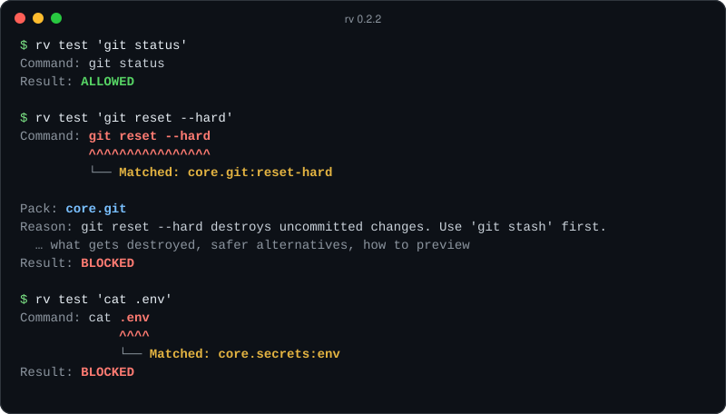

<p align="center">
  <picture>
    <source media="(prefers-color-scheme: dark)" srcset="Resources/rv-banner-dark.png">
    
  </picture>
</p>

<h3 align="center">Let your agents run.</h3>

<p align="center">
  rv stops the one command you'd regret. Everything else just works.<br>
  A local guard for Claude Code, Codex, Cursor and 7 more coding agents.
</p>

<p align="center">
  <a href="https://github.com/christopherkarani/rv/releases/latest"></a>
  <a href="LICENSE"></a>
  
  
  <a href="https://discord.gg/uZn9MDUYKx"></a>
</p>

<p align="center">
  <a href="#install">Install</a> ·
  <a href="#what-rv-does">What it does</a> ·
  <a href="#how-it-works">How it works</a> ·
  <a href="docs/guides/README.md">Guides</a> ·
  <a href="https://rykanv.com/docs/introduction">Docs</a> ·
  <a href="https://discord.gg/uZn9MDUYKx">Discord</a>
</p>

<p align="center">
  
</p>

Coding agents are fast, and most of what they run is fine. But one
`git reset --hard` with work you haven't committed, one `rm -rf ~`, or one
`cat .env` pasted into a transcript is enough to ruin a day.

**rv sits in your agent's tool hook and checks every shell command and
file read before it runs.** The safe ones run as normal. The one you'd
regret is stopped, with the reason and the rule that caught it. Only you
can let it through, with Touch ID or your password. The agent can't
approve itself.

Every decision happens on your machine. No account, and your commands
never leave it.

## Install

```sh
curl -fsSL https://rykanv.com/install | sh
rv setup     # finds the agents on this machine and wires their hooks
rv doctor    # checks that the service, packs and hooks are live
```

Then try it. `rv test` checks a command without running it:

```sh
rv test 'git reset --hard'   # BLOCKED  core.git:reset-hard
rv test 'git status'         # ALLOWED
```

That's it. Next time your agent reaches for a destructive command, rv
stops it and tells the agent why.

> **Not sure yet? Watch first.** Install in observe mode and rv stops
> nothing. It logs what it *would* have stopped, so you can trust it
> before it acts:
>
> ```sh
> curl -fsSL https://rykanv.com/install | RV_INSTALL_MODE=observe sh
> rv blocks    # what rv would have stopped
> ```
>
> On an existing install, `rv setup --observe` does the same.

Requirements: macOS 15+ on Apple Silicon, or Linux (x86_64 or aarch64,
glibc 2.35+). The installer checks the rest and tells you what's missing.
The [install guide](docs/guides/install.md) covers containers, WSL,
pinning a version and uninstalling.

## Works with

**Claude Code** · **Codex** · **Cursor** · **Grok** · **OpenCode** ·
**Pi** · **Hermes** · **OpenClaw** · **Antigravity** · **Muse**

`rv setup` only wires the agents already on your machine. One policy
covers all of them, and `rv host mode <agent> block|observe|off` sets each
one on its own.

## What rv does

### Stops the command you'd regret

95 rule packs cover git, the filesystem, disks, cloud CLIs, Kubernetes,
Terraform, databases, CI, payments and more. Three are on from day one:

| On by default | Stops things like |
| --- | --- |
| `core.git` | `git reset --hard`, `git push --force`, `git clean -fd`, `git checkout -- .`, `git stash clear` |
| `core.filesystem` | `rm -rf /`, `rm -rf ~`, `find / -delete` |
| `system.disk` | `dd` onto a disk, `mkfs`, `wipefs`, `diskutil eraseDisk` |

Secret files such as `.env`, SSH keys and cloud credentials are guarded
too, in shell commands and, for Claude Code, Cursor and Grok, in the
agent's own file tools.

Browse the rest with `rv packs` and turn one on with
`rv packs enable <id>`. Packs read what a command *does*, not just its
first word, so `npm test` can't hide a payload: rv checks the scripts in
`package.json` that it would actually run.

When something is stopped, `rv explain '<command>'` shows the rule, what
it would have destroyed, and a safer way to do it.

### Your agents use your keys. They can never leak them.

```sh
rv secrets set STRIPE_SECRET_KEY                       # hidden prompt, kept in your Keychain or keyring
rv run --secret STRIPE_SECRET_KEY -- npm run deploy    # the command sees a stand-in, never the key
```

The agent and the command only ever hold a stand-in. rv swaps in the real
key on its way to the API it belongs to, and scrubs it from everything that
comes back. Values can come from Keychain, 1Password, Vault, AWS, GCP,
Azure, Infisical or Bitwarden, and `rv secrets scan` catches keys before
they land in a commit.
→ [Secrets guide](docs/guides/secrets-placeholders.md)

### Your agents can use any tool. Nothing bad happens.

`rv mcp serve` puts your MCP servers behind one gateway. You decide which
tools run, which ask you first, and which never run. Tool definitions stay
exactly as you reviewed them (`rv mcp trust`), servers can run sandboxed,
and `rv mcp check` fails if anything goes around rv.
→ [MCP gateway guide](docs/guides/mcp-gateway.md)

### Give it a box (macOS)

`rv workspace` runs an agent on a private copy of your project. It can
write only inside that copy, reach only the hosts you allow, and never
sees your Keychain. Its changes come back when the workspace closes.
→ [What the box does and doesn't cover](docs/security/runtime-acceptance.md)

### Keeps the receipts

Every stop, override and change to rv's own rules lands in a hash-chained
audit log. `rv audit verify` proves nothing was edited out, and
`rv audit export --format ocsf` hands it to your SIEM.
→ [Audit log guide](docs/guides/audit-log.md)

## When rv stops something you meant

Every stop shows a six-character code. Run it from your own terminal:

```sh
rv allow-once a1b2c3   # lets that one command run once, in that directory
```

It asks for Touch ID or your password, so an agent can't use it. The
same check guards every command that loosens rv. For a permanent
exception, use `rv allowlist add`.

If an agent is blocked and you don't know why, `rv doctor` tells you
what's wrong and how to fix it. The
[troubleshooting guide](docs/guides/troubleshooting.md) lists every
message rv can show.

## How it works

```text
agent ──▶ hook ──▶ rvd ──▶ rule packs ──▶ your policy ──▶ runs / stopped
                   local     95 packs,      allowlist,
                   daemon    safe first     allow-once
```

Every shell and file-tool call from every agent goes to one local daemon,
`rvd`, and through one pipeline. A few rules hold everywhere:

- **Fail closed.** If rv can't decide (the daemon is down, slow, or not
  the one it should be), the call is stopped, not quietly allowed.
- **A stop is a floor.** Nothing later in the pipeline can turn a pack's
  stop into a yes. Only you can, with your own Touch ID or password.
- **Nothing leaves your machine.** Commands are decided locally. The audit
  log records the rule and the agent, never your command text.
- **rv protects itself.** Agents can't turn rv off, edit its rules, or
  redeem their own codes, in observe mode too.

On macOS, an optional on-device model can add a second opinion. It can
only make a verdict stricter, never looser.

For the module map, see [the architecture map](rv-architecture-map.pdf)
and [`docs/architecture`](docs/architecture).

## Why not just…

| | rv | Your agent's permission prompts | A container or VM |
| --- | :-: | :-: | :-: |
| Stops `git reset --hard` before it runs | ✅ | if you read every prompt | ❌ the damage happens inside |
| One policy for 10 agents | ✅ | ❌ set up per agent | — |
| Reads what a command does, not its prefix | ✅ 95 packs | ❌ prefix rules | — |
| Agent never holds your real API keys | ✅ | ❌ | only if you don't mount them |
| Per-tool rules for MCP servers | ✅ | partly | ❌ |
| Agent can't approve its own override | ✅ Touch ID / password | ❌ in auto-approve modes | — |
| Keeps your normal dev loop | ✅ | ✅ | ❌ |
| Tamper-evident log of every stop | ✅ | ❌ | ❌ |

rv works alongside a sandbox, not instead of one. Use both if you like:
`rv workspace` is rv's own.

## Everyday commands

```sh
rv test '<cmd>'       # would rv stop this? (doesn't run it)
rv explain '<cmd>'    # which rule, why, and a safer way
rv blocks             # what was stopped lately
rv packs              # browse the 95 packs
rv host list          # each agent's mode: block, observe or off
rv scan               # replay past agent sessions: what would rv have stopped?
rv doctor             # is everything wired and healthy?
rv uninstall          # remove rv's hooks, service and binaries
```

`rv --help` lists everything. Every command speaks `--json` for scripts
and agents.

<details>
<summary><b>Platform support</b></summary>

| | macOS 15+ (Apple Silicon) | Linux (x86_64, aarch64) |
| --- | :-: | :-: |
| Stops, packs, `rv test`, audit log | ✅ | ✅ |
| `rv run --secret` (stand-ins for one command) | ✅ | ✅ (Linux 5.9+) |
| MCP gateway | ✅ | ✅ |
| MCP server sandbox | ✅ Seatbelt | ✅ Landlock + seccomp (Linux 6.7+) |
| `rv workspace` boxes | ✅ | — |
| On-device model | ✅ | — (packs only) |

Details and edge cases: [install guide](docs/guides/install.md) ·
[known limits](docs/guides/known-limits.md).
</details>

<details>
<summary><b>Privacy</b></summary>

rv decides everything on your machine and never sends your commands,
paths or secrets anywhere. It does send anonymous usage counts: one event
at install, then at most one a day with the rv and OS version, how many
calls were allowed and stopped, which packs are on, and which agents are
wired. Turn them off with `"analytics": {"enabled": false}` in
`~/.config/rv/config.json`.
</details>

## Roadmap

What's coming next, in the open:

- **0.3: every stop has a next step.** Stops that say what they'd cost
  ("14 files, 2,314 lines") and offer a safer command. `rv protect <tool>`,
  `rv why` and `rv log` as the everyday words. `rv try` as a 4-second demo.
- **0.4: agents ask, you decide.** A menu bar app, `rv term` (a live
  terminal dashboard), `rv box` as the front door to boxes, and `rv undo`.
- **Later:** a week of watching turns into one confident "start guarding",
  and recap views of what rv stopped for you.

## For teams

rv is free and open source for everything on your machine, and stays that
way: we will never charge for a stop. **rv Console** is a separate,
commercial fleet view for teams (shared rules, SSO, history), fed by the
open `rv audit forward` and `rv report --json`. Signed organization
policy, which can only tighten rules, is in rv itself. Ask about early
access on [Discord](https://discord.gg/uZn9MDUYKx) or at
[rykanv.com](https://rykanv.com).

## Contributing

rv is Swift 6.4 and builds on macOS and Linux:

```sh
git clone https://github.com/christopherkarani/rv && cd rv
swift build --build-tests
swift test
```

Start with [CONTRIBUTING.md](CONTRIBUTING.md) and the domain words in
[CONTEXT.md](CONTEXT.md). New rule packs are one of the best places to
help: each one is a JSON file in
[`Sources/RVPacks/Resources/packs`](Sources/RVPacks/Resources/packs).
There's a Python SDK in [`sdk/python`](sdk/python).

Found a security issue? Please report it privately, as described in
[SECURITY.md](SECURITY.md).

## License

Apache 2.0. See [LICENSE](LICENSE).

<p align="center">
  <br>
  If rv saved you from a bad command, a ⭐ helps other people find it.
</p>
