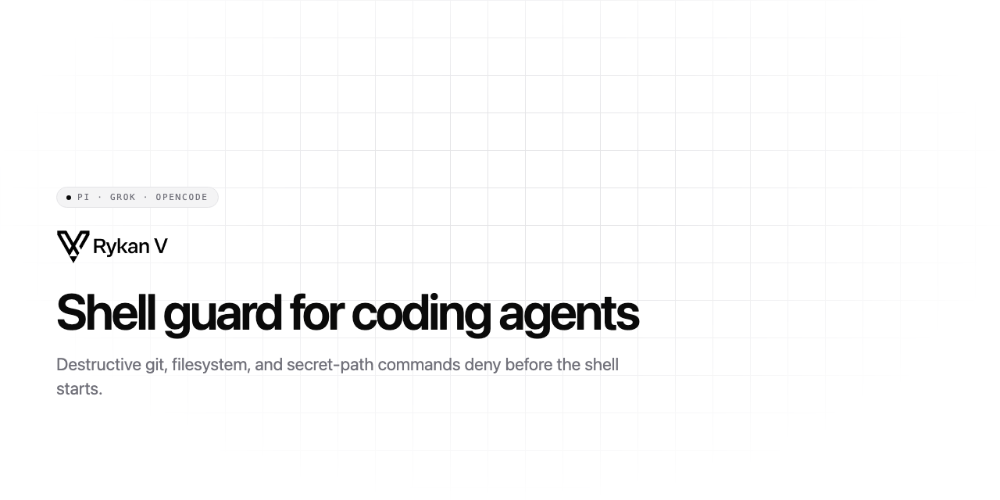

<p align="center">
  <picture>
    <source media="(prefers-color-scheme: dark)" srcset="Resources/rv-banner-dark.png">
    
  </picture>
</p>

<p align="center">
  <a href="https://github.com/christopherkarani/rv/releases/latest"></a>
  <a href="LICENSE"></a>
  <a href="https://github.com/christopherkarani/rv"></a>
  <a href="https://discord.gg/uZn9MDUYKx"></a>
  
  
</p>


# rv (Rykan V)

**Control what your agent can do.** rv's **hook-grade** guard blocks destructive shell (and Read / Edit / Write secret-path on Grok, Claude, and Cursor) when the host calls `rv`. Hook evaluation requires the host to invoke it.

`rv opencode` runs OpenCode in a host-owned terminal on the persistent per-project workspace host, under a macOS Seatbelt that starts from deny-default. The process may read and write the workspace, and it may read the system locations needed to execute programs. Public HTTPS goes through the RV proxy and loopback networking (including local servers) is allowed; direct public, LAN, and metadata connections are denied, as are Unix-socket connections to host sockets. Seatbelt cannot restrict an allowed TCP listener to loopback addresses, so a runtime with server capability can bind wildcard/LAN interfaces. It can signal processes inside its sandbox, not other host processes. Mach lookup is deny-by-default, Mach registration is denied, and the Keychain is unreachable. A workspace that already contains a hard link is refused. The host mounts the workspace path on a fresh volume so a later hard link to an outside file fails with a cross-device error. The volume belongs to the workspace for its whole life, across every runtime the host launches; each runtime has its own process group and admission capability. A same-user force-unmount of that volume is not covered. Closing a runtime or the workspace kills the owned process group. Linux refuses the launch instead of applying a weaker sandbox. This is not a finished agent isolation boundary. See the [release acceptance audit](docs/security/runtime-acceptance.md).

Site: [rykanv.com](https://rykanv.com) · Docs: [rykanv.com/docs/introduction](https://rykanv.com/docs/introduction) · Discord: [discord.gg/uZn9MDUYKx](https://discord.gg/uZn9MDUYKx)

## Why this exists

Agents delete the wrong tree. rv sits on the host's pre-tool hook and denies the command before the host runs it. Install is one curl; `rv setup` writes adapters for hosts it can see.

## Quick start

```sh
curl -fsSL https://rykanv.com/install | sh
```

To launch the currently supported agent from a writable workspace:

```sh
rv opencode --workspace /absolute/repo -- run 'describe this project'
```

RV searches absolute `PATH` directories for OpenCode, or accepts `--executable /absolute/opencode`. The command attaches to the persistent workspace host for the project and streams one host-owned terminal, exactly like `rv workspace run`. The runtime receives the productive workspace environment: an RV-managed `HOME`/cache/tmp, a sanitized `PATH` covering installed toolchains, and secret-bearing variables stripped. On macOS the process and its children may read and write only that workspace, plus the system locations needed to execute programs. Public HTTPS goes through the RV proxy and loopback networking is allowed; direct public, LAN, and metadata connections are denied, as are Unix-socket connections to host sockets. Signals to processes outside the sandbox are denied. A workspace that already contains a hard link to another file is refused, and the running workspace path is a separate volume so a new hard link cannot name an outside inode. Linux refuses this launch until its backend enforces the same limits; a write-only sandbox is not used instead. Other host integrations remain hook based.

## Laya judge + observe mode

With a Laya weights bundle installed, commands the packs allow are also
judged by the local Laya classifier (allow / ask / deny with a risk
score, CoreML on macOS). The judge can only raise a verdict, never lower
a pack deny. The production judge is the fine-tuned single-pass model,
installed at `~/.config/rv/models/laya-ft-v2-coreml` (copy the
`model.mlpackage` + `tokenizer.json` + `config.json` bundle there; weights
are never committed to the repo). `"judge.engine": "ft"` (default) uses
it; `"laya"` forces the stock three-question judge at
`~/.config/rv/models/laya-multilingual-coreml` instead.
`RV_JUDGE_ENGINE` overrides the config file. With no explicit engine the
fine-tuned bundle is used whenever it validates, else stock.
`"guard.mode": "observe"` in `~/.config/rv/config.json` turns the whole
guard observe-only: packs and judge evaluate and log the would-be verdict
(hash only, in `judge-log.jsonl`), nothing blocks. Default is `enforce`.
Design and measured numbers: `docs/plans/laya-guard-model-plan.md` and
`docs/plans/laya-judge-decision-record.md`.

Session file-tracking feeds the judge `agent-touched` context: hook
Edit/Write allows and shell commands that create/write files are
remembered per agent session (keyed by session id + workspace, 30-minute
TTL, memory only — a daemon restart forgets), and the fine-tuned judge
scores later shell commands with those paths. Session-less callers keep
v1 behavior. CLI one-shot invocations use a per-process store that starts
empty, so touched context accrues through the daemon hook path.

## What it does

| | |
| --- | --- |
| Destructive git | `reset --hard`, `checkout --`, `clean -fd`, `push --force`, `stash clear` |
| Destructive fs | `rm -rf`, `find -delete`, and similar |
| Secret paths | `.env`, SSH keys, and other known credential files |
| Allow once | Redeem the code from a block; the next matching call in this working directory runs once |
| Explain | `rv explain` shows which pack would fire |
| Hosts | Grok, Pi, OpenCode, Claude, OpenClaw, Hermes, Codex, Cursor. `rv setup` writes a host only when that host is already on the machine. |
| Platform (hook guard) | `rv hook` hook guard: macOS 15 or newer (Apple Silicon) and Linux aarch64/x86_64. |
| Platform (contained runtime) | `rv opencode` / `rv workspace` contained runtime: macOS 15 or newer (Apple Silicon) only today. Linux refuses the launch instead of using a weaker sandbox — see [why](docs/security/runtime-boundary.md). |
| Platform | Foundation Models on macOS 26 or newer. PR CI builds Swift on macos-26 and smokes the binaries on macos-15. Linux PR CI is ubuntu-24.04 x86_64; aarch64 is a supported install, not a PR job. |

## Supported hosts

| Host | After `rv setup` (if detected) | File-tool Read / Edit / Write |
| --- | --- | --- |
| Grok | `~/.grok/hooks/rv.json` | yes |
| Pi | `~/.pi/agent/extensions/rv-guard.ts` | shell only |
| OpenCode | `~/.config/opencode/plugins/rv-guard.js` | shell only |
| Claude | settings merge | yes |
| OpenClaw | `~/.openclaw/extensions/rv-guard/` | shell only |
| Hermes | `~/.hermes/plugins/rv-guard/` | shell only |
| Codex | `~/.codex/hooks/rv-guard.py` | shell only |
| Cursor | `~/.cursor/hooks/rv-guard.py` | yes |


## Commands

```sh
rv setup                         # wire hosts
rv test 'git reset --hard'       # evaluate, do not run
rv explain 'git reset --hard'    # which pack would fire
rv scan                          # session forensics (deny-only findings)
rv allow-once a1b2c3             # redeem the code from a hook deny
rv packs                         # catalog
rv packs enable <pack>           # enable an extra pack (day-one always compiled)
rv policy show                   # typed rules
rv allowlist list                # permanent exceptions
rv doctor                        # health
rv uninstall                     # remove rv-owned files
```

Anonymous usage is on by default. Turn it off with `"analytics.enabled": false` in `~/.config/rv/config.json`. Setup does not print a notice.

## License

Apache 2.0. See [LICENSE](LICENSE).
