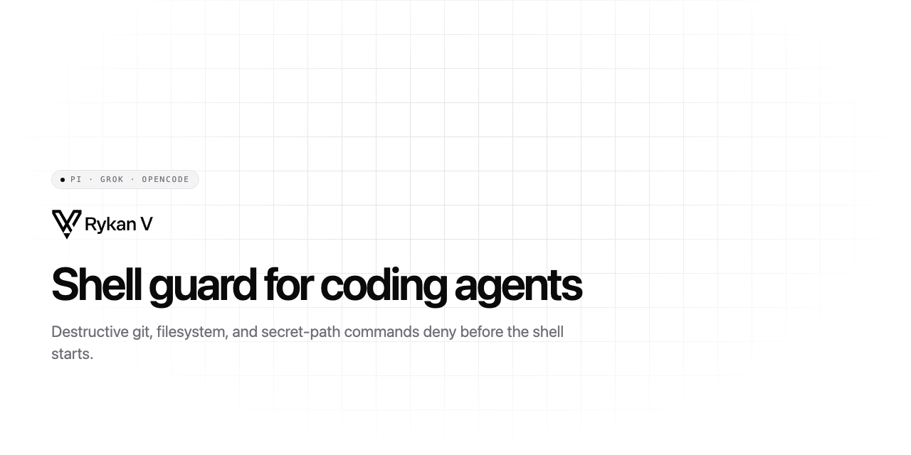

<p align="center">
  <picture>
    <source media="(prefers-color-scheme: dark)" srcset="Resources/rv-banner-dark.png">
    
  </picture>
</p>

<p align="center">
  <a href="https://github.com/christopherkarani/rv/releases/latest"></a>
  <a href="LICENSE"></a>
  <a href="https://github.com/christopherkarani/rv"></a>
  <a href="https://discord.gg/uZn9MDUYKx"></a>
  
  
</p>

# rv

**Your coding agent just tried to run `rm -rf /`. rv said no.**

rv is a fail-closed policy gate for AI coding agents. It sits on your
agent's pre-tool hook and blocks destructive shell commands — and
secret-file reads/edits — *before* the host runs them. One gate, three
verdicts: **allow · deny · indeterminate**. It never asks the agent;
only you can override, with a one-time code.

```sh
$ rv test 'git reset --hard'
{"decision":"deny","pack_id":"core.git","reason":"git reset --hard destroys uncommitted changes","rule_id":"core.git:reset-hard","schema":"rv.test.v1"}

$ rv test 'git status'
{"decision":"allow","schema":"rv.test.v1"}
```

**User guides:** [install and first run](docs/guides/install.md) ·
[secrets placeholders](docs/guides/secrets-placeholders.md) ·
[MCP gateway](docs/guides/mcp-gateway.md) ·
[audit log](docs/guides/audit-log.md) ·
[troubleshooting](docs/guides/troubleshooting.md) ·
[known limits](docs/guides/known-limits.md)

## Install (30 seconds)

```sh
curl -fsSL https://rykanv.com/install | sh
rv setup    # auto-detects your agents and wires their hooks
rv doctor   # verify everything is live
```

Want to watch before you enforce? Install in observe mode: rv logs what it
would block and lets everything run.

```sh
curl -fsSL https://rykanv.com/install | RV_INSTALL_MODE=observe sh
rv setup --observe   # same thing for an existing install (asks Touch ID if rv is already enforcing)
rv blocks            # what observe would have blocked
```

On macOS the installer also fetches the on-device judge weights (~649 MB,
verified by SHA-256, fully offline after) so the neural judge binds on first
run; Linux installs run packs-only until the ONNX runtime lands. Re-run the
installer anytime to pick up the weights.

Works with **Claude Code, Codex, Cursor, Grok, OpenCode, Pi, Hermes,
OpenClaw, Antigravity, and Muse**. Hooks are only written for hosts already
on your machine. Requires macOS 15+ (Apple Silicon) or Linux
(aarch64/x86_64) with glibc 2.35+ (Ubuntu 22.04+, Debian 12+, Fedora 36+,
RHEL 10+), libcurl and libsqlite3; the installer checks these first. musl
(Alpine) is not supported. On a Linux host with no login manager
(containers, WSL without systemd, `su`/`sudo -u` logins), `/run/user/<uid>`
must exist, owned by you, mode 0700, or `XDG_RUNTIME_DIR` must name such a
directory: `rvd` keeps its socket there and only root can create it
(`sudo install -d -m 0755 /run/user && sudo install -d -m 0700 -o $(id -u) /run/user/$(id -u)`).
`/run` is usually a tmpfs, so make it again after a reboot or container
restart. The installer checks this before downloading. Linux downloads are
checked against the release's
`SHA256SUMS`; until rv's release key is pinned in the installer that file is
not signature-checked, and the installer says so (see
[SECURITY.md](SECURITY.md#release-integrity)).

## How it works

Every shell and file-tool call from every host funnels into one daemon
(`rvd`) and one pipeline:

```text
agent ─▶ hook ─▶ rvd ─▶ 95 rule packs ─▶ script gate ─▶ on-device judge ─▶ policy ─▶ allow / deny
                          safe-first       npm bodies     CoreML (Laya)      overrides
                          deny = floor     evaluated      can only raise
```

- **95 rule packs** — git, filesystem, disks, cloud CLIs, Kubernetes,
  databases, Terraform, CI/CD, payments, and more. Safe patterns run
  first; the first blocking hit denies. Three packs are on by default
  (`core.filesystem`, `core.git`, `system.disk`); browse the rest with
  `rv packs`; `rv packs enable <id>` turns more on after owner
  authentication (see below).
- **Script gate** — `npm test` can't hide a payload: rv evaluates the
  actual `pre`/`post`/body scripts in `package.json`, not just the
  command you see.
- **On-device neural judge** — with a Laya CoreML bundle installed,
  pack-allowed commands get a local risk score. The judge can only
  raise a verdict, never lower a pack deny. Nothing leaves your
  machine. `"guard.mode": "observe"` logs would-be verdicts without
  blocking, so you can measure before you enforce. `rv host mode
  <host> observe` does the same for one host (`off` unwires it); `rv
  blocks` marks what observe would have blocked with `"observed": true`.
  `rv setup --observe` (or `RV_INSTALL_MODE=observe` for the installer)
  starts there. Observe never relaxes rv's own protection (rv admin
  commands, rv's config) while `rvd` is running. Because an idle observe
  host lets a call through when `rvd` is absent, observe also raises the
  bar on the common ways to stop or replace `rvd`: `launchctl`/`systemctl`
  stops of rv's job, `pkill`/`killall` of `rvd`, `kill` of a pid looked up
  from `rvd`, launching a second `rvd`, Linux D-Bus stops, and writes to
  rv's binaries, LaunchAgent, systemd unit or socket dir become "run it in
  Terminal". This check is **lexical, not a boundary** — it reads the
  command text, so it raises the bar but a determined agent can still get
  past it. It is observe-only; enforce already fails such a call closed.
  Residual (not caught): `kill` by a numeric pid, or a pid or path held in
  a variable or file; interpreter or script forms (a `python`/`node`
  subprocess, `bash -c "$(… | base64 -d)"`, a script file, a make/npm
  script); and a renamed or symlinked `launchctl`. When `rvd` is *absent*,
  hooks under observe let the call run unchecked and
  unlogged (with a notice on stderr) instead of prompting; a slow `rvd`, a
  daemon that fails its identity check, or a malformed reply still asks or
  denies (an "ask" is Claude Code's own prompt only in a session Claude
  Code reports as attended, in a prompting permission mode, a block
  everywhere else). Only `RV_HOOK_WHEN_DOWN=deny` closes the step-aside
  and keeps denying an absent `rvd`; `"hookAskWhenDown": false` in
  `config.json` only turns Claude Code's prompt into a block and does not
  stop the observe step-aside. "Absent" is
  platform-specific: on **macOS**, rv's launchd service is not registered
  (discovery XPC returns INVALID) — the job stays registered while launchd
  restarts `rvd`, so a restarting `rvd` is *not* absent; on **Linux**, the connect to
  `/run/user/<uid>/rv/evaluate.sock` fails with `ENOENT`/`ECONNREFUSED` and
  `XDG_RUNTIME_DIR` is unset or equals `/run/user/<uid>`. An organization gate pins enforce, and `rv setup
  --observe` refuses under one. A host set `off` before an organization
  gate arrived stays unwired until you run `rv setup`.
- **Policy gate** — a fixed override ladder (rebase recovery → pinned
  rules → allowlist → allow-once → contained-delete allowance) with
  `normal`/`strict` safety levels. Indeterminate (too large, budget
  exhausted, core packs missing) is never overridable.

## What gets blocked

| Category | Examples |
| --- | --- |
| Destructive git | `reset --hard`, `push --force`, `clean -fd`, `stash clear`, `checkout -- .` |
| Destructive filesystem | `rm -rf /`, `rm -rf ~`, `find -delete`, fork bombs, disk wipes |
| Secret paths | `.env`, SSH keys, cloud credentials — shell *and* Read/Edit/Write on Grok, Claude, Cursor |
| Cloud & infra (opt-in packs) | `terraform destroy`, `kubectl delete`, `aws s3 rm --recursive`, `DROP TABLE`, … |

Not sure why something blocked? `rv explain 'git reset --hard'` shows
exactly which pack and rule fired.

**Known limitations: search tools.** rv gates explicit secret paths and
secret-selecting globs in search tools (Claude `Grep`/`Glob`, Cursor
`Grep`). A search with no explicit path scans the working directory and
can still match inside non-ignored secret files there, because rv does
not inspect file contents.

**Vault secrets.** A secret definition with an `address` is refused unless
`VAULT_ADDR` is set to the same origin: rv never sends your Vault token to a
server the environment does not name.

## When you're blocked (and you meant it)

Every hook deny prints a six-character code. Redeem it once, from
your terminal — the agent can't redeem its own code:

```sh
rv allow-once a1b2c3    # next matching call in this directory runs once
```

Redeeming needs owner authentication: Touch ID or your password through
the signed CLI on macOS, your login password on Linux.

Typed rules live in `~/.config/rv/policy.toml` (`rv policy show`).
Commands that change the gate itself (`rv allowlist add`,
`rv packs enable`, `rv safety strict|normal`, `rv policy draft --save`,
`rv egress approve`, `rv workspace abandon`) ask for the same owner
authentication first, so an agent running as you cannot weaken its own
guard through `rv`. The config files themselves are still yours to write:
rv's hook guard refuses an agent's attempts to edit them, but the CLI,
not `rvd`, performs the change after approval. On Linux rv reads your login password from the terminal and
`rvd` checks it with the system's `unix_chkpwd`; five wrong passwords in
ten minutes lock checks for ten minutes. Every attempt is recorded as an
`owner.action` event in the audit log. That needs an account with a local
password: an SSH-key-only cloud user or root in a container usually has a
locked one (`passwd -S` shows `L` or `NP`), which can never pass. rv says
so up front instead of prompting; set a password (`sudo passwd $USER`) to
approve rv owner actions.

## Locked out?

When rv can't decide (the daemon `rvd` is down or slow, or the `rv` binary
is gone), every hook fails closed: the agent's tool call is blocked, never
quietly allowed. The block message says which of these it was:

| Message starts with | What it means | What to do |
| --- | --- | --- |
| `RV daemon is not reachable` | `rvd` isn't running | `rv doctor`; `rv setup` repairs the service |
| `RV daemon did not answer in time`, `rv did not answer within 15s` | `rvd` is busy or hung | Retry; then `rv service status`, `rv service restart` |
| `RV daemon identity check failed`, `RV daemon sent an unexpected reply` | a stale `rvd` after an upgrade | `rv service restart`; if that doesn't fix it, `rv setup` |
| `rv is not installed at <path>` | the hook points at a binary that's gone | Reinstall rv, then `rv setup` |
| `rv at <path> could not be started`, `rv exited with code N` | `rv` is broken or crashed | `rv doctor` |
| `Laya judge is still loading` | the on-device judge is still loading after `rvd` started | Retry in a few seconds |
| `Laya judge queue is full` | too many commands are waiting for the judge | Retry shortly |
| `rv degraded: judge late` | the judge did not answer this command in time | Retry; if it keeps happening, `rv doctor` |
| `rv degraded: judge unavailable (circuit open, retrying in Ns)` | the judge failed several times in a row, so rv skips it for a minute and sends what it would have scored to review | Retry after N seconds; `rv doctor` shows the circuit |
| `Laya judge unavailable; failing closed` | the judge couldn't score this command | `rv doctor` |

Run these from your own terminal, not through the agent:

```sh
rv doctor                 # what's broken and how to fix it
rv service status         # is rvd running, down, or skewed?
rv service restart        # restart rvd
rv setup                  # repair the rvd service and host hooks
rv host list              # each host's mode and hook wiring
rv host mode claude off   # stop guarding one host (asks for owner authentication)
rv uninstall              # remove rv's hooks, config, and rvd (asks for owner authentication)
```

`rv host mode <host> block` turns guarding back on.

## Beyond the shell

rv is one binary, 25 commands. The rest of the surface:

- **Secrets without exposure** — agents in a contained workspace
  (macOS) see placeholders, never values. Real bytes are injected at the
  boundary from Keychain, 1Password, Vault, AWS/GCP/Azure, Infisical, or
  Bitwarden, then scrubbed from everything that comes back.
  `rv run --secret NAME -- command` does the same for one command with no
  workspace, on macOS and Linux: the command starts suspended, its
  placeholders are bound to its process tree, and the loopback gateway
  swaps the real value in only for requests from that tree. It is not a
  sandbox.
  Hook-guarded agents get secret-path blocking instead. Stdio MCP servers
  receive the real value of each secret in their `secrets` map; one that
  lists a secret under `"placeholders"` in mcp.json is handed a
  placeholder and base URL instead (macOS, sandboxed servers only),
  spendable only by that server and its live descendants; its cage does
  not stop it asking your keychain or a provider for the value itself.
  `rv secrets scan` + a git pre-commit hook
  catch leaks before they land.
- **App logins, once** — `rv login connect vercel` imports the Vercel or
  GitHub login you already have (CLI auth file, token variable, or
  `gh auth token`; paste as fallback) into the Keychain as a gateway
  secret, so agents use it through rv instead of logging in again.
  On Linux rv keeps stored values in the Secret Service keyring (GNOME
  Keyring, KWallet, KeePassXC) through `secret-tool` (package
  `libsecret-tools`), which needs a session bus and an unlocked keyring;
  the hook guard refuses an agent's own `secret-tool` and Secret Service
  D-Bus calls, since that keyring has no per-app prompt.
  `rv login list` / `check` report status and fingerprints, never values;
  `rv login logout <app>` removes it.
- **MCP governance** — `rv mcp serve` puts every MCP server behind one
  gateway with per-tool allow/ask/deny, human approval for `ask`, and
  a full audit trail. `rv mcp check` fails if any server bypasses rv.
  A server that does not answer `initialize` within its
  `"startTimeoutSeconds"` in mcp.json (1 to 600, default 60), or answers it
  with an error, is stopped and fails for the session; until every server
  has settled, every `tools/list` and `tools/call` waits, so one slow
  server's start limit holds back every tool. When a server leaves a
  `tools/list` page unanswered for 30 s (not configurable), the listing
  ends with the pages it already returned; a `tools/call` unanswered for the server's
  `"callTimeoutSeconds"` in mcp.json (1 to 86400, default 300; each
  progress notification for the call restarts it) fails with an error
  and is never sent again: rv asks the server to cancel and stops
  waiting; it cannot make the server stop. Progress cannot
  keep a call open past 10 times its `"callTimeoutSeconds"` in all
  (50 minutes by default); a tool that legitimately runs longer needs a
  larger `"callTimeoutSeconds"`. These limits run on a clock that stops
  while the machine sleeps and ignores changes to the time of day.
  Stopping a local server sends SIGTERM, then SIGKILL 2 s later if it is
  still running. Each local server runs as the leader of its own process
  group and both go to the whole group, while its leader is not yet
  reaped, so what it started in a session of its own (`setsid`), or
  outside rv (the container of a `docker run` server), is not stopped by
  them. A terminal's Ctrl-C or a host's process-group kill reaches
  serve, not the servers: every `rv mcp serve` catches SIGINT, SIGTERM
  and SIGHUP and stops its servers itself (a second signal kills them at
  once). A server starts with every signal at its default, even one rv
  inherited ignored; it cannot `setsid()` itself (its children can); and
  a launcher that starts the real server and exits counts as the server
  exiting. On Linux a server inherits only descriptors 0, 1 and 2.
  A server that was ready and then goes away (it exits, ends its
  session, loses its connection, stops reading its input, or does not
  answer rv's `ping` within 10 s after a call timed out, which a server
  that handles one request at a time cannot do while busy with a slow
  call, so whatever it was running is cut off) is started again after 1,
  2, 4, 8, then 16 s, at most 5 times in any 10 minutes, then stays
  failed. The 10 minutes slide: a server that goes away every two minutes
  or so is restarted for as long as serve runs, its secrets resolved
  again each time. One that was never ready is not restarted. A restart
  must start and answer `initialize` within its `"startTimeoutSeconds"`
  (counted once rv has reaped its last process), or it counts toward
  that cap. It is started from the mcp.json serve verified at start and
  listed again before any call reaches it: a changed tool asks, an
  approval for the old definition does not carry over, and only tools
  that server lists again can be called (others are refused and
  audited). The client is told its tools changed. A call in flight is
  never sent again: it fails saying it may have run, and a call made
  while the server is coming back is refused at once; a prompt accepted
  then, or one the client cancels, is audited as declined. An answer a
  server wrote just before it exited that rv has not read 1 s later is
  dropped, and its call counts as may have run. On Linux each POST to a
  remote server goes on a connection of its own, since libcurl would
  send a request again when a kept-alive connection drops before its
  answer. A remote server is never slowed down: once more than 128 MiB
  of what it sent waits for the gateway, rv stops it (and restarts it as
  above). Each remote server has at most 64 calls, and about 160
  requests of any kind, in flight (a retry or a legacy stream's first
  messages can pass it briefly); past that a request is not sent (a call
  ends not run, and an approved call's approval is used up), though rv's
  own ping always goes out. A signal
  while serve plans its servers (a secret provider's
  unlock prompt, say) ends serve at once. A client that takes nothing rv
  writes for 30 s ends `rv mcp serve` with exit status 1 (on a blocking
  pipe a client must take at least 1 MiB per 30 s, about 35 KiB/s).
  Each `rv mcp serve` process also warns once at start, on stderr and in
  the audit log, when host configs bypass the gateway, run a server
  mcp.json blocks, or hold unreviewed servers (a host set up by
  `rv mcp setup` runs one serve per server).
  Tool definitions are pinned only by `rv mcp trust`, which shows every
  field it pins: a tool that is new or changed since you trusted it
  always asks and reaches the agent as its name, rv's marker saying it
  is not trusted and an empty object schema, nothing else.
  A tool whose name is longer than 64 bytes or uses any character
  outside `A-Z a-z 0-9 _ . -` (a `/` or `:`, say) is hidden and cannot be
  called, pinned or not; `rv mcp serve` names one such tool per server
  on stderr. Start
  your MCP host once so `rv mcp serve` queues the tools, run
  `rv mcp trust`, then restart the host (a running serve keeps the pins
  it started with). Tool result text is forwarded byte for byte;
  rendering it safely is the MCP host's job. Keys that differ only by
  Unicode normalization (NFC/NFD) count as duplicates, so such a message
  is dropped.
  *Platform support:* gateway trust and approvals need a key custodian
  the agent cannot read. On macOS that is RVApprovals.app. On Linux it is
  a system service you install once with `sudo rv mcp custodian install`,
  run from a copy of rv that only root can write (systemd and PAM; see
  [the custodian's threat model](docs/security/mcp-linux-custodian.md)):
  signing then asks for your login password at your terminal. Without a
  custodian rv's signing key is a file any process running as you can
  read: mcp.json is never trusted, `rv mcp serve` launches no servers,
  and `rv mcp trust` and `rv mcp approve` refuse. The MCP server sandbox
  is Seatbelt on macOS and, on Linux 6.7 or later, Landlock with a
  seccomp socket filter
  ([what it closes and what it leaves](docs/security/mcp-linux-sandbox.md)).
  Where a host has a sandbox every local server needs a `sandbox` entry
  and runs in it. Where it has none (an older Linux kernel), servers that
  ask for one, or that an organization policy with `requireSandbox`
  covers, are refused rather than run uncaged; a server with no `sandbox`
  entry runs uncaged with a warning.
  While the gateway is in use, the hook guard also keeps an agent from
  adding servers around it: writes to a host's own MCP config
  (`~/.claude.json`, `.mcp.json`, Cursor, Codex, Gemini, Claude Code
  plugins, ...) and host CLIs that add servers (`claude mcp add`, `npx
  @anthropic-ai/claude-code mcp add`, `mcp install`, `@smithery/cli`) ask
  or deny as `core.mcp:mcp-host-config`. Where a word may run (the
  program, any word after a runner, or an operand of a program not known
  to leave its operands alone), a brace or glob spelling of a host
  program, its group word or `mcp install` is resolved by every word it
  can produce, as bash expands comma groups and `{x..y}` ranges, into
  several words where bash splits them, a blank inside an alternative
  included (`claude m{c,}p add`, `clau?e mcp add`, `chronic m[c]p
  install`, `chronic mc{o..p} install`, `{claude,mcp} add`, `claude
  {mcp,add,srv,"x y"}`, `mcp {,} install`). The filesystem is not
  consulted, so a wildcard or class is assumed satisfiable; a POSIX class
  matches any one character, and a bracket range is judged as any range
  its case-folded text may have been (`cl[M-c]ude` and `cl[!A-Z]ude` may
  be `claude`). A word with a blank outside every brace is only itself,
  and a word past the spelling budget (over 256 characters, unless it
  holds no brace and its shortest match is longer than any host word,
  such as a presigned URL; over 64 brace words; or 1,000,000 matching
  steps per command) may be any words. `ls`, `cp`, `mv`, `rm`, `mkdir`,
  `touch`, `cat` and `git add|status|diff|rm`, run by their plain names
  (no path, no git option first; behind `sudo`, `env`, `nice`,
  `timeout`, `command`, `exec`, `nohup`, `time`, `doas` or `busybox`
  too, but not `stdbuf`, `xargs` or `watch`), never run an operand, so
  only their operands' literal words and carried text count (`ls mcp *`,
  `cp -r packages/mcp "$DEST"`, `touch {a..z}{0..9}` allow; `ls mcp
  install` and `stdbuf -o0 ls mcp $DIR` ask), unless the line, or the
  carried text being read, may define or redefine a command (a function,
  alias or hash entry; `PATH`, zsh's `path`, `FPATH`/`fpath`,
  `module_path`, `BASH_ENV`, `ENV` or `ZDOTDIR` named as written anywhere
  but where it is only read, such as `$PATH`, `${PATH%%:*}`, `${PATH:-…}`,
  `find -path` or `~/path/x`, once line continuations, a `$` opening a
  quote, and quotes are removed (`export $'PATH'=…` and zsh's
  `${PATH::=…}` count); a name built from escapes or expansions is not
  recognised, so instead any operand of an assigning builtin, or
  `printf -v` name, whose name before `=` or `[` holds `$` or a backtick
  counts (`export P$'\x41'TH=…`, `export ${N}TH=…`; `export FOO=$BAR`
  does not); `env -P` or `-S`, or `--split-string` or an abbreviation such
  as `--split`; a function flag such as `typeset -fu`; `source`/`.`, `eval`,
  `trap`, `autoload` or a dynamic program: `ls() { "$@"; }; ls mcp $X`,
  `: "${PATH:=./bin}"; ls mcp $X` and `echo 'alias ls=eval; ls mcp $X' |
  sh` ask, as does a printer's text read beside output rv cannot read,
  `{ cat ./defs.sh; echo 'ls mcp $X'; } | sh`). A segment rv's splitter cannot scan
  (a head still `{` or `(` that does not peel, such as `{claude,zzqx} mcp
  add`) asks when its line may name a host CLI; so do odd heads that only
  look like a group, such as `{claude}mcp` or `{claude,codex}-helper
  --version`.
  Carried text is read when it holds a host stem (also one broken only by
  `[…]` extras a package spec drops, `install-m[x]cp`) or such a word
  (`watch 'chronic m?p install srv'`). The text is split at blanks and
  `;|&()<>`; where a brace or class span holds one of those, each run of
  pieces the span joins is spelled as one more word (`watch "'cl[;a]ude'
  'm[;c]p' add s -- x"`). Text where two such runs cross (share a piece
  without one holding the other, `'{c?aude,x y}{,a b}'`), whose joined
  words pass four times its length, or whose brace word expands past 64
  words counts as naming a host. The 64-word rule has one exception: an
  integer range in a word with no glob character is judged as one word,
  since only its digits differ (`touch f{1..100}`). These are guesses at the shell's words once
  quotes are gone, and classes are closed on the text as written, before
  braces expand. Where nothing runs the word (a `grep` or
  `rg` operand, a commit message) and in text such a command carries,
  only literal words count (`grep -rn claude * | head` allows). A
  variable or substitution rv cannot read (`$c`, `"$SUB"`, `${x}`,
  `$(…)`, and ANSI-C `$'…'`, which rv cannot tell from a variable there),
  used as the program at any position after a runner it does not strip
  and followed anywhere by a group word (`stdbuf -o0 $c mcp add`, and so
  `node "$ENTRY" mcp list`; also a `find` start path or option value and
  an `xargs` or `watch` option value, since rv cannot tell `"$N"` from an
  unquoted `$N` that splits into a program: `find . -maxdepth "$DEPTH"
  -name config` and `xargs -P "$N" grep -l config` ask), or in a
  completing position of a `claude`, `codex`, `gemini`, `opencode` or
  `cursor-agent` mutation, counts as that word; so does one in the
  subcommand position after a literal `mcp` or `fastmcp` where it may run
  (`chronic mcp "$SUB" srv`, `chronic mcp $(…) srv`). `$IFS` or
  `${IFS}`, in any quoting, on a line that runs something and may name a
  host CLI asks as text rv's tokenizer cannot follow (`claude${IFS}mcp
  add`, `sh -c 'claude${IFS}mcp add'`). *Known limits:* a nested agent
  started with servers rv does not govern (`claude --mcp-config …`,
  `claude --plugin-dir …`, `codex -c mcp_servers…`), and a program that
  writes a config without its name on the command line (a script or a
  scheduled job written to disk earlier, by the shell or the file tool;
  a shell fed an expansion; text decoded or rendered by a program such
  as `base64 -d`, `rev`, `tr` or a `printf` format (`'cla%sude …' u`);
  output joined across commands other than `echo`/`printf`/`print`, such
  as two `cat <<<…`; a tarball, directory or URL whose name the agent
  chooses; Claude Code's native build reached through the working
  directory, a variable or a renamed copy (`cd …/claude/versions &&
  ./2.0.14 …`, `$D/versions/…`); or a git hook — which `git commit -m`
  still runs — diff/pager tool or `.ackrc`/lesskey file set up earlier).
  Also not caught: a value rv cannot read standing for the `mcp` host
  word of the `mcp install` installer, in any position and after any
  runner (`chronic $M install srv`, `stdbuf $M install srv`; asking there
  would fire on every `$PM install`); a glob the filesystem expands into
  several words that supply both a host and its group (`* add x` in a
  directory holding only `claude` and `mcp`); a brace, glob or dynamic
  spelling of a stem inside opaque text never re-parsed as a shell command line
  (`python3 -c "os.system('claude m{c,}p add')"`); a config file name
  written through a brace or glob spelling (`echo {} > .{mcp,x}.json`);
  in carried text, a class only a brace alternative closes
  (`watch "'cl[{],x};a]ude' 'm[{],x};c]p' add s -- x"`); and a lookup
  variable reached through a nameref whose target is an expansion
  (`N=PA; declare -n R=${N}TH; R=./bin; ls mcp $X`).
  Text that names a host mutation asks even as data (`git commit -m 'run
  claude mcp add x'`, `grep 'claude mcp add' docs/`, `grep claude "$f"`),
  as do dynamic programs given `config` (`"$GIT" config user.name`) and
  carried text that may name a host CLI or installer and runs past the
  guard's read budget. `mcp install` asks wherever a program may run it,
  whatever the server (`op run -- mcp install srv`, `mcp -- install srv`,
  `watch '…'`, `ssh host '…'`, `echo '…' | sh`), so the two words as any
  other program's operands ask too (`ls mcp install`). It is left alone
  as the value of a tool's own directory, workspace or filter option
  (`make -C|--directory`, `npm -C|--prefix|-w|--workspace`, `pnpm
  -C|--dir|--filter`, `bun --cwd|-F|--filter`: `make -C mcp install`;
  `pnpm -w mcp install` and `yarn --cwd mcp install` ask) and as text on a
  line that runs nothing: one `grep`, `rg` (no `--pre` or
  `--hostname-bin`), `echo`, `printf`, `git commit|tag` or `gh pr|issue
  create|comment|edit`, written with no
  backslash in its program or subcommand, and no pipe, list, redirect,
  substitution or parenthesis anywhere (`git commit -m 'add mcp install
  docs'`; after `cd x &&` it asks). Text that may name a host CLI and
  that rv's shell tokenizer cannot follow asks on any other line: a
  backslash before a quote or blank (`watch "sh -c \"claude mcp add
  x\""`, `'\''`, `claude\ mcp`), `\'` inside `$'…'`, and zsh `=(…)`; so
  does such text with a glob that may be a host word, which any bare `*`
  or `dir/*` word may be. This also asks for some harmless commands, such
  as `cat ~/Library/Application\ Support/Claude/…`, any such line with a
  bare wildcard (`ls ~/Library/Application\ Support/*`, `grep -rn
  "\"version\"" * | head`), `jq ".a[\"x\"]" config.json` or a commit
  message with `\"` after `cd x &&`; and for a brace word over 256
  characters where it may run, such as a long JSON body given to `curl
  -d`. zsh `=claude` counts as `claude`.
- **Egress control** — contained runtimes reach the network only
  through a credentialed CONNECT proxy: per-runtime tokens, SNI-bound
  tunnels and binary pinning. Blocked hosts are queued for review
  (`rv egress`); `rv egress approve` asks for owner authentication.
- **Tamper-evident audit** — every hook and file-tool deny, every override
  (allow-once, allowlist, rebase recovery), plus MCP and secret events,
  and every gate change (policy revisions, safety, packs, host modes,
  allowlist, secrets, egress reviews, organization bundles) with its
  prior and new value and how it was authorized, lands in a SHA-256
  hash-chained `audit.jsonl` (rule and host, never command text). Verify with `rv audit verify`, export
  as OCSF 1.3.0 to your SIEM.
- **Session forensics** — `rv scan` replays past agent sessions
  (Claude, Codex, Cursor, Grok, Hermes, OpenClaw, OpenCode, Pi)
  offline and reports which commands your enabled packs would have
  denied.
- **Signed org policy** — fleet-wide, restrict-only rules signed with
  Ed25519 and pinned root-owned on disk: MCP tool rules, secret
  sources, audit forwarding, and gate requirements (packs every agent
  must run under, strict safety). User config can never loosen them.
  `rv report` emits posture for MDM/fleet collection.
- **Contained workspaces (macOS)** — `rv opencode` / `rv workspace`
  run agents on a persistent per-project host under a deny-default
  Seatbelt profile: workspace-only writes, proxied HTTPS, no Keychain,
  no host signals, and the same packs you enabled for your agents.
  `rv workspace run --microvm <image>` runs the command in a
  network-less Linux micro-VM instead (macOS 26+). Linux hosts refuse
  rather than downgrade. This is a hardening layer, not a finished
  isolation boundary — see the
  [acceptance audit](docs/security/runtime-acceptance.md).

## Platform support

| | macOS 15+ (Apple Silicon) | Linux (x86_64, aarch64; glibc 2.35+) |
| --- | --- | --- |
| Hook guard, packs, `rv test`, audit log | yes | yes |
| Secrets gateway binds a placeholder to the process tree it was leased to | yes (libproc) | yes (`/proc`); refuses where `/proc` hides processes |
| `rv run` (placeholders for one command) | yes | yes; needs `rv-isolation-exec` beside rv (the installer puts it there) and Linux 5.9+ |
| MCP gateway: per-tool policy, tool pinning, audit | yes | yes, with the custodian installed |
| MCP approvals signed by a key the agent cannot use | RVApprovals.app (Touch ID or password) | `sudo rv mcp custodian install` (login password through PAM; systemd) |
| MCP server sandbox | Seatbelt | Landlock, a seccomp socket filter and, for `sandbox.hosts`, a connector; Linux 6.7+ (x86-64 tested), see [limits](docs/security/mcp-linux-sandbox.md) |
| Contained workspaces, micro-VMs | yes | no |
| On-device judge | yes | no (packs only) |

## Everyday commands

```sh
rv test 'rm -rf /'          # evaluate a command, don't run it
rv explain 'rm -rf /'       # why would this block?
rv packs                    # browse the 95 packs
rv blocks                   # what got denied lately?
rv host list                # per-host mode (block / observe / off) and wiring
rv workspace vms            # micro-VM runtime sessions, newest first
rv scan                     # audit past agent sessions
rv audit verify             # check the audit hash chain
rv doctor                   # service, packs, hosts, judge health
rv uninstall                # remove everything rv owns (owner-auth)
rv uninstall --remove-models  # ...and the judge weights in ~/.config/rv/models
```

`rv uninstall` removes rv's hooks, stops the service, then deletes every
file install.sh put in `~/.local/bin` and `~/Applications/RVApprovals.app`.
If rvd is not running, you confirm at the terminal with your login password
(or Touch ID) instead; without a local owner check it refuses and says how
to start rvd.

All commands speak `--json` / `--robot` / `--plain` / `--no-color`.
Anonymous usage counters are on by default; opt out with
`"analytics.enabled": false` (or `{"analytics": {"enabled": false}}`)
in `~/.config/rv/config.json`.

## For developers

```sh
git clone https://github.com/christopherkarani/rv && cd rv
swift build --build-tests   # Swift 6.4
swift test                  # full suite (this is the PR gate)
```

Architecture in one line: a tiny C front door (`rv`) execs the Swift
CLI, which talks to the `rvd` daemon over a Unix socket
(XPC on macOS) — 15 IPC methods, one gated evaluation path for every
door. A Python SDK lives in [`sdk/python`](sdk/python). Security
model and evidence: [`docs/security`](docs/security). Before opening a
PR, read [CONTRIBUTING.md](CONTRIBUTING.md); report vulnerabilities per
[SECURITY.md](SECURITY.md).

Site: [rykanv.com](https://rykanv.com) · Docs:
[rykanv.com/docs/introduction](https://rykanv.com/docs/introduction) ·
Discord: [discord.gg/uZn9MDUYKx](https://discord.gg/uZn9MDUYKx)

## License

Apache 2.0. See [LICENSE](LICENSE).
