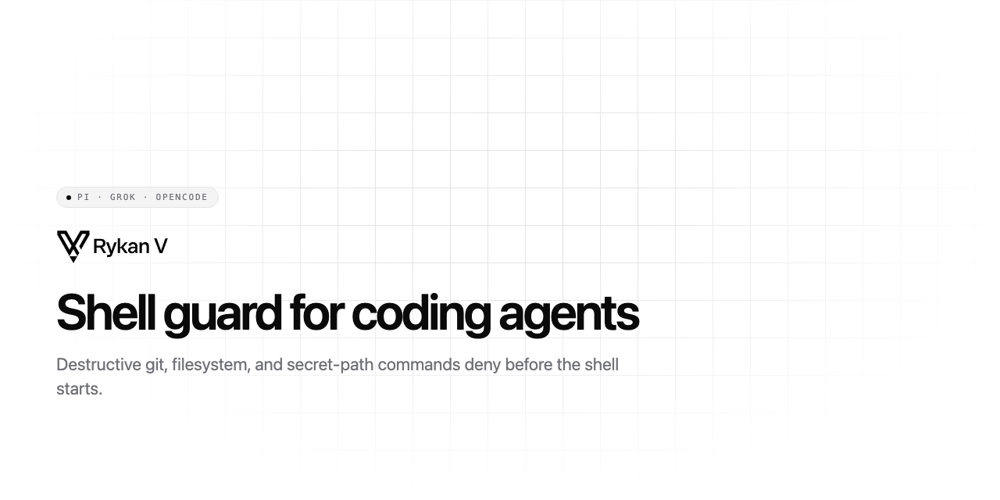

<p align="center">
  <picture>
    <source media="(prefers-color-scheme: dark)" srcset="Resources/rv-banner-dark.png">
    
  </picture>
</p>

<p align="center">
  <a href="https://github.com/christopherkarani/rv/releases/latest"></a>
  <a href="LICENSE"></a>
  <a href="https://github.com/christopherkarani/rv"></a>
  <a href="https://discord.gg/uZn9MDUYKx"></a>
  
  
</p>

# rv

**Your coding agent just tried to run `rm -rf /`. rv said no.**

rv is a fail-closed policy gate for AI coding agents. It sits on your
agent's pre-tool hook and blocks destructive shell commands — and
secret-file reads/edits — *before* the host runs them. One gate, three
verdicts: **allow · deny · indeterminate**. It never asks the agent;
only you can override, with a one-time code.

```sh
$ rv test 'git reset --hard'
{"decision":"deny","pack_id":"core.git","reason":"git reset --hard destroys uncommitted changes","rule_id":"core.git:reset-hard","schema":"rv.test.v1"}

$ rv test 'git status'
{"decision":"allow","schema":"rv.test.v1"}
```

## Install (30 seconds)

```sh
curl -fsSL https://rykanv.com/install | sh
rv setup    # auto-detects your agents and wires their hooks
rv doctor   # verify everything is live
```

Want to watch before you enforce? Install in observe mode: rv logs what it
would block and lets everything run.

```sh
curl -fsSL https://rykanv.com/install | RV_INSTALL_MODE=observe sh
rv setup --observe   # same thing for an existing install (asks Touch ID if rv is already enforcing)
rv blocks            # what observe would have blocked
```

On macOS the installer also fetches the on-device judge weights (~649 MB,
verified by SHA-256, fully offline after) so the neural judge binds on first
run; Linux installs run packs-only until the ONNX runtime lands. Re-run the
installer anytime to pick up the weights.

Works with **Claude Code, Codex, Cursor, Grok, OpenCode, Pi, Hermes,
OpenClaw, Antigravity, and Muse**. Hooks are only written for hosts already
on your machine. Requires macOS 15+ (Apple Silicon) or Linux
(aarch64/x86_64) with glibc 2.35+ (Ubuntu 22.04+, Debian 12+, Fedora 36+,
RHEL 10+), libcurl and libsqlite3; the installer checks these first. musl
(Alpine) is not supported. Linux downloads are checked against the release's
`SHA256SUMS`; until rv's release key is pinned in the installer that file is
not signature-checked, and the installer says so (see
[SECURITY.md](SECURITY.md#release-integrity)).

## How it works

Every shell and file-tool call from every host funnels into one daemon
(`rvd`) and one pipeline:

```text
agent ─▶ hook ─▶ rvd ─▶ 95 rule packs ─▶ script gate ─▶ on-device judge ─▶ policy ─▶ allow / deny
                          safe-first       npm bodies     CoreML (Laya)      overrides
                          deny = floor     evaluated      can only raise
```

- **95 rule packs** — git, filesystem, disks, cloud CLIs, Kubernetes,
  databases, Terraform, CI/CD, payments, and more. Safe patterns run
  first; the first blocking hit denies. Three packs are on by default
  (`core.filesystem`, `core.git`, `system.disk`); browse the rest with
  `rv packs`; `rv packs enable <id>` turns more on after owner
  authentication (see below).
- **Script gate** — `npm test` can't hide a payload: rv evaluates the
  actual `pre`/`post`/body scripts in `package.json`, not just the
  command you see.
- **On-device neural judge** — with a Laya CoreML bundle installed,
  pack-allowed commands get a local risk score. The judge can only
  raise a verdict, never lower a pack deny. Nothing leaves your
  machine. `"guard.mode": "observe"` logs would-be verdicts without
  blocking, so you can measure before you enforce. `rv host mode
  <host> observe` does the same for one host (`off` unwires it); `rv
  blocks` marks what observe would have blocked with `"observed": true`.
  `rv setup --observe` (or `RV_INSTALL_MODE=observe` for the installer)
  starts there. Observe never relaxes rv's own protection (rv admin
  commands, rv's config) while `rvd` is running. Because an idle observe
  host lets a call through when `rvd` is absent, observe also raises the
  bar on the common ways to stop or replace `rvd`: `launchctl`/`systemctl`
  stops of rv's job, `pkill`/`killall` of `rvd`, `kill` of a pid looked up
  from `rvd`, launching a second `rvd`, Linux D-Bus stops, and writes to
  rv's binaries, LaunchAgent, systemd unit or socket dir become "run it in
  Terminal". This check is **lexical, not a boundary** — it reads the
  command text, so it raises the bar but a determined agent can still get
  past it. It is observe-only; enforce already fails such a call closed.
  Residual (not caught): `kill` by a numeric pid, or a pid or path held in
  a variable or file; interpreter or script forms (a `python`/`node`
  subprocess, `bash -c "$(… | base64 -d)"`, a script file, a make/npm
  script); and a renamed or symlinked `launchctl`. When `rvd` is *absent*,
  hooks under observe let the call run unchecked and
  unlogged (with a notice on stderr) instead of prompting; a slow `rvd`, a
  daemon that fails its identity check, or a malformed reply still asks or
  denies, and `RV_HOOK_WHEN_DOWN=deny` keeps denying. "Absent" is
  platform-specific: on **macOS**, rv's launchd service is not registered
  (discovery XPC returns INVALID) — the job is on-demand, so an idle `rvd`
  is *not* absent; on **Linux**, the connect to
  `/run/user/<uid>/rv/evaluate.sock` fails with `ENOENT`/`ECONNREFUSED` and
  `XDG_RUNTIME_DIR` is unset or equals `/run/user/<uid>`. An organization gate pins enforce, and `rv setup
  --observe` refuses under one. A host set `off` before an organization
  gate arrived stays unwired until you run `rv setup`.
- **Policy gate** — a fixed override ladder (rebase recovery → pinned
  rules → allowlist → allow-once → contained-delete allowance) with
  `normal`/`strict` safety levels. Indeterminate (too large, budget
  exhausted, core packs missing) is never overridable.

## What gets blocked

| Category | Examples |
| --- | --- |
| Destructive git | `reset --hard`, `push --force`, `clean -fd`, `stash clear`, `checkout -- .` |
| Destructive filesystem | `rm -rf /`, `rm -rf ~`, `find -delete`, fork bombs, disk wipes |
| Secret paths | `.env`, SSH keys, cloud credentials — shell *and* Read/Edit/Write on Grok, Claude, Cursor |
| Cloud & infra (opt-in packs) | `terraform destroy`, `kubectl delete`, `aws s3 rm --recursive`, `DROP TABLE`, … |

Not sure why something blocked? `rv explain 'git reset --hard'` shows
exactly which pack and rule fired.

**Known limitations: search tools.** rv gates explicit secret paths and
secret-selecting globs in search tools (Claude `Grep`/`Glob`, Cursor
`Grep`). A search with no explicit path scans the working directory and
can still match inside non-ignored secret files there, because rv does
not inspect file contents.

**Vault secrets.** A secret definition with an `address` is refused unless
`VAULT_ADDR` is set to the same origin: rv never sends your Vault token to a
server the environment does not name.

## When you're blocked (and you meant it)

Every hook deny prints a six-character code. Redeem it once, from
your terminal — the agent can't redeem its own code:

```sh
rv allow-once a1b2c3    # next matching call in this directory runs once
```

Redeeming needs owner authentication: Touch ID or your password through
the signed CLI on macOS, your login password on Linux.

Typed rules live in `~/.config/rv/policy.toml` (`rv policy show`).
Commands that change the gate itself (`rv allowlist add`,
`rv packs enable`, `rv safety strict|normal`, `rv policy draft --save`,
`rv egress approve`, `rv workspace abandon`) ask for the same owner
authentication first, so an agent running as you cannot weaken its own
guard through `rv`. The config files themselves are still yours to write:
rv's hook guard refuses an agent's attempts to edit them, but the CLI,
not `rvd`, performs the change after approval. On Linux rv reads your login password from the terminal and
`rvd` checks it with the system's `unix_chkpwd`; five wrong passwords in
ten minutes lock checks for ten minutes. Every attempt is recorded as an
`owner.action` event in the audit log. That needs an account with a local
password: an SSH-key-only cloud user or root in a container usually has a
locked one (`passwd -S` shows `L` or `NP`), which can never pass. rv says
so up front instead of prompting; set a password (`sudo passwd $USER`) to
approve rv owner actions.

## Locked out?

When rv can't decide (the daemon `rvd` is down or slow, or the `rv` binary
is gone), every hook fails closed: the agent's tool call is blocked, never
quietly allowed. The block message says which of these it was:

| Message starts with | What it means | What to do |
| --- | --- | --- |
| `RV daemon is not reachable` | `rvd` isn't running | `rv doctor`; `rv setup` repairs the service |
| `RV daemon did not answer in time`, `rv did not answer within 15s` | `rvd` is busy or hung | Retry; then `rv service status`, `rv service restart` |
| `RV daemon identity check failed`, `RV daemon sent an unexpected reply` | a stale `rvd` after an upgrade | `rv service restart`; if that doesn't fix it, `rv setup` |
| `rv is not installed at <path>` | the hook points at a binary that's gone | Reinstall rv, then `rv setup` |
| `rv at <path> could not be started`, `rv exited with code N` | `rv` is broken or crashed | `rv doctor` |
| `Laya judge is still loading` | the on-device judge is still loading after `rvd` started | Retry in a few seconds |
| `Laya judge queue is full` | too many commands are waiting for the judge | Retry shortly |
| `Laya judge unavailable; failing closed` | the judge couldn't score this command | `rv doctor` |

Run these from your own terminal, not through the agent:

```sh
rv doctor                 # what's broken and how to fix it
rv service status         # is rvd running, down, or skewed?
rv service restart        # restart rvd
rv setup                  # repair the rvd service and host hooks
rv host list              # each host's mode and hook wiring
rv host mode claude off   # stop guarding one host (asks for owner authentication)
rv uninstall              # remove rv's hooks, config, and rvd (asks for owner authentication)
```

`rv host mode <host> block` turns guarding back on.

## Beyond the shell

rv is one binary, 25 commands. The rest of the surface:

- **Secrets without exposure** — agents in a contained workspace
  (macOS) see placeholders, never values. Real bytes are injected at the
  boundary from Keychain, 1Password, Vault, AWS/GCP/Azure, Infisical, or
  Bitwarden, then scrubbed from everything that comes back.
  Hook-guarded agents get secret-path blocking instead; stdio MCP servers
  receive the real value. `rv secrets scan` + a git pre-commit hook
  catch leaks before they land.
- **App logins, once** — `rv login connect vercel` imports the Vercel or
  GitHub login you already have (CLI auth file, token variable, or
  `gh auth token`; paste as fallback) into the Keychain as a gateway
  secret, so agents use it through rv instead of logging in again.
  On Linux rv keeps stored values in the Secret Service keyring (GNOME
  Keyring, KWallet, KeePassXC) through `secret-tool` (package
  `libsecret-tools`), which needs a session bus and an unlocked keyring;
  the hook guard refuses an agent's own `secret-tool` and Secret Service
  D-Bus calls, since that keyring has no per-app prompt.
  `rv login list` / `check` report status and fingerprints, never values;
  `rv login logout <app>` removes it.
- **MCP governance** — `rv mcp serve` puts every MCP server behind one
  gateway with per-tool allow/ask/deny, human approval for `ask`, and
  a full audit trail. `rv mcp check` fails if any server bypasses rv.
- **Egress control** — contained runtimes reach the network only
  through a credentialed CONNECT proxy: per-runtime tokens, SNI-bound
  tunnels and binary pinning. Blocked hosts are queued for review
  (`rv egress`); `rv egress approve` asks for owner authentication.
- **Tamper-evident audit** — every hook and file-tool deny, every override
  (allow-once, allowlist, rebase recovery), plus MCP and secret events,
  lands in a SHA-256 hash-chained `audit.jsonl` (rule and host, never
  command text). Verify with `rv audit verify`, export
  as OCSF 1.3.0 to your SIEM.
- **Session forensics** — `rv scan` replays past agent sessions
  (Claude, Codex, Cursor, Grok, Hermes, OpenClaw, OpenCode, Pi)
  offline and reports which commands your enabled packs would have
  denied.
- **Signed org policy** — fleet-wide, restrict-only rules signed with
  Ed25519 and pinned root-owned on disk: MCP tool rules, secret
  sources, audit forwarding, and gate requirements (packs every agent
  must run under, strict safety). User config can never loosen them.
  `rv report` emits posture for MDM/fleet collection.
- **Contained workspaces (macOS)** — `rv opencode` / `rv workspace`
  run agents on a persistent per-project host under a deny-default
  Seatbelt profile: workspace-only writes, proxied HTTPS, no Keychain,
  no host signals, and the same packs you enabled for your agents.
  `rv workspace run --microvm <image>` runs the command in a
  network-less Linux micro-VM instead (macOS 26+). Linux hosts refuse
  rather than downgrade. This is a hardening layer, not a finished
  isolation boundary — see the
  [acceptance audit](docs/security/runtime-acceptance.md).

## Everyday commands

```sh
rv test 'rm -rf /'          # evaluate a command, don't run it
rv explain 'rm -rf /'       # why would this block?
rv packs                    # browse the 95 packs
rv blocks                   # what got denied lately?
rv host list                # per-host mode (block / observe / off) and wiring
rv workspace vms            # micro-VM runtime sessions, newest first
rv scan                     # audit past agent sessions
rv audit verify             # check the audit hash chain
rv doctor                   # service, packs, hosts, judge health
rv uninstall                # remove everything rv owns (owner-auth)
rv uninstall --remove-models  # ...and the judge weights in ~/.config/rv/models
```

`rv uninstall` removes rv's hooks, stops the service, then deletes every
file install.sh put in `~/.local/bin` and `~/Applications/RVApprovals.app`.
If rvd is not running, you confirm at the terminal with your login password
(or Touch ID) instead; without a local owner check it refuses and says how
to start rvd.

All commands speak `--json` / `--robot` / `--plain` / `--no-color`.
Anonymous usage counters are on by default; opt out with
`"analytics.enabled": false` (or `{"analytics": {"enabled": false}}`)
in `~/.config/rv/config.json`.

## For developers

```sh
git clone https://github.com/christopherkarani/rv && cd rv
swift build --build-tests   # Swift 6.4
swift test                  # full suite (this is the PR gate)
```

Architecture in one line: a tiny C front door (`rv`) execs the Swift
CLI, which talks to the `rvd` daemon over a Unix socket
(XPC on macOS) — 15 IPC methods, one gated evaluation path for every
door. A Python SDK lives in [`sdk/python`](sdk/python). Security
model and evidence: [`docs/security`](docs/security). Before opening a
PR, read [CONTRIBUTING.md](CONTRIBUTING.md); report vulnerabilities per
[SECURITY.md](SECURITY.md).

Site: [rykanv.com](https://rykanv.com) · Docs:
[rykanv.com/docs/introduction](https://rykanv.com/docs/introduction) ·
Discord: [discord.gg/uZn9MDUYKx](https://discord.gg/uZn9MDUYKx)

## License

Apache 2.0. See [LICENSE](LICENSE).
