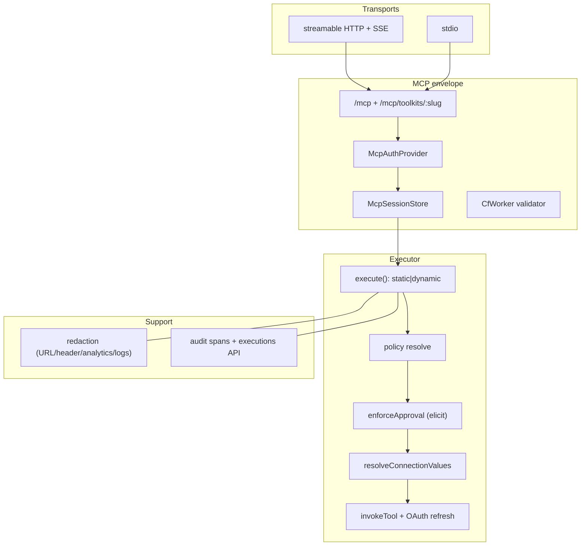

# Executor Architecture (MCP + Policy Reference for RV)

> Sources inspected under `/tmp/rv-secrets-compare/executor`. RV replicates this design in Swift: code-mode MCP, 5-segment addresses, connection-as-credential, owner-scoped policy, approval-before-resolution, opaque errors, layered redaction, execution audit.

## 1. Overview

Serving package `@executor-js/host-mcp` exports a provider-neutral envelope (`McpServingRoutes` + 2 seams: `McpAuthProvider`, `McpSessionStore` — `packages/hosts/mcp/src/seams.ts:17`). The MCP surface is code-mode tools `execute/skills/resume/search` (`tool-server.ts:2051`), not one-MCP-tool-per-integration. Schemas are zod/v4 validated by `CfWorkerJsonSchemaValidator` (`tool-server.ts:100`, Workers-safe). Transports: streamable HTTP with SSE (`apps/local/src/mcp.ts:212`) + stdio (`mcp.ts:333`); sessions routed by `mcp-session-id` with resource-key match or 403 (`mcp.ts:190`).

Invocation (`executor.ts:6443 execute()`): static-map O(1) or dynamic path with concurrent tool-row + policy + connection reads; policy-before-credential; approval via elicitation; credential resolve after approval (`executor.ts:6689`); opaque defects with correlation ids (`tool-invoker.ts:339`).

## 2. Component table

| Component | Inspected path | Role |
|---|---|---|
| Envelope | `packages/hosts/mcp/src/tool-server.ts:2051`, `src/seams.ts:17`, `index.ts` | routes `/mcp`, `/mcp/toolkits/:slug`; 2 seams; `jsonRpcErrorBody` |
| Validator | `tool-server.ts:100` | `CfWorkerJsonSchemaValidator` (2020-12) |
| HTTP transport | `apps/local/src/mcp.ts:212,190` | per-session `WebStandardStreamableHTTPServerTransport`, SSE, session map |
| Stdio transport | `apps/local/src/mcp.ts:333` | single `McpServer` + `StdioServerTransport`, SIGINT/SIGTERM lifetime |
| Address grammar | `packages/core/sdk/src/executor.ts:313` | `tools.<integration>.<owner>.<connection>.<tool>`, dot-tolerant tool |
| Sandbox prefix | `packages/core/execution/src/tool-invoker.ts:64` | `pathToAddress` re-prefix; static fqids passthrough |
| Connection | `packages/core/sdk/src/connection.ts:13` | saved credential = secret+account+connection; value in provider |
| Policy | `packages/core/sdk/src/policies.ts:226,86` | block>require_approval>approve; `*`/exact/trailing-*/mid-* grammar |
| Execute | `executor.ts:6443,6689` | speculative concurrent reads; `resolveConnectionValues` after approval |
| Invoker | `tool-invoker.ts:339` | `ExecutionToolError` opaque defects, server-logged cause |
| HTTP edge | `packages/core/api/src/observability.ts:20` | `StorageError`→`InternalError{traceId}` via `ErrorCapture` |
| URL redaction | `sdk/src/telemetry-url-redaction.ts:12` | strip query values/fragment/userinfo; param names only |
| Header redaction | `sdk/src/hosted-http-client.ts:276` | inverted allowlist; auth always redacted |
| Analytics rules | `analytics/src/events.ts:13` | never secrets/code/args/results/free-text |
| Approvals | `api/src/handlers/executions.ts:109` | `recordPendingApproval/consume` keyed by executionId |
| Sealed bundle | `kernel/runtime-quickjs/src/sealed-bundle.ts:55` | no host globals, no `process.env`; tools proxy only capability |

## 3. Diagrams



```mermaid
sequenceDiagram
  participant M as MCP client
  participant E as execute({code})
  participant Q as QuickJS + tools proxy
  participant X as executor.execute
  participant P as policy engine
  participant H as elicitation handler
  participant C as credential provider
  participant T as plugin invokeTool
  M->>E: tools.call execute
  E->>Q: run sealed bundle
  Q->>X: invoke(path,args)
  X->>X: path→address; speculative reads
  X->>P: resolvePolicyFromRuleSet
  P-->>X: EffectivePolicy
  X->>H: FormElicitation (if require_approval)
  H-->>X: accept/decline
  X->>C: resolveConnectionValues (post-approval)
  C-->>X: values (refresh if expired)
  X->>T: invokeTool(ctx,credential,args)
  T-->>M: ToolResult ok/fail (opaque defects)
```

## 4. Security boundaries

- **No env inheritance:** sealed bundles self-contained; only server flag `EXECUTOR_MCP_DEBUG` read from env. Secrets reach tools only via resolved credential values.
- **Connection-as-credential:** rows hold routing (provider + per-variable item ids, `token` for single-secret) only; origins `{value}`→default provider or `{from:{provider,id}}`; template applied lazily per call, never stored rendered; OAuth refresh before resolve + single reactive retry; failures carry label + RFC6749 code, never material.
- **Policy:** `ToolPolicy{id,owner,pattern,action,position}`; owners org|user; first-match-per-owner, most-restrictive-wins; fractional-index `positionForNewPattern` (specificity = literals×2 + exact bonus); plugin-default fallback; toolkits as allowlist scopes.
- **Error opacity:** 3 layers — tool dispatch (enumerated expected vs `Internal tool error [corr]`), HTTP edge (`InternalError{traceId}`), MCP (`jsonRpcErrorBody`, -32601 probes, 403/404 w/o internals).
- **Redaction:** URLs (strip all values, keep param names), headers (inverted allowlist), analytics (booleans/counts, no free text/slugs), health (status+identity), logs (correlation + path only).

## 5. Ops model

Local: in-process session store; cloud/selfhost: DO/in-process `McpSessionStore` Layers behind the same seams. Pause/resume via Deferred+Queue + pending-approval records; executions API (get/resume); analytics `execution_completed` once per terminal completion; metering on execute paths, resume free. Gaps honored: cloud DO internals, metering counters, stdio passthrough bodies (prior result 3).

## 6. Integration surface for RV

RV Swift mapping: `McpServingRoutes`→ mediated action through `RuntimeAdmissionSession.submitIdentityRequired` (`Sources/RVIsolation/RuntimeAdmission.swift`) with fresh `registry.context(forBinding:)`; 5-segment address grammar as closed `FileToolKind`-style enum in RVDomain; policy engine mirroring `policies.ts` (actions, grammar, most-restrictive-wins, fractional positions); `resolveConnectionValues`-after-approval ordering inside the broker; stdio + loopback-HTTP transports (`EgressPolicy.allowsLoopbackTarget`); inverted-allowlist header + URL-param-names redaction; pending-approval records + executions-style audit.

## 7. File map (inspected)

`packages/hosts/mcp/src/tool-server.ts:2051,100`, `packages/hosts/mcp/src/seams.ts:17`, `apps/local/src/mcp.ts:212,190,333`, `packages/core/sdk/src/executor.ts:313,6443,6689`, `packages/core/execution/src/tool-invoker.ts:64,339`, `packages/core/sdk/src/connection.ts:13`, `packages/core/sdk/src/policies.ts:226,86`, `packages/core/api/src/observability.ts:20`, `packages/core/sdk/src/telemetry-url-redaction.ts:12`, `packages/core/sdk/src/hosted-http-client.ts:276`, `packages/core/analytics/src/events.ts:13`, `packages/core/api/src/handlers/executions.ts:109`, `packages/kernel/runtime-quickjs/src/sealed-bundle.ts:55`. Full bodies via handoff-27e1… (MCP setup, transports, registry, 15-step invocation, connection, policy, env, opacity, redaction, audit).
