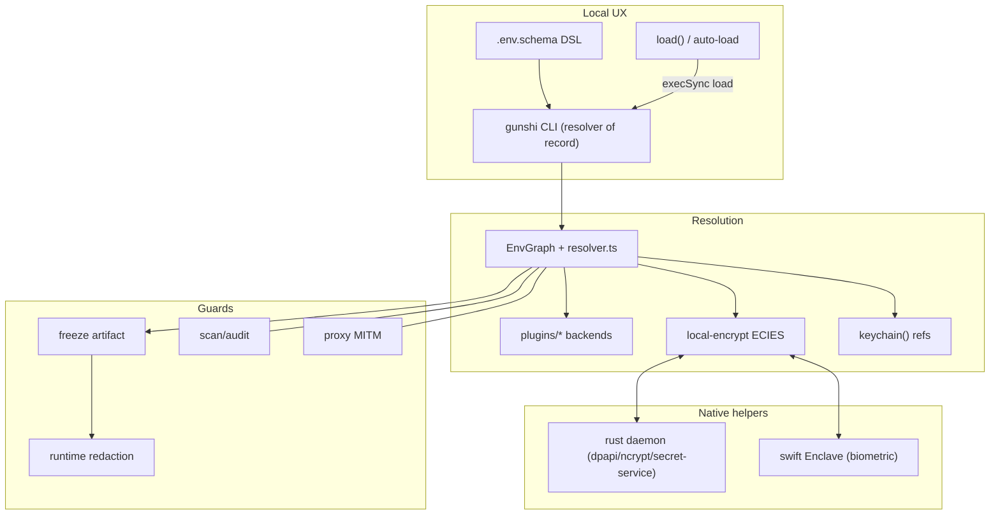
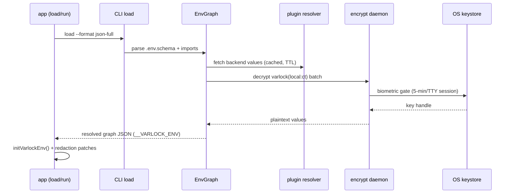

# Varlock Architecture (Local-UX Reference for RV)

> Sources inspected in varlock monorepo v1.22.0 (bun+turbo). Varlock is the local resolver + leak-guard UX pattern RV copies; it is NOT a server secrets manager (no rotation engine, leases, RBAC, revocation, versioning).

## 1. Overview

`packages/varlock` is core (gunshi CLI + library + env-graph resolver + runtime guards + MITM proxy). `packages/env-spec-parser` (PEG.js `grammar.peggy` + `classes.ts`) parses the `.env.schema` DSL. `packages/plugins/*` (18 dirs: 1password/aws-secrets/azure-key-vault/bitwarden/doppler/infisical/hashicorp-vault/…) register resolver fns via `varlock/plugin-lib`. `packages/integrations/*` (astro/cloudflare/expo/nextjs/nuxt/vite) do build-time replacement + runtime redaction. Native helpers: `packages/encryption-binary-rust` (Linux/Windows) + `packages/encryption-binary-swift` (macOS Secure Enclave).

CLI is the resolver of record: library `load()` (`packages/varlock/src/index.ts:12-34`) builds an `EnvGraph`, stashes JSON in `process.env.__VARLOCK_ENV`, calls `initVarlockEnv()`; `auto-load.ts:73` execSyncs `load --format json-full --compact`.

## 2. Component table

| Component | Inspected path | Role |
|---|---|---|
| CLI verbs | `packages/varlock/src/cli/commands/` | 19 gunshi pairs: run/load/scan/encrypt/keychain/freeze/lock/proxy/audit/reveal/flatten/typegen… |
| Library entry | `packages/varlock/src/index.ts:12-34` | `load()` → EnvGraph → `__VARLOCK_ENV` → `initVarlockEnv()` |
| Auto-load | `packages/varlock/src/auto-load.ts:73` | execSync CLI, reuse parent blob/frozen file |
| Schema DSL | `env-spec-parser/src/classes.ts`, `grammar.peggy` | dotenv + JSDoc `@decorator` blocks |
| Resolvers | `env-graph/lib/resolver.ts` | concat/fallback/exec/ref/forEnv/if/ifs/randomNum/randomUuid/domainFromUrl + plugins |
| Local-encrypt resolver | `lib/local-encrypt/builtin-resolver.ts` | `varlock("local:<ct>")`, batched prompt queue |
| ECIES (TS) | `lib/local-encrypt/crypto.ts` | P-256 ECDH + HKDF-SHA256 + AES-256-GCM; `ver\|ephPub\|nonce\|ct\|tag` |
| ECIES (Rust) | `encryption-binary-rust/src/crypto.rs` | wire-compatible helper (Linux/Windows) |
| Key store | `encryption-binary-rust/src/key_store/mod.rs` | `~/.config/varlock/local-encrypt/keys/*.json`, dpapi\|ncrypt\|tpm2\|secret-service\|none |
| Enclave (mac) | `encryption-binary-swift/…/SecureEnclaveManager.swift` | P-256 Secure Enclave, biometric ACL, opaque handles |
| Daemon IPC | `daemon-client.ts`, `daemon.rs`, `IPCServer.swift` | unix-socket 4B-LE JSON RPC, 5-min/TTY sessions, 30-min idle shutdown |
| Blob crypto | `runtime/crypto.ts` | `varlock:v1:`+base64 AES-256-GCM, key `_VARLOCK_ENV_KEY` |
| Freeze | `lib/frozen-env-file.ts` | encrypted resolved graph → `.varlock-frozen-env` deploy artifact |
| Redaction | `runtime/env.ts`, `patch-console/…` | globalThis map, patches console/streams/fetch/ServerResponse |
| Scan/audit | `cli/commands/scan.command.ts`, `audit.command.ts` | grep tracked files; diff schema vs code refs |
| Egress proxy | `src/proxy/` | MITM placeholder substitution + allow/approve/deny |
| Plugins | `packages/plugins/` | 18 backends via `plugin-lib` |
| Integrations | `packages/integrations/` | 6 framework adapters |
| Login | `cli/commands/login.command.ts` | GitHub device flow → api.varlock.dev JWT; persistence TODO |
| Cache | `src/lib/cache/` | resolver cache w/ TTL |

## 3. Diagrams

## 4. Security boundaries

- **Machine-bound keys:** ECIES private keys never leave the box (`~/.config/varlock/…` 0600 JSON, DPAPI/NCrypt-TPM/Secret-Service, Secure Enclave handles). Ciphertext in schema is not portable.
- **Two cryptosystems:** (1) ECIES P-256/HKDF(`varlock-ecies-v1`)/AES-GCM for `local:` values (3 implementations: TS/Rust/Swift); (2) blob AES-GCM `varlock:v1:` for `__VARLOCK_ENV`/frozen artifacts keyed by random `_VARLOCK_ENV_KEY`.
- **Daemon:** socket `~/.config/varlock/local-encrypt/daemon.sock` (named pipe on Windows), 4B-LE JSON `{id,action,payload}`, content-hash election, Touch ID/Hello/polkit once per 5-min per-TTY session, `lock` invalidates, WSL2→Windows.exe interop. Gaps honored: socket perms/peer-auth unevidenced (prior result 5).
- **Redaction:** globalThis per-value `{redact, preventLeaks}` incl. composites; streaming holdback; scan/audit are local-only (no server trail).
- **No central authority:** no RBAC/revocation/versioning/rotation engine; rotation = next deploy (freeze defers).

## 5. Ops model

Single-machine: schema committed to git (AI-safe context); `run -- cmd` injects resolved env + blob into child (reuse/frozen/proxy guards, redacted stdout); `freeze` ships encrypted artifact; sharing delegated to third-party backends (1Password/Vault/AWS…) or platform env. `login` JWT exists but persists nothing (TODO); no sync/push/pull/team commands.

## 6. Integration surface for RV

RV copies: schema-declared keys + resolver chain + `run`-style injection; `freeze`-like staged artifact; redaction map + scan discipline; daemon+biometric pattern mapped onto macOS Keychain via `KeychainReader.live` / Linux fail-closed nil. RV does NOT copy: execSync-CLI resolution (RV resolves in-process broker), plaintext `__VARLOCK_ENV` transport (RV uses broker FDs/env ≤8KB fail-closed per var), machine-bound-only sharing (RV adds Vault-HTTP team backend behind the provider trait).

## 7. File map (inspected)

`packages/varlock/src/cli/commands/`, `packages/varlock/src/index.ts:12-34`, `packages/varlock/src/auto-load.ts:73`, `env-spec-parser/src/classes.ts`, `env-spec-parser/grammar.peggy`, `env-graph/lib/resolver.ts`, `lib/local-encrypt/builtin-resolver.ts`, `lib/local-encrypt/crypto.ts`, `encryption-binary-rust/src/crypto.rs`, `encryption-binary-rust/src/key_store/mod.rs`, `encryption-binary-swift/…/SecureEnclaveManager.swift`, `daemon-client.ts`, `daemon.rs`, `IPCServer.swift`, `runtime/crypto.ts`, `lib/frozen-env-file.ts`, `runtime/env.ts`, `patch-console/process-streams/server-response/response`, `cli/commands/scan.command.ts`, `cli/commands/audit.command.ts`, `src/proxy/`, `packages/plugins/`, `packages/integrations/`, `cli/commands/login.command.ts`, `src/lib/cache/`. Gaps honored: decorator catalogue, per-TTY algorithm line-by-line, `hashicorp-vault` plugin file, proxy CA/approval channel, ECIES test vectors, cache/redaction bypasses (prior result 5).
