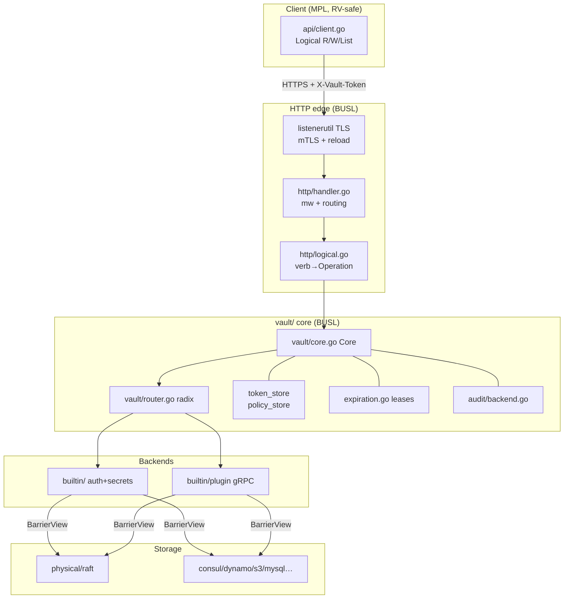
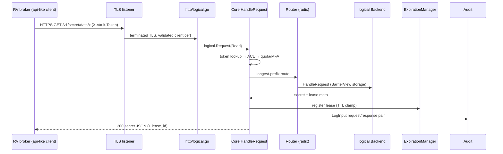

# Vault Architecture (HTTP-Only Reference for RV)

> Sources inspected under `/tmp/rv-secrets-compare/vault`. Vault server is BUSL-1.1 (`LICENSE`); only `api/` + `sdk/` + `shamir/` are MPL-2.0. RV talks to Vault over HTTP only — never links server code.

## 1. Overview

HashiCorp Vault is a Go monorepo (`github.com/hashicorp/vault`, Go 1.27.1 per `.go-version`) shipping a single binary: `main.go` → `command/server.Run`. The server core (`vault/`, ~280 entries) owns seal/barrier/router/mounts; `http/` adapts REST to logical operations; `api/` is the MPL REST client RV mirrors; `sdk/` is the MPL plugin contract; `physical/` holds ~20 storage backends; `builtin/` holds in-tree auth/secrets backends; `audit/` is the fail-closed audit pipeline; `command/agent` is the auto-auth/caching daemon.

Request lifecycle: `http/logical.go` maps verb → `logical.Operation` → `Core.HandleRequest` (`vault/request_handling.go`): token-auth → ACL → quota/MFA → radix-router dispatch → barrier-scoped backend → lease registration → audit pair. Standbys forward via gRPC (`request_forwarding.go`).

## 2. Component table

| Component | Inspected path | Role |
|---|---|---|
| Entry | `main.go` | single-binary entry → server command |
| Core | `vault/core.go` | seal/barrier/router/mounts; `Sealed()`/`Unseal()` |
| Router | `vault/router.go` | radix longest-prefix; `storagePrefix` mount map |
| Pipeline | `vault/request_handling.go` | auth→ACL→quota→audit→backend→lease; 90s max |
| HTTP adapter | `http/logical.go` | verb→Operation, ns-strip, query parse |
| Handler/mw | `http/handler.go` | routing, wrap/forward/MFA headers, gzip |
| Go client | `api/client.go` | REST client, `X-Vault-Token`, `VAULT_*` env |
| Storage iface | `sdk/physical/physical.go` | `Backend{Put,Get,Delete,List}` + `HABackend{LockWith}` |
| Raft backend | `physical/raft/raft.go` | integrated Raft HA (hashicorp/raft, autopilot, bbolt/WAL) |
| Consul backend | `physical/consul/consul.go` | `NewConsulBackend`, `ConsulLock` |
| DynamoDB backend | `physical/dynamodb/` | `NewDynamoDBBackend`, `DynamoDBLock` |
| S3 backend | `physical/s3/` | `NewS3Backend` |
| MySQL backend | `physical/mysql/` | `NewMySQLBackend`, `MySQLHALock`/`MySQLLock` |
| Plugin contract | `sdk/logical/logical.go` | `Backend{HandleRequest,…}`; TypeLogical vs TypeCredential |
| Builtin registry | `helper/builtinplugins/registry.go` | immutable registry (approle/cert/userpass/pki/ssh/transit in-tree; kv/jwt external) |
| External plugins | `builtin/plugin/backend.go` | v5 gRPC `Backend()` + legacy multiplex |
| Auth mounts | `vault/auth.go` | `core/auth` table, `auth/` barrier view |
| Token store | `vault/token_store.go` | `id/`+`accessor/`+`parent/` indexes, cubbyhole, wrapping |
| Policy store | `vault/policy_store.go` | `policy/` store, 1024-entry cache, default builtins |
| Expiration | `vault/expiration.go` | leases on `expire/` view, revoke timers |
| Audit | `audit/backend.go` | eventlogger pipeline, salted HMAC, `log_raw` opt-in |
| TLS listeners | `internalshared/listenerutil/listener.go`, `tls_reload.go`, `internalshared/configutil/listener.go`, `helper/serverconfig/listener_tcp.go` | `tls.Config` build, client-cert modes, reload poll, tcp+unix+PROXY |
| KMS seals | `internalshared/configutil/kms.go`, `vault/seal/seal.go` | alicloud/aws/azure/gcp/oci/transit wrappers; pkcs11 = Enterprise-only |
| Shamir | `shamir/` (MPL) | threshold combine |

## 3. Diagrams

## 4. Security boundaries

- **Seal/barrier:** Shamir threshold (`shamir/`) or auto-seal (`vault/seal/`, go-kms-wrapping AEAD/AWSKMS…); `barrier_aes_gcm.go` AES-GCM-256 envelope, keyring at `core/keyring`. Sealed core rejects all data ops (`ErrBarrierSealed`).
- **TLS:** terminates in listeners; `ClientAuth` defaults `RequestClientCert` → `RequireAndVerifyClientCert` with `tls_require_and_verify_client_cert`, off via `tls_disable_client_certs`; `TLSReloader` polls cert/key (5-failure escalation); cipher suites via `tlsutil.ParseCiphers`; min/max version + `tls_reload_interval` 1s–24h. `tls_util.go` dev CA is dev-only (ECDSA P-256).
- **Token/policy/lease:** parent-child token tree (service/batch, orphan, accessor indirection); HCL path capabilities (+ default ceiling); leases = `{lease_id, renewable, TTL}` clamped to mount/system max, renewed/revoked via `sys/leases`.
- **Audit:** fail-closed forked pipeline per device with salt/HMAC; `log_raw` only when explicitly enabled.
- **Storage untrusted:** physical `Backend` treated as untrusted KV; HA adds `LockWith` leader lock.

## 5. Ops model

- **Dev:** `server.go -dev` (inmem, auto-init+unseal, `-dev-tls/-dev-ha/-dev-latency`, root token printed, no persistence).
- **Prod HA:** integrated Raft (single binary, autopilot, snapshots) or external `HABackend` (consul/etcd/…) with active+standbys, seal-wrap, `serviceregistration/`, metrics/quotas/activity-log. Standby forwarding via gRPC + `X-Vault-Forward`.
- **Replication:** OSS tree has call sites/stubs only (`vault/cluster/cluster.go`, `ha.go`); DR/Performance enable paths are Enterprise (gap, prior result 6).

## 6. Integration surface for RV

RV implements an `api/client.go`-shaped HTTP client (token header, `VAULT_*` env conventions, KV-v2 paths, lease TTL honor, wrapping TTL passthrough) inside the broker. No server import: Vault protocol = `GET/POST /v1/…`, `X-Vault-Token`, `X-Vault-Wrap-TTL`, `X-Vault-Forward`, response `{data, lease_id, renewable, lease_duration}`. Auth methods RV may use: token + AppRole (agent-style auto-auth per `command/client/agent/doc.go`).

## 7. File map (inspected)

`main.go`, `.go-version`, `LICENSE`, `api/LICENSE`, `vault/core.go`, `vault/router.go`, `vault/request_handling.go`, `vault/auth.go`, `vault/token_store.go`, `vault/policy_store.go`, `vault/expiration.go`, `vault/mount.go`, `http/logical.go`, `http/handler.go`, `api/client.go`, `sdk/physical/physical.go`, `sdk/logical/logical.go`, `physical/raft/raft.go`, `physical/consul/consul.go`, `physical/dynamodb/`, `physical/s3/`, `physical/mysql/`, `helper/builtinplugins/registry.go`, `builtin/plugin/backend.go`, `audit/backend.go`, `internalshared/listenerutil/listener.go`, `internalshared/listenerutil/tls_reload.go`, `internalshared/configutil/listener.go`, `internalshared/configutil/kms.go`, `helper/serverconfig/listener_tcp.go`, `vault/seal/seal.go`, `shamir/`, `command/server/`, `command/client/agent/doc.go`, `vault/request_forwarding.go`, `vault/cluster/cluster.go`, `vault/ha.go`. Gaps honored: `barrier_aes_gcm.go` keyring internals, full `acl.go`/`quotas`/MFA/eventbus bodies, plugincatalog lifecycle, agent cache/proxy bodies (see prior result 5).
