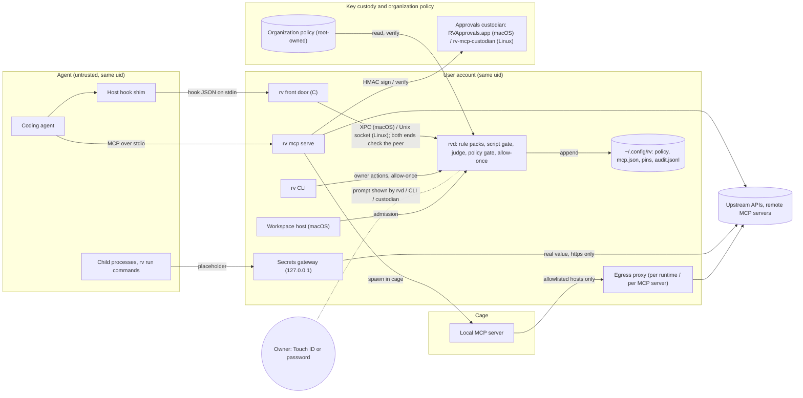

# rv security overview

For a security team reviewing rv before purchase. It says what rv protects,
from whom, how each control works, what each control does not stop, and
what rv stores and sends. It is not a user guide; user documentation,
including a list of known limits written for users, is under
[`docs/guides/`](../guides/README.md).

**Commit described:** `38f2f82b2a53839c01a9363739bf9ea34d60a9f3`
(branch `claude/mcp-reliability`, which contains draft PR 582 and `main` as
of that commit). Every behavioural claim below carries a tag such as
**[C12]**. [Appendix A](#appendix-a-claims-to-source) maps each tag to
`file:line` at that commit.

**How it was checked.** Source and tests were read on Linux. Nothing below
was measured on a machine for this document. Behaviour marked
**(macOS, source only)** comes from macOS code paths (XPC, Keychain,
Seatbelt, LocalAuthentication, codesign) that cannot run on Linux and was
read, not executed. "Not verified" means the source did not settle the
question.

**Release status.** No signed release exists yet. The installer's signature
pins are empty, and the latest published release (v0.2.1, 2026-10-26)
predates most of what this document describes. See
[section 6](#6-key-custody-and-the-release-chain).

Contents

1. [What rv is and is not](#1-what-rv-is-and-is-not)
2. [Components and trust boundaries](#2-components-and-trust-boundaries)
3. [Controls](#3-controls)
4. [Fail-closed behaviour](#4-fail-closed-behaviour)
5. [Data handling](#5-data-handling)
6. [Key custody and the release chain](#6-key-custody-and-the-release-chain)
7. [Known limits and residual risks](#7-known-limits-and-residual-risks)
8. [Appendix A: claims to source](#appendix-a-claims-to-source)

---

## 1. What rv is and is not

rv sits between an AI coding agent and the machine it runs on. A host
agent's pre-tool hook sends each shell command and file-tool call to a
per-user daemon, `rvd`, which answers allow, deny, ask or indeterminate.
Beside that gate rv has a secrets gateway, an MCP gateway (`rv mcp serve`)
and a hash-chained audit log.

### Assets rv protects

| Asset | What rv tries to prevent |
| --- | --- |
| The working tree, home directory and disks | Destructive commands an agent issues (`git reset --hard`, `rm -rf`, disk tools) running without the owner's say. |
| Secret files | An agent reading or editing `.env`, SSH keys, cloud credentials and similar paths through the shell or file tools. |
| Secret values | An agent or MCP server holding the real bytes of a credential, when the secret is delivered as a placeholder. |
| rv's own configuration | An agent loosening its own guard (enabling an allowlist entry, disabling a pack, trusting an MCP tool) through `rv`. |
| MCP tool calls | A tool running that the owner did not allow or approve, or a tool definition changing after the owner reviewed it. |
| The record of what happened | Denies, overrides, gate changes and MCP calls happening without a record. |

### Adversaries

- **A coding agent that is mistaken, prompt-injected or malicious.** It
  issues tool calls through its host, and it can run arbitrary programs as
  the user once a command is allowed.
- **A hostile or compromised MCP server.** It can lie in its tool
  definitions, change them between listings, return crafted results, run
  slowly, or try to read files and reach the network from its own process.
- **Other local processes.** Other user accounts on the same machine, and
  processes running as the same user that an agent started.

### What the code assumes, and what is out of scope

The code states its assumptions in several places. Taken together:

- **The hooks gate a cooperating agent.** The hook path assumes the agent's
  tool calls go through its host's hook. "Same-user code can already exec
  directly" **[C1]**. A same-user agent can make `rvd` unreachable on
  purpose **[C2]**.
- **A same-user process outside an agent, or root, has the user's
  authority.** "A same-user or root process that can kill RV,
  force-unmount the workspace volume, or debug RV has the same authority as
  the person running RV" **[C3]**. `SECURITY.md` lists "attacks that
  require already running arbitrary code as your user outside any agent
  session" as out of scope **[C4]**.
- **rv's binaries and configuration are writable by the user.** The
  installer puts binaries in `~/.local/bin` **[C5]**, and configuration
  lives in `~/.config/rv` **[C6]**. Owner authentication stops an agent
  from loosening rv *through `rv`*; the CLI, not `rvd`, performs the change
  after approval, and the files remain the user's to write **[C7]**. The
  hook guard refuses an agent's file-tool writes to rv's wiring files, and
  its file-tool reads and writes of `~/.config/rv` through the secret-path
  catalog **[C8]**, but that is a check on the agent's tool calls, not an
  OS permission.
- **Root is not defended against.** `rv doctor` warns against running
  agents as root, and the Linux MCP sandbox page against running
  `rv mcp serve` as root **[C9]**.

So rv is **not**:

- a sandbox for hook-guarded agents. Hooks see the command text the host
  sends; once a command is allowed it runs with the user's full authority.
- a sandbox for `rv run`. `rv run --secret` keeps real values out of a
  command's environment, but the command "can read anything your user
  can" **[C10]**.
- an isolation boundary on Linux for agents. Contained workspaces are
  refused on Linux before exec **[C11]**. On Linux the only OS-level cage
  rv applies is the one around local MCP servers (section 3.6).
- a defence against code that already runs as the user outside an agent.

---

## 2. Components and trust boundaries

The boxes are not all OS boundaries. Everything in "Agent" and "User
account" runs as the same uid, and so does `RVApprovals.app` on macOS,
whose key is protected by the keychain's access group and user-presence
check rather than by a separate account. The OS boundaries rv relies
on are: other uids (socket and directory modes, peer credentials), the
cage around MCP servers, the Linux custodian's system account and root
helper, the root-owned organization-policy directory, and on macOS the
code-signing identity of peers when a protected manifest is installed.

### Per component

| Component | Runs as | Trusts | Does not trust | How it authenticates peers |
| --- | --- | --- | --- | --- |
| **Host hook shim** (per host: Claude Code, Codex, Cursor, …) | user | its host to call it for every tool call | — | none; it execs `rv hook` |
| **rv front door** (`Sources/rv-c`) | user | the sibling `rv-cli` and `rvd` next to its own executable, found from `/proc/self/exe` or `_NSGetExecutablePath`, never PATH or argv0 **[C12]** | hook stdin: over 1 MiB, NUL or invalid UTF-8 is denied **[C13]**; `rvd`'s reply until checked | **Linux:** `SO_PEERCRED` uid equals its own, and `/proc/<pid>/exe` resolves to the sibling `rvd` path; no hash **[C14]**. **macOS (source only):** with a root-owned `peer-trust.json`, the reply's sender must match the `.service` entry (hardened runtime, Developer ID anchor or pinned dev cdhash); with no manifest, same euid and a cdhash equal to the on-disk sibling `rvd`; a manifest that exists but fails validation rejects every `rvd` **[C15]**. Replies must carry the request id and the same semver major **[C16]**. |
| **rvd** (policy engine, packs, script gate, judge, policy gate, allow-once) | user; launchd agent on demand (macOS), systemd user unit (Linux) **[C17]** | its packs and policy files; the organization policy after ownership checks | every request until the peer is checked; owner mutations over any generic IPC path **[C18]** | **Linux:** `SO_PEERCRED` uid must equal its own **[C19]**; the socket is 0600 in a 0700 directory under `$XDG_RUNTIME_DIR` or `/run/user/<uid>`, never `/tmp` **[C20]**. **macOS (source only):** per-message code identity from the XPC audit token, bound to its cdhash; component roles come only from the root-owned manifest; no uid comparison on the XPC path **[C21]**. On the Unix socket listeners (both platforms): frames capped at 1 MiB, 64 connections, 30 s receive timeout **[C22]**. |
| **Judge** (Laya, on-device) | inside rvd | — | — | not a peer; local CoreML model **[C23]** |
| **rv CLI** | user | `rvd` after the same daemon check as the front door | its own terminal input for owner checks done by `rvd` | as the front door |
| **Secrets gateway** | user (inside rvd, `rv run` or `rv mcp serve`) | the provider or keychain that holds the value | any connection until its process is found in the bound runtime's process tree | loopback listener; the connecting socket's owning process must be the runtime's group leader, a descendant, or in its session, checked before the request head is read and again after **[C24]** |
| **Egress proxy** | user | its policy | requests without the per-runtime credential (credentialed mode) | a 256-bit credential in the proxy URL, compared in constant time **[C25]**. For macOS contained runtimes the credential sits in the runtime's environment, readable by same-uid processes (source only) **[C26]**. |
| **rv mcp serve** (MCP gateway) | user | mcp.json and tool pins only when their HMAC verifies with the custodian | MCP servers, their tool definitions and results; an mcp.json whose MAC does not verify | spawns servers itself; checks the custodian's identity (next row) |
| **Approvals custodian** | macOS: user, `RVApprovals.app` launchd agent **[C27]**. Linux: key daemon as system account `rv-mcp-custodian`, presence helper as root **[C28]** | — | its callers; a caller's requests act only on its own key, and only the root helper's attestation names a uid **[C29]** | **Linux:** `SO_PEERCRED`; rv requires the daemon to be the `rv-mcp-custodian` uid and the helper uid 0; the daemon keys requests by the caller's uid and accepts presence attestations only from uid 0 **[C30]**. **macOS (source only):** the custodian accepts only a peer with the `.cli` role from the installed manifest, else denies all; rv requires the custodian to have the `.mcpCustodian` role, or with no manifest the same euid, hardened runtime and the cdhash of `~/Applications/RVApprovals.app` **[C31]**. |
| **Workspace host** (macOS) | user | `rvd` with the `.service` role | the contained runtime | XPC roles from the manifest; control socket requires same uid and a role **[C32]** |
| **Audit log** | file | — | — | not a peer; written by rvd, `rv mcp serve`, the secrets gateway and CLI stores that change the gate **[C33]** |
| **Organization policy** | root-owned files | root ownership of the directory chain | user-owned or group/world-writable files | file ownership and mode checks; Ed25519 signature only when `org-key.pub` is present (section 3.9) |

What a same-uid process can do over rvd's socket: evaluate, consult hooks
and read diagnostics and control state. It cannot enable or disable packs,
save rules or resolve approvals over any generic IPC path **[C18]**, and
allow-once redemption and owner confirmation require an owner check that
`rvd` runs itself (section 3.3).

---

## 3. Controls

### 3.1 Command gate

**Stops.** Shell commands that match a blocking rule in an enabled rule
pack, commands whose `package.json` scripts would run such a command, and
(on macOS with the judge installed) pack-allowed commands the judge scores
as risky.

**How.**

- The host's hook payload is decoded per host. Shell calls go to the
  evaluate door; malformed payloads that claim to be from the host are
  denied **[C34]**.
- Packs are tried in enabled order when a keyword hits. Inside a pack,
  safe patterns run first and a safe match skips that pack's destructive
  rules; the first destructive hit whose severity blocks by default denies
  **[C35]**. Three packs are on by default: `core.filesystem`, `core.git`,
  `system.disk` **[C36]**.
- Floors applied after packs: a secret-path match becomes a pinned
  `core.secrets` deny, and an `rv` command that weakens rv (uninstall,
  `packs disable`, `allowlist add`, allow-once, `policy apply`,
  `mcp approve`, secrets writes, `host mode` other than block, …) becomes
  indeterminate **[C37]**. Observe mode keeps self-protection, the
  rv-config and Secret Service rules and the wiring guard enforced; other
  secret-path denies are only recorded there **[C53]**.
- Then the package-script gate, the judge, and the policy gate run in that
  order **[C38]**.
- **Indeterminate**: a command over 65,536 bytes **[C39]**, a pattern
  budget exhausted (1,500 ms CPU, 150 ms per search, 6 s wall) **[C40]**,
  core packs that failed to load **[C41]**. The policy gate never turns
  indeterminate into allow **[C42]**.
- **Judge (macOS, source only).** It sees only pack-allowed calls, can
  raise but never lower a verdict, and a judge block cannot be overridden
  **[C43]**. While the judge loads, when its queue (12) is full, or when a
  prediction fails, the call goes to review (ask) **[C44]**. It runs a local
  CoreML model; no networking code was found in the judge module **[C23]**.
- **Policy gate override ladder**: rebase recovery, pinned check,
  allowlist, allow-once, contained delete (only `rm -rf` variants at the
  normal safety level) **[C45]**. Pinned denies cannot be overridden:
  protected paths, `core.secrets`, judge blocks, unwrap limits, semantic
  hard binds, builtin denies other than those carrying a mandatory-human
  review bind **[C46]**. Rebase recovery never lifts
  `reset --hard`, `reset --merge`, `clean -f`, force pushes or the MCP host
  config rule **[C47]**.

**Does not stop.**

- Anything the command text does not show: a script written earlier, a
  program that decides at run time what to do, an interpreter reading a
  file. The gate judges text, not effects.
- Tool calls the hook codec does not recognise. A payload for a tool rv
  does not grade decodes as "foreign" and is answered allow without any
  rule being evaluated **[C48]**. For Claude Code the graded tools are
  Bash, Read, Edit, Write, MultiEdit, NotebookEdit, Grep and Glob **[C49]**;
  other tools (including web and MCP tool calls through the host) are not
  graded by the hook.
- On Linux, and on macOS without the judge bundle, the judge does not run.
  A selected judge bundle that is missing or fails to load gives packs-only
  evaluation plus a note, not a fail-closed answer **[C50]**.
- Rebase recovery is enabled by the existence of a `rebase-merge` or
  `rebase-apply` directory in the git directory **[C51]**, and lifts the
  working-tree-discard rule **[C52]**.
- Observe mode lets denied calls run (they are recorded as observed),
  except rv's own floor: self-protection, rv's config directory, rv's
  Linux Secret Service rule and rv's wiring files, and, in observe only,
  stopping or retuning `rvd` and writing rv's install **[C53]**. A shell
  command whose program rv cannot see (a dynamic command word, `eval` or
  `trap` action; a shell or interpreter reading its program from stdin
  unless every producer is a literal `echo`, plain `printf` or `cat` of
  literal paths, whose fed text is then scanned and stop-read too; a
  same-line function or alias redefining a name the floor reads,
  `coproc`; dynamic or encoded inline code, or inline code, `awk`
  or `sed e` running a command over unreadable input; `ssh` with a
  dynamic remote command; a runner whose verb is a shell, an interpreter
  or a process or service control verb; an unresolved alias; an
  over-budget command) is sent to Terminal as
  `observe.floor:unanalyzable`, never hard-denied; a deny stays the deny
  **[C53]**. A command proven to
  only read a wiring file is observed **[C53]**. These floors are lexical:
  code the agent can already run as the user can stop `rvd`, after which
  observe steps aside (below).

### 3.2 File and edit doors

**Stops.** File-tool reads and writes of secret paths; file-tool writes to
rv's wiring files; and, while the MCP gateway is in use, writes to host MCP
configuration files.

**How.** The file door checks the target path against the secret-path
catalog; an empty path or a catalog hit is a pinned `core.secrets` deny
**[C54]**. The catalog includes `.env` variants, `.npmrc`, `.pypirc`,
`.netrc`, `.git-credentials`, private key names, and under home `.ssh`,
`.aws`, `.config/gcloud`, `.kube/config`, `.docker/config.json`, `.azure`,
`.gnupg`, keychains and keyrings, `.password-store`, `.config/gh`,
`.config/rv`, and host agents' auth files **[C55]**. Writes to rv's wiring
and to host MCP configs are denied separately **[C8]**.

**Does not stop.**

- A search with no explicit path. Claude `Grep`/`Glob` without a path and
  without a secret-named glob is not graded, and can match inside
  non-ignored secret files in the working directory **[C56]**.
- Secret contents reached by any route other than the named path (a copy,
  a symlink the agent made elsewhere and the catalog does not resolve, an
  allowed command that prints the file). rv does not read file contents.
- File-tool coverage for hosts other than Claude Code was not read for
  this document (not verified).

### 3.3 Owner authentication and allow-once

**Stops.** An agent approving its own denied command, or loosening rv
through the `rv` CLI.

**How.**

- A deny that may be unlocked prints a six-character code: 3 random bytes
  **[C57]**, bound to the command fingerprint, working directory and a
  payload digest, valid 15 minutes **[C58]**. Pinned denies get no code
  **[C59]**.
- Redeeming runs an owner check in `rvd`, not in the caller. A code `rvd`
  never issued raises no prompt **[C60]**. Grants live only in `rvd`'s
  memory, are single-use, and an `rvd` restart voids them **[C61]**.
  Nothing is granted unless its audit event is written **[C62]**.
- **macOS (source only):** `rvd` runs LocalAuthentication
  (`deviceOwnerAuthentication`, Touch ID or password) **[C63]**. Five
  commands (`rv uninstall`, `rv host mode`, `rv setup --observe`,
  `rv egress approve`, `rv egress deny`) run LocalAuthentication inside
  the CLI process instead **[C64]**.
- **Linux:** `rvd` runs `unix_chkpwd` with the password on a pipe. Five
  failures in 600 s lock checks for 600 s, one check at a time. The
  daemon-down fallback for `rv uninstall` and `rv host mode` runs
  `unix_chkpwd` in the CLI, outside that lockout **[C65]**. Where
  `passwd -S` reports the account locked or passwordless (it can on
  Debian, Ubuntu, Arch and openSUSE), the CLI refuses before prompting;
  where it cannot tell (Fedora, for one), the normal check runs and fails
  **[C66]**.
- Owner-changing IPC methods (`setPackEnabled`, `ruleSave`,
  `pendingResolve`) are refused on every generic IPC path **[C18]**.
  `confirmOwnerAction` only returns approved or denied; the CLI performs
  the change on approval **[C67]**.

**Does not stop.**

- A same-uid process writing `~/.config/rv` directly. Owner authentication
  gates `rv`, not the files **[C7]**.
- On Linux, password guessing outside `rvd`: the lockout counter is in
  `rvd`'s memory **[C68]**, and resets when `rvd` restarts.
- The 24-bit code is not the secret; the owner check is. The code's job is
  to name a pending deny.

### 3.4 Secrets placeholders, the gateway and the egress proxy

**Stops.** A process that holds a placeholder from sending it anywhere but
the secret's bound HTTPS upstream, and that upstream's answer from carrying
the real value back.

**Where the real value lives.**

- Values rv stores itself: macOS login Keychain, service `rv.secrets`,
  generic passwords with `kSecAttrAccessibleWhenUnlocked` and no explicit
  access control; the code relies on the login keychain's default
  per-application prompt when another program reads them (macOS, source
  only; the prompt was not verified on a device) **[C69]**; Linux Secret
  Service through
  `secret-tool` at fixed paths, values on stdin/stdout only **[C70]**. The
  code notes the Linux keyring has no per-application access control
  **[C71]**.
- External providers are read through their CLIs (1Password, AWS, GCP,
  Azure, Infisical, Bitwarden). The binary is taken first from fixed
  directories (`/opt/homebrew/bin`, `/usr/local/bin`, `/usr/bin`), whose
  ownership is not checked, and otherwise only from PATH entries that only
  root can change **[C72]**. Vault is reached over HTTPS (or plain HTTP to
  loopback), only at the origin named by `VAULT_ADDR` **[C73]**.
- `secrets.json` holds definitions, never values **[C74]**; it is written
  0600 **[C75]**.
- The value is read in the host process (rvd, or the CLI for `rv run`),
  never inside a cage **[C76]**.

**Who can exchange a placeholder.** Nobody receives the value back. The
gateway substitutes it into the outgoing request only toward the bound
`https` host **[C77]**. A placeholder is an optional configured prefix,
then `rvph_` and 16 random bytes in hex **[C78]**. The gateway listens on `127.0.0.1` **[C79]** and serves a
request only from a process in the bound runtime's process tree (libproc on
macOS, `/proc` on Linux) **[C24]**. Where `/proc` hides processes
(`hidepid`) or belongs to another pid namespace, binding cannot be verified
and `rv run` refuses to start **[C80]**.

**What a child process can see.** With gateway delivery, the placeholder
and a base URL `http://127.0.0.1:<port>/s/<NAME>` **[C81]**. With
**environment delivery, the real value is in the process's environment**
**[C82]**, unless an organization policy forbids environment delivery
**[C83]**. `rv run` refuses environment-delivered secrets and drops
inherited variables that hold a real value: exactly, trimmed, or
containing it when the value is 12 bytes or longer **[C84]**.

**Response scrubbing.** Raw, percent-encoded and JSON-escaped forms of
the value are scrubbed, and base64, base64url and hex forms in runs of 8
characters or more (up to two base64 edge characters, under 12 bits of the
value, can remain), including across chunk boundaries **[C85]**. Not covered: double encodings, HTML entities;
compressed answers are refused rather than scrubbed **[C86]**.

**Fail-closed record.** A request whose audit record cannot be written is
not sent **[C87]**. Records carry the secret name, method, path with
placeholders redacted and no query string, upstream host, and an HMAC
fingerprint of the value, never the value **[C88]**.

**Egress proxy.** Contained runtimes get a credentialed proxy per runtime
**[C89]**. MCP sandbox proxies use an allowlist of host names and refuse
loopback **[C90]**.

**Does not stop.**

- `rv run` commands reading the value from where it is stored. `rv run` is
  not a sandbox **[C10]**.
- On macOS, a caged MCP placeholder server asking the keychain or a
  provider itself: the MCP cage does not deny Mach/XPC lookups **[C91]**.
- On Linux, any same-user program that links libsecret reading unlocked
  Secret Service items. rv's protection there is a check on command text
  **[C92]**.
- Encodings the scrubber does not cover **[C86]**.
- **macOS: a GET or HEAD can be sent up to three times**, credential
  included, when the upstream drops the connection. Darwin's URLSession
  does this and has no setting to stop it; rv's own test accepts one to
  three upstream requests on Darwin **[C93]**.
- **Linux: an answer over 64 MiB from a fast upstream is cut off.** On
  Linux the transport keeps reading while the client is slow. A request
  fails when more than 64 MiB of its answer waits for the client, or when
  all answers together have more than 256 MiB waiting beyond each one's
  first 1 MiB (the request holding the most fails). The upstream request
  is cancelled and the client's answer ends without the chunked terminator
  **[C94]**.
- Workspace runtime proxies use a generic public-HTTPS grant: any public
  DNS name on ports 80 and 443, and loopback (`localhost`, `127.x`) on any
  port **[C95]**. SNI binding applies only to
  allowlist grants **[C96]**. The per-binary gate runs only when a proxy is
  given a binary-scoped policy, and no production caller passes one
  **[C97]**. Owner approvals of blocked hosts do not reach credentialed
  proxies **[C98]**.

### 3.5 MCP tool pinning and approvals

**Stops.** An MCP tool call the owner did not allow; a tool definition
that changed after the owner reviewed it ("rug pull"); an agent writing its
own `mcp.json` or approving its own calls.

**How.**

- Every tool needs a rule; a tool no rule names is denied, and an
  organization policy can only make a decision stricter **[C99]**.
- A pin is the SHA-256 of the canonical JSON of the whole tool object
  (after secret scrubbing) **[C100]**. Only `rv mcp trust`, with the owner
  present, writes pins; the gateway never does **[C101]**. The pins file is
  HMAC'd with the approvals key **[C102]**.
- A tool that is not pinned is shown to the agent as its name, rv's
  "not yet trusted" marker and an empty object schema **[C103]**, and an
  `allow` rule for it becomes `ask` **[C104]**. Tool names must be 1 to 64
  bytes of `A-Z a-z 0-9 _ . -`; others are neither listed nor callable
  **[C105]**. A pin store that cannot be read or verified pins nothing, so
  every tool asks **[C106]**.
- An `ask` reaches a human through the MCP client's own prompt
  (elicitation), which must show the full arguments, or through
  `rv mcp approve <id>` with a confirmation code **[C107]**.
- The "signatures" are HMAC-SHA256 with a 32-byte key held by the
  custodian **[C108]**. A grant covers the call id, server, tool, argument
  digest, argument names, tool definition hash and pin status **[C109]**. A
  forged grant is deleted and audited **[C110]**.
- If `mcp.json`'s MAC does not verify, `rv mcp serve` launches no servers
  **[C111]**.
- Without a custodian (Linux), the key is a file the user's processes can
  read, so mcp.json is never trusted, serve launches no servers, and
  `rv mcp trust` and `rv mcp approve` refuse **[C112]**.
- Tool results and listings are scrubbed of the raw and JSON-escaped
  forms of that server's secret values before they reach the client
  (not the percent, base64 or hex forms the secrets gateway also
  scrubs) **[C113]**.

**Does not stop.**

- An approval given in the MCP client's own prompt involves no custodian.
  Whoever controls the MCP host can answer it **[C114]**.
- **macOS (source only):** the custodian keeps no counter ledger; a grant
  is spent by deleting its row **[C115]**. Rollback of `mcp.json` or the
  pins file is therefore not detected by the custodian on macOS. The Linux
  custodian keeps per-account counters: a grant verifies once and only the
  newest `mcp.json` MAC verifies **[C116]**.
- What a pinned tool does when called. Pinning fixes the definition, not
  the server's behaviour.

### 3.6 Caged MCP servers

**macOS (source only).** Each local server runs under a Seatbelt profile
that starts from `(allow default)` **[C117]**: writes only under the
server's scratch directory, temp directories, `/dev`, package caches and
`sandbox.writable`; reads and writes denied on credential stores,
keychains, browser profiles, other hosts' MCP configs and rv's config
directory; other processes' arguments and file info denied; LaunchServices
opens and Apple events denied **[C118]**. A server without `sandbox.hosts`
gets `(deny network*)`; a server with hosts gets outbound TCP only to the
loopback ports of its proxy and the secrets gateway **[C119]**. **There is
no Mach lookup rule, so XPC and Mach services remain reachable from every
caged server** **[C91]**.

**Linux.** Landlock, a seccomp socket filter and, for a server with
`sandbox.hosts`, a connector process outside the cage, applied by
`rv-isolation-exec --confine` before exec **[C120]**. It needs Landlock ABI
4 (Linux 6.7) and seccomp filters **[C121]**. The filter allows Unix
sockets only from ABI 9, and internet sockets only as plain TCP for a
server with a proxy, whose `connect` calls the connector makes itself, to
`127.0.0.1` and the proxy port only **[C122]**. The repo's own
[Linux sandbox page](mcp-linux-sandbox.md) lists what Landlock leaves open
per ABI (signals below 6.12, device `ioctl` below 6.10, `chmod` of any
user file, `/tmp` and `/dev`, SysV IPC).

**Where there is no cage.** On Linux without Landlock ABI 4 or seccomp, a
server with a `sandbox` entry is refused, a server without one runs
uncaged, and an organization's `requireSandbox` refuses every local server
**[C123]**. Where the helper is missing or cannot report, every local
server is refused **[C124]**. Where the cage is enforced (always on macOS
**[C125]**), a server without a `sandbox` entry is refused, and a server
whose sandbox leaves `network` true (the default when no `hosts` are
listed) is refused **[C126]**. Serve plans every server together when it
starts, and a plan that fails starts nothing, so one refused server stops
the whole `rv mcp serve` **[C204]**.

**Local daemons.** The background brief for this document says a caged
server allowed network access can reach some local daemons. In this
commit, a caged server cannot have unrestricted network access: `network:
true` is refused wherever the cage is enforced **[C126]**, and listing
`hosts` sets `network` false **[C127]**. What remains:

- **macOS:** every caged server can reach Mach/XPC services, which act
  outside the cage (keychain, other system and user agents) **[C91]**.
  Loopback TCP is limited to the proxy and gateway ports **[C119]**.
- **Linux, cage on:** below ABI 9 no Unix socket can be made; from ABI 9
  only sockets in the server's own directories are reachable (per
  `mcp-linux-sandbox.md`, asserted by its tests). Loopback TCP reaches only
  the proxy through the connector **[C122]**.
- **Linux, no cage (kernel before 6.7):** a server without a `sandbox`
  entry runs uncaged and reaches everything the user can **[C123]**.
  `rv mcp list` and `rv mcp check` say so, but `rv mcp serve` does not
  warn when it starts such a server **[C128]**.

### 3.7 MCP timeouts and restart

- `startTimeoutSeconds` 1 to 600 (default 60); `callTimeoutSeconds` 1 to
  86,400 (default 300) **[C129]**. Progress notifications cannot keep a
  call open past 10 times its call timeout **[C130]**. A `tools/list` page
  waits 30 s; rv's ping after a call timeout waits 10 s **[C131]**.
- A call in flight is never sent again; when a server exits, the call fails
  saying it may have run **[C132]**.
- Stopping a local server sends SIGTERM to its process group, then SIGKILL
  2 s later if its leader is still running; once the leader has exited,
  signals no longer reach the group **[C133]**.
- A call that times out is cancelled with the server (rv sends
  `notifications/cancelled` and tells the client the call may still have
  run); rv cannot force the server to stop it **[C132]**.
- A server that was ready and goes away is restarted after 1, 2, 4, 8, 16 s,
  at most 5 times in 600 s **[C134]**. **The window slides**: each time,
  restarts older than 600 s are dropped before the count is checked, so a
  server that goes away less often than every two minutes is restarted for
  as long as serve runs, its secrets resolved again each time **[C135]**.
- A remote server may have at most 64 calls and 160 requests in flight;
  past that a request is not sent **[C136]**. A server (local or remote)
  with more than 128 MiB waiting for it is stopped **[C137]**. On Linux each POST gets its own
  connection, so libcurl does not resend a request on a dropped kept-alive
  connection **[C138]**.

### 3.8 Audit log

**Guarantees.**

- `~/.config/rv/audit.jsonl`, created 0600 with `O_NOFOLLOW`; the
  directory is made 0700 when rv creates it **[C139]**. Each line's `prev` is the SHA-256 of the previous
  line's bytes; the first line's is 64 zeros **[C140]**. Lines are capped
  at 1 MiB and fsynced before an append reports success **[C141]**.
- `rv audit verify` reports the first break caused by an edit, deletion,
  insertion or reordering that did not recompute every later `prev`, by
  stripped `prev` fields, duplicate keys or an oversized line; tests cover
  each **[C142]**.
- Recorded: hook and file-tool denies, policy-gate overrides, owner
  approvals, gate changes with prior and new values of scalar settings,
  organization bundle
  transitions, MCP calls, secret-gateway use and misuse **[C33]**.
- Events carry rule ids, hosts, tools, home-redacted paths, MCP argument
  *names*, HTTP paths with placeholders redacted, and value fingerprints.
  They do not carry full command text, argument values, tool results or
  secret values **[C143]**.

**Limits.**

- **The chain is unkeyed.** Any process that can write the file can
  recompute every hash. Cutting lines off the end is not detected locally.
  The code says the off-machine head is what anchors trust **[C140]**.
  Forwarding (`rv audit forward`) is opt-in. It refuses to forward past a
  chain break, except when no line carries `prev` at all, which it treats
  as a file older than the chain: it then forwards without a chain head
  and only warns on stderr. A receiver must compare the forwarded chain
  head with the next `prev` to detect a rewrite **[C144]**.
- Plain allows are not recorded, and contained-workspace (`evaluateAgent`)
  decisions are not recorded, denies included **[C203]**.
- The 0600 mode is applied only when the file is created; an existing file
  with looser permissions is not tightened **[C139]**.
- The only writer appends; nothing rotates, truncates or prunes
  `audit.jsonl`, so it grows without bound (found by search; reads of it
  are capped at 16 MiB per file) **[C205]**.
- When an append fails, some events are lost rather than refusing the
  action (section 4).

### 3.9 Organization policy

An organization can install a policy that only tightens: required packs,
strict safety, MCP tool rules, secret sources, audit forwarding. It lives
in a fixed root-owned directory (`/Library/Application Support/RV/managed`
on macOS, `/etc/rv/managed` on Linux); every file and ancestor must be
root-owned and not group/world-writable **[C145]**. A policy is checked
against Ed25519 keys in `org-key.pub` **only if that file exists**; without
it an unsigned policy is accepted **[C146]**. With the key present, a
missing or bad signature makes the policy invalid **[C147]**. An invalid
policy forces strict safety and enforce mode and disables MCP and secret
staging **[C148]**. Rollback protection is a highest-serial record in the
user-owned config directory **[C149]**, so it protects against whoever can
write the root-owned directory, not against the user. On Linux the ACL
check is a stub that always passes **[C150]**.

---

## 4. Fail-closed behaviour

"Ask" means the host's native confirmation prompt where the host has one
(Claude Code and Cursor), and the host's deny otherwise **[C151]**.

| Situation | Enforce mode | Observe mode |
| --- | --- | --- |
| `rvd` absent. macOS: the XPC connection is invalid (service not registered; an idle on-demand `rvd` is not absent). Linux: `ENOENT`/`ECONNREFUSED` on the uid-derived socket path **[C152]** | Ask; `RV_HOOK_WHEN_DOWN=deny` makes it deny. No value allows **[C153]** | The call runs unchecked and unlogged, only if the owner's config selects observe for that host, the config file passes ownership checks, no organization policy directory exists, and `RV_HOOK_WHEN_DOWN` is not `deny` **[C154]** |
| `rvd` slow or the connection drops (hook timeouts: 3 s per hello, 8 s for the evaluation, request never sent after 5 s, one retry before sending) **[C155]** | Ask, or deny with `RV_HOOK_WHEN_DOWN=deny` | Same as enforce (observe never steps aside for a slow or dropped `rvd`) **[C153]** |
| `rvd` fails its identity check, sends a malformed reply, or skews in major version; hook input invalid | Deny **[C153]** | Deny |
| `rvd` exceeds its own 7 s budget | Side effects attempted after 7 s are skipped and the reply becomes a timeout deny, unless an allow-once grant was already spent (its allow is sent); a slow reply that attempted no side effect is returned as computed **[C156]** | Same |
| Pattern budget exhausted, command over 64 KiB, core packs missing | Indeterminate (not overridable) **[C39] [C40] [C41]** | Same |
| Judge loading, queue full, or prediction failed (macOS) | Ask **[C44]** | Recorded as observed |
| Judge bundle missing or unloadable; Linux | Packs-only evaluation, not fail-closed **[C50]** | Same |
| Audit append fails: deny | Deny stands; its record is lost; one stderr line per kind per minute **[C157]** | — |
| Audit append fails: override (allow-once, allowlist, rebase recovery, contained delete) | Override not applied; command stays denied **[C158]** | — |
| Audit append fails: owner approval | Approval refused; no grant **[C62]** | — |
| Audit append fails: MCP call forward record | Call refused, not sent upstream **[C159]**. Other MCP events (results, approvals) are best effort **[C160]** | — |
| Audit append fails: secrets gateway forward record | Request not sent **[C87]** | — |
| Audit append fails: gate change | Written before the change; a tightening change proceeds with a warning, any other change is refused **[C161]** | — |
| Audit lock wait | 2 s (1 s for gate-change and organization-bundle records), then the append fails with nothing written **[C162]** | — |
| `mcp.json` MAC does not verify | Serve launches no servers **[C111]** | n/a |
| Pins file unreadable or MAC fails | Every tool asks **[C106]** | n/a |
| Grant MAC fails | Grant deleted and audited; call not run **[C110]** | n/a |
| Linux custodian installed but not answering | No fallback to the key file **[C163]** | n/a |
| Organization policy signature fails (key present) | Policy invalid: strict safety, enforce, MCP and secret staging disabled **[C147] [C148]** | Enforce is forced |
| Organization policy with no `org-key.pub` | Accepted unsigned **[C146]** | — |
| macOS `peer-trust.json` present but invalid | Every `rvd` rejected by clients (source only) **[C15]** | — |
| No Landlock/seccomp (Linux) | Sandboxed servers refused; servers without `sandbox` run uncaged **[C123]** | n/a |
| `/proc` hides processes (Linux) | `rv run` refuses **[C80]** | n/a |
| Installer: checksum mismatch | Install refused **[C164]** | — |
| Installer: no release signature pinned | Linux warns **[C165]**; macOS warns on unsigned, ad-hoc and Developer ID files, refuses invalid signatures and non-Developer-ID signatures **[C199]** | — |

Two allow paths exist by design and are worth naming: the observe-mode
step-aside above, and "foreign" tool payloads, which are allowed without
evaluation **[C48]**.

---

## 5. Data handling

### What rv stores

| Data | Where | Mode set by code |
| --- | --- | --- |
| Configuration, policy, allowlist, allow-once ledger, pending approvals, typed rules, egress review files, denial ledger, `mcp.json`, MCP approvals and pins | `$HOME/.config/rv/` on both platforms (`XDG_CONFIG_HOME` is not read) **[C6]** | JSONL stores 0600 in a 0700 directory **[C166]**; owner-only files 0600 via temp and rename, refusing files owned by others or group/world-writable **[C167]** |
| Audit log | `~/.config/rv/audit.jsonl` | 0600 at creation only **[C139]** |
| Audit fingerprint key | `~/.config/rv/audit.key`, 32 random bytes | 0600 **[C168]** |
| `secrets.json` | `~/.config/rv/` | 0600 on write; on load, refused if group/world-writable but not if readable **[C75]** |
| Secret values rv stores | macOS Keychain `rv.secrets`; Linux Secret Service **[C69] [C70]** | keychain / keyring |
| OAuth refresh state | `~/.config/rv/secrets-oauth/*.json`: an HMAC of the token, not the token; rotated refresh tokens go back to the keychain **[C169]** | 0600 |
| MCP OAuth tokens (`rv mcp connect`) | macOS Keychain; Linux a 0600 file under the config directory **[C170]** | 0600 (Linux) |
| Allow-once rows | store a redacted command and the cwd **[C171]** | as JSONL stores |
| Pending approvals | store the full proposed action **[C172]** | as JSONL stores |
| Denial ledger `blocks.jsonl` | timestamp, host, tool, rule, category, path, observed; no argv; 200 rows or 7 days; on unless `blocks.enabled` is false **[C173]** | as JSONL stores |
| Judge log `judge-log.jsonl` (macOS) | scores and a 16-hex-character unsalted SHA-256 prefix of the command **[C174]** | no explicit mode |
| Analytics identity and counters | `~/.config/rv/analytics-*` **[C175]** | no explicit mode |
| `rvd` log | rvd's stderr. When stderr is discarded (launchd on macOS) it goes to `~/Library/Logs/rv/rvd.log` (macOS) or `~/.local/state/rv/rvd.log` (Linux); under systemd it stays on stderr, so the journal keeps it **[C176]** | file: 0700 dir, 0600 file, symlinks refused |
| `rvd` socket (Linux) | `$XDG_RUNTIME_DIR/rv/evaluate.sock` or `/run/user/<uid>/rv/` **[C20]** | 0600 socket, 0700 dir |
| Judge weights (macOS) | `~/.config/rv/models/` **[C177]** | no explicit mode |
| Linux custodian keys and ledgers | `/var/lib/rv-mcp-custodian/u<uid>/`, owned by the `rv-mcp-custodian` account **[C178]** | 0700 |
| Organization policy | root-owned directory (section 3.9) | checked, not set |

### What leaves the machine

| Destination | What | When |
| --- | --- | --- |
| PostHog (`https://us.i.posthog.com`) | A random install UUID, rv version, OS version and build, daily allow/deny/indeterminate counts, enabled pack ids, which host agents are wired **[C179]** | The preference defaults to on (`analytics.enabled: false` opts out; no environment opt-out) **[C180]**, but the API key compiled into this tree is empty and an empty key disables sending; a key can be supplied with `RV_POSTHOG_API_KEY` **[C181]**. No release script that injects a key was found. Whether published binaries carry a key: not verified. |
| The organization's or user's audit sink | Events from `audit.jsonl` and six other local ledgers (denials, egress denials, runtime admission, workspace and runtime sessions, agent instances), as rv JSON or OCSF; OCSF includes the device hostname. Only `audit.jsonl` is hash-chained **[C182]** | Only when `rv audit forward` runs: by hand, or on macOS as a LaunchAgent installed with `--install` (on Linux `--install` only prints a cron hint). `audit.forward` in organization policy supplies the default destination and headers. HTTPS, or HTTP to localhost only; no redirects **[C183]** |
| Secret upstreams, Vault, OAuth token endpoints, provider CLIs | Requests with the real credential | When a placeholder is spent or a secret is read **[C77] [C73]** |
| Remote MCP servers and their OAuth endpoints | MCP traffic | As configured in `mcp.json` |
| GitHub releases, Hugging Face | Installer downloads (binaries; judge weights on macOS) **[C184]** | At install |

No remote model is called. The judge is a local CoreML model **[C23]**.
On macOS 26 with Apple's on-device Foundation Models available,
`rv policy draft` and an action reviewer use that framework; elsewhere
`rv policy draft` uses a local fallback compiler **[C185]**. The reviewer
runner is referenced only by tests (not verified further). No update check was found in the sources.

### What is logged

- **Audit log**: see section 3.8. Full command text is not recorded. File
  paths (home-redacted), secret-path fragments matched in a command, MCP
  tool and argument names, HTTP request paths (placeholders redacted, no
  query) and owner-action summaries are **[C143]**.
- **`rvd` log**: the code says only lifecycle lines go there and no command
  text or secret reaches it **[C176]**. Audit-drop warnings (rule id and
  file path) are also written to stderr during request handling **[C157]**.
- **Secret values** do not appear in audit records by construction
  **[C88]**. One path was not settled: a failed upstream request records the
  transport's error description as the reason **[C186]**; whether that text
  can include the request URL (and so a query-string substitution) was not
  verified.

---

## 6. Key custody and the release chain

### Keys and where they live

| Key | macOS | Linux | Who can use it |
| --- | --- | --- | --- |
| **MCP approvals key** (32-byte HMAC key) **[C108]** | Data-protection keychain, service `rv.approvals`, `kSecAttrAccessibleWhenUnlocked` with `.userPresence` (Touch ID or device password), access group `<TeamID>.dev.rv.mcp-custodian`, held behind `RVApprovals.app` **[C187]**. One authentication covers further use for 30 s, process-wide **[C188]**. (source only) | With the custodian: per-uid key in `/var/lib/rv-mcp-custodian/u<uid>/`, owned by the `rv-mcp-custodian` account, which refuses to run as root **[C178]**. Without: `~/.config/rv/approvals.key`, 0600, which rv treats as same-user and refuses to trust **[C112]** | macOS: a `.cli` peer, after user presence. Linux custodian: the caller's own key only; signatures that mean "the owner decided" (grant, mcp.json) need a PAM-authenticated presence proof from the root helper, which unlocks 16 signatures for 30 s on that connection; code and argument-name MACs do not **[C189]** |
| **Secret values** | Keychain `rv.secrets`, no explicit access control; other programs depend on the keychain's default prompt (not verified on a device) **[C69]** | Secret Service, no per-app access control **[C71]** | macOS: rv, and other programs the owner lets through the keychain prompt. Linux: any same-user process on the session bus, for unlocked items |
| **Audit fingerprint key** | `~/.config/rv/audit.key` 0600 **[C168]** | same | the user's processes |
| **Egress proxy credential** | per contained runtime, 256-bit, in the runtime's environment **[C25] [C26]** | per MCP server proxy | macOS contained runtimes: same-uid processes can read it (source only) |
| **Allow-once codes and grants** | 24-bit codes; grants in `rvd` memory **[C57] [C61]** | same | `rvd` |
| **Organization policy key** | `org-key.pub` beside the policy (public keys only) **[C146]** | same | root writes it |

The Linux custodian's systemd units: the key daemon runs as
`rv-mcp-custodian` with no capabilities, no network and `AF_UNIX` only; the
presence helper runs as root with its bounding set limited to
`CAP_DAC_READ_SEARCH`, `CAP_DAC_OVERRIDE`, `CAP_SETUID`, `CAP_SETGID`,
`CAP_AUDIT_WRITE`, `CAP_CHOWN` and `CAP_FOWNER`, and no access to the key
directory **[C190]**. `sudo rv mcp custodian
install` refuses unless every program, library and search directory root
would use is writable only by root **[C191]**; the installer's
`~/.local/bin` copy does not qualify, by design.

### Release chain

- Releases build on a `v*` tag push in GitHub Actions **[C192]**.
- macOS binaries are codesigned with hardened runtime and notarized when
  the signing secrets are configured; without them the stage ships
  unsigned with a warning, unless the repository variable
  `RV_REQUIRE_SIGNED_RELEASE=1` is set **[C193]**. Without a provisioning
  profile, `RVApprovals.app` is left unsigned **[C194]**.
- `SHA256SUMS` covers every asset, `install.sh` included, and is signed
  with `ssh-keygen -Y sign`, namespace `rv-release`, when the
  `RV_RELEASE_SSH_SIGNING_KEY` secret is set. Without the key it is
  published unsigned, unless a public key is pinned or
  `RV_REQUIRE_SIGNED_RELEASE=1` is set, in which case publishing fails
  **[C195]**.
- Third-party actions are pinned by tag, not commit SHA **[C196]**.

### What `install.sh` verifies

- It downloads from `github.com/christopherkarani/rv/releases` with
  `curl -fsSL` (no `--proto` restriction) **[C197]**.
- Every asset is checked against `SHA256SUMS` from the same release; a
  mismatch refuses the install. `RV_INSTALL_SKIP_CHECKSUMS=1` skips this
  with a warning **[C164]**.
- `signed_releases=0`, `release_team_id=""`,
  `release_ssh_allowed_signers=""` **[C198]**. With the SSH signer pin
  empty, `SHA256SUMS` is not checked against any key; Linux installs warn
  that release signatures are not verified **[C165]**. On macOS an invalid
  code signature, or a valid one without Developer ID authority, is
  refused; with no team pinned, unsigned, ad-hoc and Developer ID files
  all take the warn-only path **[C199]**.
- macOS judge weights are fetched from Hugging Face at a pinned revision
  and checked against SHA-256 values and sizes hard-coded in `install.sh`
  **[C200]**.
- On macOS, if an administrator has installed `peer-trust.json`, an
  unsigned, ad-hoc or non-hardened `rvd` is refused, unless
  `RV_INSTALL_ALLOW_UNSIGNED=1`, which stages it anyway with a warning
  **[C201]**.

**Consequence today.** `SHA256SUMS` comes from the same place as the
binaries, so it protects against corruption, not against whoever controls
the release or the download path. The README's install command pipes a
script from `rykanv.com` to `sh`; nothing verifies that script.

**No signed release exists yet.** The latest release, v0.2.1
(2026-10-26), has `SHA256SUMS` and no `SHA256SUMS.sig` and no
`RVApprovals.app` archive (GitHub releases API, read 2026-11-17). Whether
its macOS binaries carry a Developer ID signature was not verified. The
code described here is not in any release.

---

## 7. Known limits and residual risks

The user-facing list is [Known limits](../guides/known-limits.md). The
items below are those a reviewer should weigh, stated from the code at this
commit.

**Scope**

1. The hook path gates an agent that uses its host's tools. Code that runs
   as the user outside an agent, or as root, is out of scope **[C1] [C3]**.
2. rv's binaries (`~/.local/bin`) and configuration (`~/.config/rv`) are
   user-writable **[C5] [C6]**. On Linux, `rvd` is identified to its
   clients by path, not by content **[C14]**.
3. Owner authentication gates `rv`, not the files it writes **[C7]**.
4. Tools the hook codec does not recognise are allowed without evaluation
   **[C48]**.

**Gate**

5. The command gate reads text. Scripts written earlier, dynamic programs
   and decoded payloads are not seen.
6. The MCP host-config guard (which keeps an agent from adding MCP servers
   around the gateway) has **22 known gaps recorded as expected failures**:
   20 cases of `mcp install` with the `mcp` word given as a variable or
   command substitution (four spellings, bare and under four wrappers), a
   glob class closed by a brace alternative, and a nameref whose target is
   an expansion **[C202]**.
7. Rebase recovery is enabled by the presence of a rebase directory and
   lifts the working-tree-discard rule **[C51] [C52]**.
8. Observe mode allows denied calls (except rv's own floor), and allows
   calls unchecked while `rvd` is absent **[C53] [C154]**.
9. A missing or broken judge bundle degrades to packs-only **[C50]**.
10. Searches without a path can match inside secret files **[C56]**.
11. On Linux the owner-check lockout is in `rvd`'s memory **[C68]**.

**Secrets**

12. Environment delivery puts the real value in the process **[C82]**.
13. `rv run` is not a sandbox **[C10]**.
14. On macOS a GET or HEAD through the gateway can be sent up to three
    times when the upstream drops the connection **[C93]**.
15. On Linux an answer over 64 MiB from a fast upstream is cut off, and
    the largest backlog fails once all answers together pass 256 MiB
    waiting **[C94]**.
16. Scrubbing misses double encodings and HTML entities **[C86]**; MCP
    result scrubbing covers only raw and JSON-escaped forms **[C113]**.
17. Unlocked Linux Secret Service items are readable by any same-user
    process on the session bus **[C71] [C92]**.
18. Provider CLIs are taken first from `/opt/homebrew/bin`,
    `/usr/local/bin` and `/usr/bin` without an ownership check **[C72]**.
19. Workspace egress is generic public HTTPS plus loopback on any port; SNI binding, binary pinning
    and live approvals do not apply to workspace runtime proxies
    **[C95] [C96] [C97] [C98]**.

**MCP**

20. A caged server on macOS can reach Mach/XPC services, which act outside
    the cage **[C91]**. On Linux before 6.7, servers without a `sandbox`
    entry run uncaged, and serve does not warn **[C123] [C128]**.
21. The restart limit is a sliding window: a server that fails less often
    than five times in ten minutes is restarted indefinitely **[C135]**.
22. Approvals given in the MCP client's prompt do not involve the custodian
    **[C114]**.
23. On macOS the custodian has no counter ledger, so replay of a saved
    grant row and rollback of `mcp.json` or pins are not detected by it
    **[C115]**.
24. A timed-out call may still run: rv asks the server to cancel it but
    cannot force it **[C132]**.

**Audit**

25. The audit chain is unkeyed and does not detect truncation locally
    **[C140]**. Off-machine forwarding is opt-in **[C183]**, and forwards
    a file in which no line carries `prev` with only a warning **[C144]**.
26. A deny whose audit record cannot be written still denies, and the
    record is lost **[C157]**.

**Organization policy and release**

27. An organization policy without `org-key.pub` is accepted unsigned;
    rollback protection is user-owned; Linux skips the ACL check
    **[C146] [C149] [C150]**.
28. No signed release exists. `install.sh` verifies checksums against a
    file from the same release; signature pins are empty **[C198]**.

---

## Appendix A: claims to source

All paths are relative to the repository root at commit `38f2f82b`.
Line numbers are where the behaviour or the statement quoted is found.

| Claim | Source |
| --- | --- |
| C1 | Sources/RVService/AuthenticatedRequestContext.swift:52-58 |
| C2 | Sources/rv-c/README.md:44-46; Sources/rv-c/hook_fallback.h:20-21 |
| C3 | docs/security/runtime-boundary.md:85 |
| C4 | SECURITY.md:46-47 |
| C5 | install.sh:68 |
| C6 | Sources/RVPolicy/RVPolicyPaths.swift:199-204 |
| C7 | Sources/RVService/ServiceRuntime.swift:467-469; README.md:163-166 |
| C8 | Sources/RVService/GatedEvaluate.swift:138-149; Sources/RVService/MCPHostConfigDoor.swift:15-38; Sources/RVDomain/SecretPathCatalog.swift:124-126; Sources/RVEngine/FileToolEvaluate.swift:10-33 |
| C9 | Sources/RVCLI/Doctor/DoctorInstallProbes.swift:243-244; docs/security/mcp-linux-sandbox.md:228 |
| C10 | Sources/RVIsolation/SecretRun.swift:55; Sources/RVIsolation/SecretRun.swift:119-121; Sources/RVCLI/Help/HelpCatalog.swift:131 |
| C11 | Sources/RVIsolation/LandlockApply.swift:32-34; Sources/RVIsolation/LandlockApply.swift:109; Sources/RVIsolation/IsolationApply.swift:810-811 |
| C12 | Sources/rv-c/rv.c:256-283; Sources/rv-c/daemon_trust.c:819-838; Sources/rv-c/daemon_trust.c:929-951 |
| C13 | Sources/rv-c/rv.c:61; Sources/rv-c/rv.c:1128-1133 |
| C14 | Sources/rv-c/daemon_trust.c:917-951; Sources/RVService/UnixServiceConnection.swift:100-112 |
| C15 | Sources/rv-c/daemon_trust.c:26; Sources/rv-c/daemon_trust.c:594-599; Sources/rv-c/daemon_trust.c:788-817; Sources/rv-c/daemon_trust.c:841-875; Sources/rv-c/daemon_trust.c:877-897 |
| C16 | Sources/rv-c/rv.c:1153-1164; Sources/rv-c/evaluation_route.h:38-51 |
| C17 | Sources/RVCLI/Resources/launchd/dev.rv.evaluate.plist; Sources/RVCLI/Resources/systemd/dev.rv.evaluate.service:6-14 |
| C18 | Sources/RVService/AuthenticatedRequestContext.swift:125-128; Sources/RVService/ServiceRuntime.swift:416-431 |
| C19 | Sources/RVIsolation/WorkspacePeerAuthenticator.swift:477-491; Sources/RVService/UnixFrameTransport.swift:207-220 |
| C20 | Sources/RVService/UnixSocketPath.swift:19-23; Sources/RVService/UnixSocketPath.swift:225-233; Sources/RVService/UnixSocketPath.swift:250-290 |
| C21 | Sources/RVIsolation/MacOSPeerAuthenticator.swift:18-25; Sources/RVIsolation/WorkspacePeerAuthenticator.swift:406-423; Sources/RVIsolation/WorkspacePeerAuthenticator.swift:117; Sources/RVService/XPCListener.swift:183-193 |
| C22 | Sources/RVService/UnixConnectionLimits.swift:8-17; Sources/RVIPC/FrameCodec.swift:11 |
| C23 | Sources/RVLaya/LayaJudge.swift:115-143 |
| C24 | Sources/RVIsolation/SecretGatewayPeer.swift:57-65; Sources/RVIsolation/SecretGatewayPeer.swift:145-180; Sources/RVIsolation/SecretGateway.swift:580; Sources/RVIsolation/SecretGateway.swift:837-881 |
| C25 | Sources/RVIsolation/EgressProxy.swift:55-90 |
| C26 | Sources/RVIsolation/SessionSupervisor.swift:1089-1105 |
| C27 | Sources/RVCLI/Resources/launchd/dev.rv.mcp-custodian.plist |
| C28 | Sources/RVCLI/Commands/MCPCustodianCommand.swift:38-39; Sources/RVCLI/Commands/MCPCustodianCommand.swift:80-81; Sources/rv-mcp-custodian-linux/main.swift:98 |
| C29 | Sources/RVMCP/CustodianSocketWire.swift:61-68; Sources/RVMCP/CustodianSocketService.swift:145-151 |
| C30 | Sources/RVMCP/CustodianSocketClient.swift:84-86; Sources/RVMCP/CustodianSocketClient.swift:147; Sources/RVMCP/CustodianSocketService.swift:238; Sources/RVMCP/CustodianSocketService.swift:271 |
| C31 | Sources/RVMCPCustodianCore/CustodianXPCListener.swift:106-111; Sources/RVMCPCustodianCore/CustodianRequestHandler.swift:44-54; Sources/RVMCP/CustodianXPCClient.swift:128-146 |
| C32 | Sources/RVIsolation/WorkspaceHostServer.swift:337-339; Sources/RVIsolation/WorkspaceHostClient.swift:217-220; Sources/RVService/XPCWorkspaceHostBridge.swift:76-78 |
| C33 | Sources/RVService/GatedEvaluate.swift:1086; Sources/RVService/GatedEvaluate.swift:1117; Sources/RVService/OwnerPresence.swift:394; Sources/RVService/ManagedGateAudit.swift:53; Sources/RVCLI/Commands/MCPCommand.swift:1052; Sources/RVCLI/Commands/MCPCommand.swift:1064; Sources/RVIsolation/SecretLaunchBroker.swift:117-119; Sources/RVHistory/ConfigChangeAudit.swift:24-27; Sources/RVHistory/ConfigChangeAudit.swift:129-139 |
| C34 | Sources/RVHooks/HookDispatch.swift:37-78; Sources/RVHooks/HookDecode.swift:11-13 |
| C35 | Sources/RVEngine/Evaluate.swift:260-297; Sources/RVEngine/Evaluate.swift:343-349 |
| C36 | Sources/RVDomain/RVDomain.swift:7-11 |
| C37 | Sources/RVEngine/SecretPathDecider.swift:60-77; Sources/RVDomain/HookAuthorization.swift:48; Sources/RVEngine/Evaluate.swift:159-167; Sources/RVEngine/SelfProtectionGuard.swift:82-114 |
| C38 | Sources/RVService/GatedEvaluate.swift:402-407; Sources/RVService/GatedEvaluate.swift:589-604 |
| C39 | Sources/RVEngine/Evaluate.swift:4; Sources/RVEngine/Evaluate.swift:74-79 |
| C40 | Sources/RVEngine/PatternBudget.swift:16-18; Sources/RVEngine/Evaluate.swift:152-157 |
| C41 | Sources/RVService/CoreWarmup.swift:13-18; Sources/RVEngine/Evaluate.swift:80-85 |
| C42 | Sources/RVPolicy/PolicyGate.swift:45-47 |
| C43 | Sources/RVService/JudgeGate.swift:401; Sources/RVService/JudgeGate.swift:511; Sources/RVDomain/HookAuthorization.swift:49 |
| C44 | Sources/RVService/JudgeGate.swift:501-503; Sources/RVService/JudgeGate.swift:535-541; Sources/RVService/JudgeAdmission.swift:23; Sources/RVService/JudgeAdmission.swift:55-65 |
| C45 | Sources/RVPolicy/PolicyGate.swift:42-87; Sources/RVPolicy/ContainedReversibleDelete.swift:15-19 |
| C46 | Sources/RVDomain/HookAuthorization.swift:39-58 |
| C47 | Sources/RVPolicy/RebaseRecovery.swift:35-44 |
| C48 | Sources/RVHooks/HookDispatch.swift:72-73; Sources/RVHooks/HookDecode.swift:13 |
| C49 | Sources/RVHooks/ClaudeHostCodec.swift:10-11; Sources/RVHooks/ClaudeHostCodec.swift:61 |
| C50 | Sources/RVService/JudgeGate.swift:412-423; Sources/RVService/JudgeGate.swift:584-585 |
| C51 | Sources/RVService/GitRebaseProbe.swift:6-16 |
| C52 | Sources/RVPolicy/RebaseRecovery.swift:20-30; Sources/RVPolicy/PolicyGate.swift:49-50 |
| C53 | Sources/RVService/ObserveFloor.swift:5-24; Sources/RVService/ObserveFloor.swift:31-39; Sources/RVService/ObserveFloor.swift:84-88; Sources/RVService/ObserveFloor.swift:105-164; Sources/RVService/ObserveReadProof.swift:3-32; Sources/RVEngine/OpaqueExecution.swift:3-26; Sources/RVEngine/OpaqueExecution+Input.swift:4-16; Sources/RVEngine/OpaqueExecution+Scan.swift:3-21; Sources/RVEngine/OpaqueExecution+Lexer.swift:3-12; Sources/RVEngine/OpaqueExecution+Lexer.swift:77-82; Sources/RVService/GatedEvaluate.swift:568-583 |
| C54 | Sources/RVEngine/FileToolEvaluate.swift:10-33 |
| C55 | Sources/RVDomain/SecretPathCatalog.swift:93-127 |
| C56 | Sources/RVHooks/ClaudeSearchTarget.swift:7-10 |
| C57 | Sources/RVPolicy/AllowOnceStore.swift:635-644 |
| C58 | Sources/RVPolicy/AllowOnceStore.swift:172-190; Sources/RVPolicy/AllowOnceStore.swift:223-231 |
| C59 | Sources/RVDomain/HookAuthorization.swift:85-90; Sources/RVService/GatedEvaluate.swift:914-917 |
| C60 | Sources/RVService/ServiceRuntime.swift:515-530; Sources/RVService/ServiceRuntime.swift:555-559 |
| C61 | Sources/RVPolicy/EphemeralAllowOnceTable.swift:5-22 |
| C62 | Sources/RVService/ServiceRuntime.swift:598-603; Sources/RVService/OwnerPresence.swift:372-373 |
| C63 | Sources/RVService/OwnerAuthenticator.swift:52-69; Sources/RVService/OwnerPresence.swift:265-305 |
| C64 | Sources/RVCLI/CLIOwnerAuth.swift:45-49; Sources/RVCLI/Commands/UninstallCommand.swift:33; Sources/RVCLI/Commands/HostCommand.swift:69; Sources/RVCLI/Commands/SetupCommand.swift:74; Sources/RVCLI/Commands/EgressCommand.swift:328; Sources/RVCLI/Commands/EgressCommand.swift:399; Sources/RVCLI/DaemonDownOwnerConfirmation.swift:208-226 |
| C65 | Sources/RVService/OwnerPresence.swift:20-35; Sources/RVService/OwnerPresence.swift:224-226; Sources/RVService/OwnerPresence.swift:328-337; Sources/RVService/OwnerPresence.swift:360-361; Sources/RVCLI/DaemonDownOwnerConfirmation.swift:179-198 |
| C66 | Sources/RVCLI/OwnerAccountPassword.swift:8-15; Sources/RVCLI/OwnerAccountPassword.swift:26-52 |
| C67 | Sources/RVService/ServiceRuntime.swift:467-469 |
| C68 | Sources/RVService/OwnerPresence.swift:247-249 |
| C69 | Sources/RVIsolation/SecretStore.swift:55-56; Sources/RVIsolation/SecretStore.swift:85-98; Sources/RVEngine/SecretServiceGuard.swift:4-7; Sources/RVIsolation/SecretServiceStore.swift:22-27 |
| C70 | Sources/RVIsolation/SecretServiceStore.swift:15-21; Sources/RVIsolation/SecretServiceStore.swift:29 |
| C71 | Sources/RVIsolation/SecretServiceStore.swift:22-27 |
| C72 | Sources/RVIsolation/SecretProviders.swift:147-287; Sources/RVIsolation/SecretProviders.swift:310-333 |
| C73 | Sources/RVIsolation/SecretProviders.swift:414-434; Sources/RVIsolation/SecretProviders.swift:465-474 |
| C74 | Sources/RVIsolation/SecretStore.swift:142-231 |
| C75 | Sources/RVIsolation/OwnerOnlyFile.swift:16-18; Sources/RVIsolation/OwnerOnlyFile.swift:29-32; Sources/RVIsolation/OwnerOnlyFile.swift:50-61; Sources/RVIsolation/SecretsConfiguration.swift:277-278; Sources/RVIsolation/SecretStore.swift:263-267 |
| C76 | Sources/RVIsolation/SecretLaunchBroker.swift:191; Sources/RVIsolation/SecretRun.swift:93-98 |
| C77 | Sources/RVIsolation/SecretGatewayProtocol.swift:190-195 |
| C78 | Sources/RVIsolation/SecretGatewayProtocol.swift:3-4; Sources/RVIsolation/SecretGatewayProtocol.swift:20-23; Sources/RVIsolation/SecretLaunchBroker.swift:221 |
| C79 | Sources/RVIsolation/SecretGateway.swift:344-346 |
| C80 | Sources/RVIsolation/ProcFSProcessTable.swift:348-360; Sources/RVIsolation/SecretGatewayPeer.swift:301-305; Sources/RVIsolation/SecretRunProcess.swift:16-27 |
| C81 | Sources/RVIsolation/SecretLaunchBroker.swift:221-230 |
| C82 | Sources/RVIsolation/SecretLaunchBroker.swift:213-216; Sources/RVIsolation/SecretStore.swift:45 |
| C83 | Sources/RVIsolation/SecretRelease.swift:187-198 |
| C84 | Sources/RVIsolation/SecretLaunchBroker.swift:164-169; Sources/RVIsolation/SecretRunPlan.swift:175-190 |
| C85 | Sources/RVIsolation/SecretGatewayScrubber.swift:6-20; Sources/RVIsolation/SecretGatewayScrubber.swift:32-38 |
| C86 | Sources/RVIsolation/SecretGatewayScrubber.swift:22-25; Sources/RVIsolation/SecretGateway.swift:1000-1008 |
| C87 | Sources/RVIsolation/SecretGateway.swift:769-773 |
| C88 | Sources/RVIsolation/SecretGateway.swift:28-58; Sources/RVIsolation/SecretGatewayProtocol.swift:58-65; Sources/RVIsolation/SecretLaunchBroker.swift:437-460 |
| C89 | Sources/RVIsolation/WorkspaceSessionSupervisor.swift:1454-1463 |
| C90 | Sources/RVMCP/MCPSandbox.swift:153-158; Sources/RVMCP/MCPSandboxLinux.swift:184; Sources/RVDomain/EgressPolicy.swift:64-66; Sources/RVDomain/EgressPolicy.swift:93-97 |
| C91 | Sources/RVMCP/MCPSandbox.swift:336-339; CHANGELOG.md:39 |
| C92 | Sources/RVEngine/SecretServiceGuard.swift:1-16 |
| C93 | Tests/RVIsolationTests/URLSessionStreamingTransportTests.swift:736-761; CHANGELOG.md:116 |
| C94 | Sources/RVIsolation/URLSessionStreamingTransport.swift:19-31; Sources/RVIsolation/URLSessionStreamingTransport.swift:42-63; Sources/RVIsolation/URLSessionStreamingTransport.swift:208; Sources/RVIsolation/URLSessionStreamingTransport.swift:339-347; Sources/RVIsolation/SecretGateway.swift:1054-1084 |
| C95 | Sources/RVIsolation/WorkspaceSessionSupervisor.swift:1462; Sources/RVDomain/EgressPolicy.swift:49-61; Sources/RVDomain/EgressPolicy.swift:69-100 |
| C96 | Sources/RVIsolation/EgressAdmission.swift:88-93 |
| C97 | Sources/RVIsolation/EgressProxy.swift:695-696 |
| C98 | Sources/RVIsolation/EgressProxy.swift:712-718; Sources/RVIsolation/WorkspaceSessionSupervisor.swift:1478-1485 |
| C99 | Sources/RVMCP/MCPConfiguration.swift:268-277 |
| C100 | Sources/RVMCP/MCPToolPins.swift:122-130; Sources/RVMCP/MCPApprovals.swift:399-415; Sources/RVMCP/MCPGatewayCore.swift:1455-1467 |
| C101 | Sources/RVMCP/MCPToolPins.swift:34-35 |
| C102 | Sources/RVMCP/MCPToolPins.swift:300-307 |
| C103 | Sources/RVMCP/MCPGatewayCore.swift:1092-1095; Sources/RVMCP/MCPGatewayCore.swift:1691-1700 |
| C104 | Sources/RVMCP/MCPGatewayCore.swift:915 |
| C105 | Sources/RVMCP/MCPGatewayCore.swift:324-336; Sources/RVMCP/MCPGatewayCore.swift:922-930 |
| C106 | Sources/RVMCP/MCPToolPins.swift:177-181; Sources/RVCLI/Commands/MCPCommand.swift:1776-1790 |
| C107 | Sources/RVMCP/MCPGatewayCore.swift:991-1065; Sources/RVMCP/MCPGatewayCore.swift:676-677 |
| C108 | Sources/RVMCP/MCPApprovalKey.swift:16-30 |
| C109 | Sources/RVMCP/MCPApprovals.swift:287-295; Sources/RVMCP/CustodianWire.swift:6-11 |
| C110 | Sources/RVMCP/MCPApprovals.swift:228-234; Sources/RVMCP/MCPGatewayCore.swift:970-980 |
| C111 | Sources/RVCLI/Commands/MCPCommand.swift:1184-1191 |
| C112 | Sources/RVMCP/MCPApprovalKey.swift:136-138; Sources/RVMCP/MCPApprovalKey.swift:218-232; Sources/RVMCP/MCPIntegrity.swift:72; Sources/RVMCP/MCPPlatformSupport.swift:11-14; Sources/RVCLI/Commands/MCPCommand.swift:459; Sources/RVCLI/Commands/MCPCommand.swift:638 |
| C113 | Sources/RVMCP/MCPGatewayCore.swift:1962-2005 |
| C114 | docs/security/mcp-linux-custodian.md:27-34; Sources/RVMCP/MCPGatewayCore.swift:676-677 |
| C115 | Sources/RVMCP/CustodianClient.swift:45-57; Sources/RVMCP/MCPApprovals.swift:228-234 |
| C116 | Sources/RVMCP/CustodianSocketService.swift:20-85 |
| C117 | Sources/RVMCP/MCPSandbox.swift:20-21; Sources/RVMCP/MCPSandbox.swift:292-300 |
| C118 | Sources/RVMCP/MCPSandbox.swift:46-48; Sources/RVMCP/MCPSandbox.swift:69-75; Sources/RVMCP/MCPSandbox.swift:252-266; Sources/RVMCP/MCPSandbox.swift:305-325 |
| C119 | Sources/RVMCP/MCPSandbox.swift:326-335 |
| C120 | Sources/RVMCP/MCPSandboxLinux.swift:7-12; Sources/RVMCP/MCPSandboxLinux.swift:197-205 |
| C121 | Sources/RVMCP/MCPLinuxCage.swift:28-29; Sources/RVMCP/MCPLinuxCage.swift:112-121 |
| C122 | Sources/RVIsolation/socket_filter.c:92-160; Sources/rv-isolation-exec/main.c:148; Sources/RVIsolation/proxy_connector.c:263-283 |
| C123 | Sources/RVMCP/MCPSandbox.swift:25-35; Sources/RVMCP/MCPSandbox.swift:136-137; Sources/RVMCP/MCPGatewayRuntime.swift:157-161 |
| C124 | Sources/RVMCP/MCPLinuxCage.swift:164-167 |
| C125 | Sources/RVMCP/MCPSandbox.swift:30-31 |
| C126 | Sources/RVMCP/MCPGatewayRuntime.swift:150-156; Sources/RVMCP/MCPConfiguration.swift:79 |
| C127 | Sources/RVMCP/MCPConfiguration.swift:675-680 |
| C128 | Sources/RVMCP/MCPSandbox.swift:136; Sources/RVCLI/Commands/MCPCommand.swift:209; Sources/RVCLI/Commands/MCPCommand.swift:397 |
| C129 | Sources/RVMCP/MCPConfiguration.swift:175-178; Sources/RVMCP/MCPConfiguration.swift:513-523 |
| C130 | Sources/RVMCP/MCPGatewayCore.swift:542; Sources/RVMCP/MCPGatewayCore.swift:1853 |
| C131 | Sources/RVMCP/MCPGatewayCore.swift:46; Sources/RVMCP/MCPGatewayCore+Restart.swift:19 |
| C132 | Sources/RVMCP/MCPGatewayCore.swift:1894-1903; Sources/RVMCP/MCPGatewayCore.swift:598-630 |
| C133 | Sources/RVMCP/MCPGatewayRuntime.swift:1029-1046 |
| C134 | Sources/RVMCP/MCPGatewayCore+Restart.swift:15-24 |
| C135 | Sources/RVMCP/MCPGatewayCore+Restart.swift:59-69; Sources/RVCLI/Commands/MCPCommand.swift:1223-1239 |
| C136 | Sources/RVMCP/MCPGatewayCore.swift:1182-1195; Sources/RVMCP/MCPRemoteUpstream.swift:176-181 |
| C137 | Sources/RVMCP/MCPGatewayRuntime.swift:356-361; Sources/RVMCP/MCPGatewayRuntime.swift:999-1003; Sources/RVMCP/MCPGatewayRuntime.swift:1021-1024 |
| C138 | Sources/RVMCP/MCPRemoteUpstream.swift:93-99; Sources/RVMCP/MCPRemoteUpstream.swift:143-147 |
| C139 | Sources/RVHistory/AuditLog.swift:88-92; Sources/RVHistory/AuditLog.swift:111 |
| C140 | Sources/RVHistory/AuditChain.swift:37-45; Sources/RVHistory/AuditChain.swift:129 |
| C141 | Sources/RVHistory/AuditLog.swift:158; Sources/RVHistory/AuditLog.swift:164 |
| C142 | Sources/RVHistory/AuditChain.swift:126-163; Sources/RVCLI/Commands/AuditCommand.swift:157-180; Tests/RVHistoryTests/AuditChainTests.swift:69-122 |
| C143 | Sources/RVHistory/AuditEvent.swift:75-97; Sources/RVService/GatedEvaluate.swift:1076-1085; Sources/RVService/GatedEvaluate.swift:989-992; Sources/RVHistory/DenialPathRedaction.swift:6-21; Sources/RVMCP/MCPGatewayCore.swift:2056-2088; Sources/RVService/OwnerPresence.swift:389; Sources/RVIsolation/SecretGatewayProtocol.swift:58-65; Sources/RVIsolation/SecretGateway.swift:612 |
| C144 | Sources/RVCLI/Commands/AuditForward.swift:139-152; Sources/RVHistory/AuditCursor.swift:9-15; Sources/RVHistory/AuditEvent.swift:94-97 |
| C145 | Sources/RVPolicy/ManagedPolicy.swift:391-416; Sources/RVPolicy/ManagedPolicy.swift:476-494 |
| C146 | Sources/RVPolicy/ManagedPolicy.swift:533-560 |
| C147 | Sources/RVPolicy/ManagedPolicy.swift:541-549 |
| C148 | Sources/RVService/ManagedGate.swift:97-106; Sources/RVService/ManagedGate.swift:117-125; Sources/RVCLI/Commands/MCPCommand.swift:122-124; Sources/RVCLI/Commands/SecretsCommand.swift:407-409; Sources/RVIsolation/SecretRelease.swift:72 |
| C149 | Sources/RVPolicy/ManagedSerialRecord.swift:3-5; Sources/RVPolicy/ManagedSerialRecord.swift:49-71 |
| C150 | Sources/RVPolicy/ManagedPolicy.swift:523-524 |
| C151 | Sources/rv-c/hook_fallback.c:104-119; Sources/rv-c/hook_fallback.c:171-177 |
| C152 | Sources/rv-c/rv.c:594-596; Sources/rv-c/rv.c:985-987 |
| C153 | Sources/rv-c/hook_fallback.c:30-38; Sources/rv-c/hook_fallback.c:155-178 |
| C154 | Sources/rv-c/rv.c:330-342; Sources/rv-c/observe_gate.c:48-57 |
| C155 | Sources/rv-c/rv.c:64-74; Sources/rv-c/rv.c:1050-1089 |
| C156 | Sources/RVService/HookDeadline.swift:26; Sources/RVService/HookDeadline.swift:55-90; Sources/RVService/HookDoor.swift:24-35 |
| C157 | Sources/RVService/GatedEvaluate.swift:1097-1104; Sources/RVService/AuditDropLog.swift:33-41 |
| C158 | Sources/RVService/GatedEvaluate.swift:1054-1059; Sources/RVService/GatedEvaluate.swift:358-375; Tests/RVServiceTests/GateAuditTests.swift:104 |
| C159 | Sources/RVMCP/MCPGatewayCore.swift:771-788 |
| C160 | Sources/RVCLI/Commands/MCPCommand.swift:1051-1054 |
| C161 | Sources/RVHistory/ConfigChangeAudit.swift:129-139; Sources/RVHistory/ConfigChangeAudit.swift:176-180; Sources/RVHistory/ConfigChangeAudit.swift:197-207 |
| C162 | Sources/RVHistory/AuditLog.swift:24; Sources/RVHistory/AuditLog.swift:288-306; Sources/RVHistory/ConfigChangeAudit.swift:52 |
| C163 | Sources/RVMCP/MCPApprovalKey.swift:180-192 |
| C164 | install.sh:274; install.sh:320-334; install.sh:380-392 |
| C165 | install.sh:341-345 |
| C166 | Sources/RVFileStore/FileLockedJSONLStore.swift:178; Sources/RVFileStore/FileLockedJSONLStore.swift:243-258 |
| C167 | Sources/RVIsolation/OwnerOnlyFile.swift:30-32; Sources/RVIsolation/OwnerOnlyFile.swift:50-61 |
| C168 | Sources/RVIsolation/SecretFingerprint.swift:14; Sources/RVIsolation/SecretFingerprint.swift:30-41 |
| C169 | Sources/RVIsolation/SecretOAuth.swift:71; Sources/RVIsolation/SecretOAuth.swift:139-149; Sources/RVIsolation/SecretOAuth.swift:378-401 |
| C170 | Sources/RVMCP/MCPOAuth.swift:736-760 |
| C171 | Sources/RVPolicy/AllowOnceRecord.swift:64-66 |
| C172 | Sources/RVDomain/PendingApproval.swift:275 |
| C173 | Sources/RVHistory/DenialLedgerRecord.swift:150-151; Sources/RVHistory/DenialLedger.swift:4; Sources/RVHistory/DenialLedgerPreferences.swift:4 |
| C174 | Sources/RVService/JudgeGate.swift:724; Sources/RVService/JudgeGate.swift:747; Sources/RVService/JudgeGate.swift:779-785 |
| C175 | Sources/RVAnalytics/AnalyticsPaths.swift:15-29; Sources/RVAnalytics/AnalyticsCoordinator.swift:150-161; Sources/RVAnalytics/AnalyticsIdentity.swift:28 |
| C176 | Sources/RVService/RVDLogFile.swift:14-37; Sources/RVService/RVDLogFile.swift:43-46; Sources/RVService/RVDLogFile.swift:93-131 |
| C177 | install.sh:75; Sources/RVCLI/Setup/OwnedPaths.swift:67 |
| C178 | Sources/RVMCP/CustodianSocketStore.swift:24-34; Sources/rv-mcp-custodian-linux/main.swift:98-101; Sources/RVCLI/Commands/MCPCustodianCommand.swift:237 |
| C179 | Sources/RVAnalytics/AnalyticsCredentials.swift:9; Sources/RVAnalytics/AnalyticsSink.swift:67; Sources/RVAnalytics/AnalyticsIdentity.swift:14; Sources/RVAnalytics/AnalyticsCoordinator.swift:110-118; Sources/RVAnalytics/AnalyticsCoordinator.swift:135-139 |
| C180 | Sources/RVAnalytics/AnalyticsPreferences.swift:12-13; Sources/RVAnalytics/AnalyticsPreferences.swift:25-29 |
| C181 | Sources/RVAnalytics/AnalyticsCredentials.swift:3-6; Sources/RVAnalytics/AnalyticsCredentials.swift:19-34; Sources/RVAnalytics/AnalyticsCoordinator.swift:226-229 |
| C182 | Sources/RVHistory/AuditLedger.swift:15-23; Sources/RVHistory/AuditCursor.swift:49; Sources/RVHistory/AuditOCSF.swift:49; Sources/RVCLI/Commands/AuditForward.swift:141 |
| C183 | Sources/RVCLI/Commands/AuditForward.swift:49-71; Sources/RVCLI/Commands/AuditForward.swift:174-176; Sources/RVCLI/Commands/AuditForward.swift:194-201; Sources/RVCLI/Commands/AuditForward.swift:343-363 |
| C184 | install.sh:71; install.sh:545 |
| C185 | Sources/RVPolicy/FoundationModelsActionReviewer.swift:131-138; Sources/RVPolicy/FoundationModelsEnglishCompiler.swift:173-180; Sources/RVCLI/Commands/PolicyDraftCommand.swift:35; Sources/RVPolicy/EnglishCompileChain.swift:3-22 |
| C186 | Sources/RVIsolation/SecretGateway.swift:796; Sources/RVIsolation/URLSessionStreamingTransport.swift:590 |
| C187 | Sources/RVMCP/MCPApprovalKey.swift:46-49; Sources/RVMCPCustodianCore/ApprovalKeychain.swift:261-271; Sources/RVMCPCustodianCore/ApprovalKeychain.swift:488 |
| C188 | Sources/RVMCPCustodianCore/ApprovalKeychain.swift:544-549 |
| C189 | Sources/RVMCP/CustodianSocketService.swift:12-16; Sources/RVMCP/CustodianSocketService.swift:293-297; Sources/RVMCP/CustodianSocketWire.swift:40-41; Sources/rv-mcp-custodian-linux/main.swift:275-285 |
| C190 | Sources/RVCLI/Commands/MCPCustodianCommand.swift:38-73; Sources/RVCLI/Commands/MCPCustodianCommand.swift:101-106 |
| C191 | Sources/RVCLI/Commands/MCPCustodianCommand.swift:209-216; Sources/RVCLI/Setup/RootTrust.swift:36-53 |
| C192 | .github/workflows/release.yml:3-7 |
| C193 | .github/workflows/release.yml:84-115; Scripts/sign-macos.sh:247-249; Scripts/sign-macos.sh:310-326 |
| C194 | Scripts/sign-macos.sh:261-262 |
| C195 | .github/workflows/release.yml:390-391; Scripts/release-sign-sums.sh:36-37; Scripts/release-sign-sums.sh:58-71 |
| C196 | .github/workflows/release.yml:24 |
| C197 | install.sh:71; install.sh:252 |
| C198 | install.sh:101-111 |
| C199 | install.sh:829-831; install.sh:866-881; install.sh:925-930 |
| C200 | install.sh:82-90; install.sh:570-579 |
| C201 | install.sh:1009-1039 |
| C202 | Tests/RVEngineTests/MCPHostSpellingTests.swift:40-42; Tests/RVEngineTests/MCPHostSpellingTests.swift:72-104; Tests/RVEngineTests/MCPHostSpellingTests.swift:128-131; Tests/RVEngineTests/MCPHostSpellingTests.swift:226-231; Tests/RVEngineTests/MCPHostSpellingTests.swift:406-411 |

| C203 | CHANGELOG.md:133; Sources/RVService/GatedEvaluate.swift:805-806 |
| C204 | Sources/RVMCP/MCPGatewayRuntime.swift:80-96; Sources/RVCLI/Commands/MCPCommand.swift:1203-1218 |
| C205 | Sources/RVHistory/AuditLog.swift:111; Sources/RVHistory/AuditLedger.swift:25-26 |
