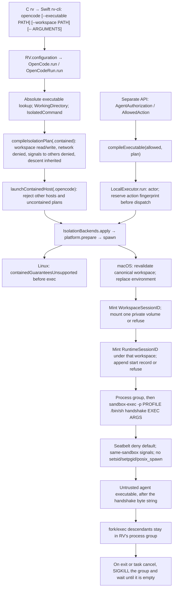

# RV runtime security boundary

Last updated: 2026-09-22. Audit base: `854e69103333a65e86deacac853f915adc450868`, with the uncommitted hardening pass described in [the acceptance matrix](runtime-acceptance.md). **Release status: NOT SATISFIED.** The implemented macOS containment is a deny-default Seatbelt scoped to the workspace, with the system paths required to start programs left readable. It is not a complete agent capability system.

## Implemented execution paths

Contained macOS launch mints a `WorkspaceSessionID` for the protected workspace and a `RuntimeSessionID` for each contained process. Neither is the hook `SessionID`, and neither launch API accepts a caller-chosen value. The workspace id is the parent of every runtime started inside it. `rv opencode` opens one workspace, runs one runtime, and closes the workspace when that process returns. A workspace can host more than one runtime; each has its own process group and admission capability, and they share the one private volume. Closing the workspace is what publishes. One runtime exiting does not. `rv <agent>` currently means the single registered `rv opencode` subcommand. Other agent hosts are not launchable through this door. The selected executable need not be a verified OpenCode binary; `--executable /bin/sh` is deliberately supported for testing. `HookHost.opencode` identifies the launch adapter, not a principal.

`LocalExecutor.perform` is an independent authorized-action API. It is not called for the OpenCode process or its tools. Agent-created descendants do not re-enter `perform`, policy evaluation or approval. Their inherited kernel restrictions are the only RV containment applied to those operations. Hook evaluation/history elsewhere in RV does not establish mediation of this process tree.

The general `IsolationBackends.apply` API still implements explicit observed/mediated execution without a sandbox. `launchContainedHost` and `LocalExecutor.run` reject these modes, and the CLI constructs contained plans. This is a restricted launch door, not proof that every use of RV's library APIs is supervised.

## Components and trust assumptions

| Component | Trust and concrete responsibility |
|---|---|
| RV CLI, `OpenCodeRun`, domain compiler, isolation backend and executor | Trusted code. Validate launch input and request the fence. They have the invoking user's ambient authority. |
| macOS kernel and `/usr/bin/sandbox-exec` | Trusted enforcement/loader path. The kernel enforces the generated write rules on the process and descendants. |
| Linux kernel, helper, dynamic loader and linked libraries | Trusted pre-isolation path. Helper must be an executable regular file named `rv-isolation-exec` outside the workspace. This is a path check, not cryptographic authentication, ownership validation or an inode-pinned launch. |
| Workspace and agent executable/arguments | Untrusted work. The host/operator deliberately selects the write root and executable. Agent-written scripts, replacements, shebangs and descendants are untrusted. |
| Parent directory tree and installed RV/helper | Assumed stable and outside adversary write authority while preparing and launching. The audit has not established protection against a same-user external attacker replacing these resources. |
| Standard handles | macOS contained spawn grants only stdio plus the handshake write end. `launchContainedHost` inherits the parent's stdin, stdout, and stderr. `LocalExecutor` and the default `apply` path point all three at `/dev/null`. The wrapper closes fd 3 before exec. Inherited stdio is still a capability to whatever resource it already references. Observed and mediated execution is unsandboxed and is not this boundary. |
| Host services, Unix sockets, system processes and credentials | Not isolated by the current capability model. OS permissions still apply; RV does not add default-deny access rules for them. |
| Hook request `SessionID` | Optional validated nonempty self-declared string, not an authenticated runtime identity. It must not become a credential/wallet authority without a new binding. |

The C frontend now locates its sibling `rv-cli` from the running executable path (`_NSGetExecutablePath` on Darwin, `/proc/self/exe` on Linux), not caller-controlled argv0 or HOME. Linux Swift helper resolution uses only the `/proc/self/exe` sibling; it has no argv0/bundle fallback on Linux. Legacy lookup is confined to the non-Linux conditional branch. Darwin/Linux C tests and the staged PATH CLI proof validate the corrected dispatch. These checks do not authenticate file ownership/content or eliminate executable replacement races.

Seatbelt still authorizes the path used in the syscall. On the tested Mac, a hard link inside the workspace to an outside inode let a sandboxed write change that outside file. RV now refuses a regular file whose link count is already above one, then mounts the workspace path on a fresh volume before any runtime starts. That volume belongs to the workspace. A second runtime does not mount again. A hard link from another device fails with `EXDEV`, including a link created by another same-user process after preflight. Copy-back runs once, when the workspace closes, and writes a saved inode only when its device, inode, and kind still match the pre-launch snapshot. Regular files and symlinks must also keep their link count. A directory's link count changes as its children are published, so that count is not directory identity. A runtime exiting does not copy anything back. A same-user `diskutil unmount force` can remove the volume; that case is not closed. Linux contained launch still does not execute.

## RV policy, RV checks and OS enforcement

**RV policy:** `Sources/RVDomain/Isolation.swift` defines closed enums and immutable plans for observed, mediated and contained modes. Contained means `.workspaceScoped(workspace)`, network `.denied`, process `.hostSignalsDenied`, and descent `.inherited`. These are isolation intentions, not authenticated per-agent capabilities. `compileIsolationPlan` is a pure function of its typed input. Backend compilation additionally resolves filesystem paths, so its output depends on the current filesystem. Landlock compilation of that plan fails closed.

**RV launch checks:** `IsolatedCommand` rejects relative/empty executables and embedded NULs in argv. Contained prepare/run checks reject `/`, nonexistent and non-directory workspaces, unsafe paths, and a caller alias retargeted between prepare and spawn. The spawn boundary replaces the environment with `PATH=/usr/bin:/bin`, `LANG=C`, `LC_ALL=C`, `HOME=<workspace>` and `TMPDIR=<workspace>`. Ambient secret values, loader variables, interpreter variables, proxy/socket references and search paths are not forwarded. A shell can add its own bookkeeping variables. This restricts inherited environment authority; it does not hide host files or network services.

**Seatbelt enforcement:** `SeatbeltProfile.swift` generates `(deny default)`. It allows `process-exec`, `process-fork`, `signal` inside the same sandbox, `sysctl-read`, `mach-lookup` denied by default with a narrow allow for `com.apple.bsd.dirhelper` only (proven necessary for SwiftPM linking; see `SeatbeltMachPolicy`), `file-read-data` of the root inode, `file-read-metadata` on `/private`, `/tmp`, `/var`, and `/Users`, and file read/map/ioctl on `/usr`, `/bin`, `/System`, `/Library`, `/dev`, plus read/write of the canonical workspace. It denies `setpgid` (syscall 82), `setsid` (147), and `posix_spawn` (244) so a descendant cannot leave the process group RV owns. `fork` and `execve` stay allowed. The granted executable is an extra literal read/map allow, including its realpath. Actual macOS tests deny ordinary outside reads and writes, symlink reads and writes, relative traversal, interpreter and shell wrappers, non-loopback TCP connect (LAN, public, metadata/link-local), UDP, Unix sockets, and DNS. Loopback TCP (127.0.0.1/::1) connect, bind, listen, and accept are allowed so contained processes can run ordinary localhost dev servers. `kill` of another test-owned process is denied. One deliberate hole: the confstr per-user temp dir is granted read-write because SwiftBuild backend tasks drop TMPDIR/TEMP/TMP and fall back to it (link temp files, test-bundle plist temp dirs); macOS isolates that dir per-user only, and outside-fence probes live under `/tmp` instead. Quotes and backslashes in profile paths are escaped; NUL, newline, and root paths fail validation. A workspace regular file with link count greater than one refuses launch. The profile also denies `file-link` and `file-clone`. The separate volume, not the scan, is what blocks a hard link created after preflight. `mach-lookup` and `mach-register` are denied by default, which also blocks XPC to host credential/security services (securityd, SecurityServer, trustd, pasteboard, and others); the cage has no ambient Keychain access. Linux does not apply this profile.

**Landlock enforcement:** none in production today — the Swift layer refuses contained launches on Linux before exec, so the C shim compiles but is never applied on a launch path. If wired, the shim would handle read-class (`READ_FILE`, `READ_DIR`) plus write-class filesystem bits, including `REFER` and `TRUNCATE`, and requires ABI 3. It sets `no_new_privs`, resolves the canonical workspace with `openat2(RESOLVE_NO_SYMLINKS | RESOLVE_NO_MAGICLINKS)`, then applies `landlock_restrict_self` before `execve`. Helper startup closes descriptors above 2 using `close_range`, failing closed if that fails. No execute/network rules, namespaces, seccomp, cgroups or PID controls are installed by RV. Docker's namespaces/seccomp/network restrictions in the audit fixture belong to Docker and are not RV guarantees. Actual Landlock enforcement was **not available** on the tested Linux kernel; only unsupported-kernel fail-closed behavior and separately labeled C setup tests were observed.

The [Linux kernel Landlock API documentation](https://docs.kernel.org/userspace-api/landlock.html) describes inherited restrictions and limitations for descriptors opened before sandboxing. It is platform background, not evidence that RV applied those controls on a supported kernel.

The code does not support a host or domain allowlist. Seatbelt's profile allows loopback TCP only: `(allow network-outbound (remote tcp "localhost:*"))` for connects, plus `(allow network-bind (local tcp "localhost:*"))` and `(allow network-inbound (local tcp "localhost:*"))` for servers. The inbound key must be `local`: at listen() time there is no remote peer, so a `remote` filter never matches and every listen fails with EPERM. Direct public HTTPS goes through the host-side egress proxy; the cage dials the proxy over loopback and cannot dial out directly.

Two loopback residuals are measured Seatbelt limits, locked in by `SeatbeltLoopbackTests`, not bugs in the rules. First, the compiler accepts only `*` or `localhost` as a network host, and in `local` position both match every bind address (filters combine with OR, and only the port part is matched), so any policy that allows loopback listen also allows bind+listen+accept on 0.0.0.0, ::, and LAN addresses: a caged process can serve the LAN, and RV cannot prevent it via Seatbelt. Outbound connect to the LAN stays denied. Second, host loopback is one shared interface with no per-workspace isolation: a runtime in another workspace, or the unsandboxed host, can connect to a caged server's port. The admission broker's one public HTTPS GET below is unchanged and is not a general network capability.

## Failure and lifecycle limits

1. Invalid commands, workspace checks and unavailable backends return typed errors before inner execution; marker tests verify the covered paths. A failed session-record write does not start the contained command. An invalid Seatbelt profile returns `seatbeltNotEstablished` and does not run the inner command.
2. A Seatbelt `IsolatedRunResult` is returned only after the in-sandbox wrapper writes a nonce on an inherited pipe. That wrapper closes the write end before exec, and the inner program sees `EBADF` on fd 3. The inner program's exit status is not that proof. `EstablishedIsolation` cannot represent contained+Landlock. A recognized `rv-isolation-exec` is refused with `containedGuaranteesUnsupported` before it runs, so a helper exit of 0 is not establishment. Linux helper exits 125/126 remain convention codes for the unused trampoline. Linux contained launch returns `containedGuaranteesUnsupported` before exec.
3. `LocalExecutor` records an action fingerprint before a potentially effectful dispatch. An ambiguous failure cannot replay the same authorization in that executor. Pre-dispatch cancellation consumes nothing. Cancellation during a contained run terminates the process group and returns `cancelled`. Another executor is a separate deduplication scope.
4. On macOS, RV places each Seatbelt process in its own process group. Cancelling one runtime kills that group and invalidates that runtime's admission channel. It does not close the workspace, kill another runtime, publish, or unmount. Closing the workspace refuses new runtimes, kills every remaining group, and does not return success while one of those groups still has a live member. A background child, a nested shell, `setsid()`, and a double-fork no longer keep workspace write authority after their runtime returns. `posix_spawn` with `POSIX_SPAWN_SETSID` is denied inside the profile because a scanner cannot see that child before it is reparented. If the RV process itself is killed with SIGKILL, this cleanup does not run, and the group can keep the mounted volume.
5. A real isolated shell was denied `kill` of a harness-owned unrelated process. It can signal processes in its own sandbox. An agent directly killing the RV supervisor or manipulating it through available IPC is not excluded by current process policy. `mach-lookup` is denied by default except `com.apple.bsd.dirhelper`. A launchctl service-submission probe exited 1 without the outside marker; its cause was inconclusive and cannot count as a kernel denial. Debugger attachment, privilege operations and host process inspection have not received sufficient probes.
6. On macOS, contained `posix_spawn` sets `POSIX_SPAWN_CLOEXEC_DEFAULT`. The child receives the selected stdio, the handshake write end on fd 3 until the trusted wrapper closes it, and two admission pipes: fd 4 for requests and fd 5 for the grant and responses. Those pipes are created by RV for that runtime, not shared with another runtime in the workspace. The Seatbelt profile does not gain a Unix-socket, localhost, or network allow. A file, socketpair, or pipe RV still holds is absent in the child (`EBADF`), including the workspace volume directory, the hidden original directory, and another runtime's admission pipes. An outside file opened by RV stays unchanged. Discarded stdio is `/dev/null`. Inherited stdio is the parent's stdin, stdout, and stderr. Linux contained launch still returns `containedGuaranteesUnsupported` before exec and does not provide this boundary.
7. Canonical path revalidation closes a demonstrated alias-retarget window. It does not pin the workspace/executable/helper inode across every subsequent race, prevent same-path directory replacement, or authenticate the helper. The direct dynamic helper can execute an injected loader constructor before `main`; production Swift spawn strips the relevant environment. An actual Linux Swift startup probe confirms the constructor marker stays absent and the unsupported kernel prevents inner execution. Positive enforcement on a supported kernel remains unproven.
8. Workspace files include `.git/hooks`, shell startup files and any RV policy/config/binary placed there. These are writable. RV does not reserve protected control-plane subpaths or prevent an outside same-user controller from consuming those files later.
9. The launch path appends a start record (runtime session id, parent workspace id, host when present, canonical workspace, backend, start time) before spawn. Workspace create and close, and runtime end, are separate lines in `~/.config/rv/workspace-sessions.jsonl`. These are not a full audit stream: no policy id, capability set, or kernel-deny events. If the workspace record cannot be written, the workspace does not become active. If the runtime start record cannot be written, that runtime is not started. A `created` line with no later `closed` line means RV did not finish closing. This chunk does not scan that log on the next start, republish, or unmount a leftover volume.
10. A contained payload can ask RV to run one shell command, or one HTTPS GET. The request travels on the admission pipes, and it must present the unguessable capability RV wrote on that pipe plus the session id RV minted for it. RV builds the `ProposedAction` from its own session record and `AgentAuthorization.decide`. Denied, pending, malformed, and evaluation failures do not run. An allowed command is spawned by RV under the same Seatbelt profile, not by the agent, and it does not receive the admission pipes. An allowed GET is performed by RV, not by the agent. The Seatbelt profile still has no network allow. The same request id or the same action fingerprint cannot run twice. If the contained process exits while that command or GET is still running, RV stops it and then kills the contained process group. When the runtime returns or is cancelled, RV closes the pipes and a later write cannot run. `HookAuthorization` and `PolicyGate` are not on this path.

    The GET is HTTPS only. RV canonicalizes the URL before policy, resolves a DNS name once, and dials one pinned address. A public address is a built-in allow. Loopback, private, link-local, unique-local, 6to4, Teredo, and other non-public answers are a built-in deny, including when a public-looking name resolves to one. Redirects are not followed. The request carries no cookies and no ambient credentials. The response body stops at 65536 bytes. The request budget is 10 seconds, of which the connect waits at most 5. Name lookup shares that budget and stops when the contained process has exited, so a stuck resolver cannot keep the process group alive. This is not MCP, a secret broker, or a general network capability.

Knowing a `RuntimeSessionID` or a `WorkspaceSessionID` is not authentication. Another local process that does not hold the pipe and the capability cannot submit the action. Runtime A's pipe cannot act as runtime B. The workspace does not have a shared capability. Admission events include the parent workspace id. HTTP stays bound to the runtime that presented its own capability; there is no workspace-wide HTTP token. A capability copied after the session is finished is rejected.

Two threats are outside this boundary. The contained agent is the untrusted caller. A same-user or root process that can kill RV, force-unmount the workspace volume, or debug RV has the same authority as the person running RV. This phase does not add anti-tamper protection against that second case. If RV itself is SIGKILLed, pipe cleanup does not run.

## Remaining work, by release impact

| Priority | Gap | Required next evidence |
|---|---|---|
| Release blocker | Default-allow reads, network, IPC and process interaction | Typed capability compiler and real negative tests for secret reads, IPv4/IPv6/TCP/UDP/DNS/Unix sockets and host processes on both supported OSes. |
| Release blocker | Runtime admission covers one shell command and one public HTTPS GET, not a full capability or audit stream | Session id alone is not a credential. The granted pipes and capability bind that action to `AgentAuthorization`. Secrets, MCP, private-network access, and a durable audit backend are still absent. |
| Release blocker | Descendants do not re-enter semantic authorization. Process-group cleanup does not run if RV is SIGKILLed | Defined OS-vs-broker boundary for tool exec. Prove cleanup when the supervisor is killed. |
| Release blocker | Same-user force-unmount of the workspace volume. Inherited stdio is still an explicit capability | Pre-existing hard links refuse launch. A post-preflight hard link onto the mounted workspace fails with `EXDEV`. Ambient descriptors other than granted stdio are closed on macOS contained spawn. |
| Release blocker | Linux helper exit codes 125/126 are still convention codes, and that path does not execute | Keep `containedGuaranteesUnsupported` until Linux can enforce the same lifetime and sandbox contract. macOS Seatbelt establishment is a pipe nonce, not the child exit status. |
| Release blocker | Linux enforcement unproven; no process/network boundary | Actual Landlock ABI >= 3 Linux host and CI/container runs; fail-closed required namespaces/seccomp if those become the selected mechanisms. |
| Important hardening | Filesystem path/executable/helper replacement races and helper provenance | Inode-stable grant/launch design and adversarial race tests; trusted ownership/install validation. |
| Important hardening | TMPDIR/HOME mapped to workspace; broad shared write root | Deliberate temporary-directory permissions and cleanup tests; protected control-plane paths. |
| Important hardening | CLI compatibility under minimal environment and platform packaging | Real OpenCode interactive smoke test with explicit credential/network requirements; packaged Linux launcher test. |
| Future enhancement | Central enterprise ingestion and additional agent adapters | Build on authenticated identity and typed audit events after blockers are closed. Secrets, MCP credentials and wallets remain out of scope for this pass. |

See [the criterion matrix](runtime-acceptance.md), [the attack inventory](adversarial-inventory.md), and the appended [phase-10 completion notes](../rv-agent/handoffs/phase-10-contained-host-launch.md).

## Phase addenda (phases 1-7)

The per-phase addenda below were merged into this file directly; no standalone note files exist.

### Phase 1 boundary note: policy revision history

Phase 1 adds an append-only revision log for the machine and repo policy
documents. It does not change enforcement: restrict-only merge and strict-wins
keep their existing semantics, and every save still fails closed on lock or
encode errors.

#### What changed

- Each `policy.toml` save appends one JSON line to a revision log:
  `policy-revisions.jsonl` beside the machine file, and a per-workspace
  `repo-revisions-<sha16>.jsonl` in the machine config dir for the repo
  layer. (The repo log no longer lives at `.rv/policy-revisions.jsonl`
  inside the caged workspace; see the integration seam addendum.) The
  append happens under the same exclusive file lock as the document
  write, so generation numbers stay monotonic.
- Each entry carries a monotonic `revision`, a deterministic content `hash`,
  `rule_count`, `recorded_at`, and the full document TOML. A save whose hash
  matches the head records nothing: the head already is that document.
  Machine readers verify every metadata field: the HMAC chain seals TOML
  plus a record timestamp, so a forged `recorded_at` refuses `logCorrupted`,
  and `rule_count` is recounted from the line's own TOML on every read
  (both layers). Repo `recorded_at` has no sealed counterpart and stays
  unverified display — the documented same-uid-forge residual.
- Rollback is re-submission, never a rewrite: `rollback(layer:to:)` parses an
  earlier entry's TOML and saves it as a new head revision. Earlier log lines
  are byte-identical before and after.
- `rv policy list [--repo]` prints one layer's log, oldest first.
  `rv policy show` keeps its per-layer base output by default and with
  `--base`; `--effective` shows the restrict-only merged rules instead, and
  both flags together show base sections followed by the effective section.
  Robot mode mirrors the same split (`builtin`/`machine`/`repo` versus
  `effective`).

#### OpenShell mirrors

- Deterministic policy identity follows OpenShell's `canonical_rule_bytes`
  discipline: each rule encodes to a canonical string, rules sort before
  hashing, and `english` provenance is excluded, so rule order and commentary
  never change the hash.
- The monotonic revision per layer plays the role of OpenShell's installation
  `revision` / policy generation guard: list and rollback name generations,
  and rollback moves the head forward rather than rewinding it.
- Unlike OpenShell's 8-retained-generations cache, the durable log is never
  truncated in this phase; retention policy is later work.

#### Limits

- The log records document saves only. Approval, draft review, and who saved
  are not recorded here.
- There is no CLI rollback subcommand yet; rollback is a workspace/store API
  for a later phase to expose behind owner authorization.
- This section is the merged phase 1 addendum; the revision log carries no cryptographic authentication, so a same-user writer can forge entries — forged lines fail closed on read (revision sequence and content hash are re-verified), but a corrupt log blocks saves until repaired.

### Phase 2 boundary note: policy diff risk checks

Phase 2 adds a deterministic risk evaluator over policy diffs
(`Sources/RVPolicy/PolicyDiffRisk.swift`) and wires it into `policy apply`
preview and `policy validate` (`Sources/RVCLI/Commands/PolicyCommand.swift`
only).

#### What it flags

Evaluated over old-vs-new `PolicyDocument` plus old-vs-new `PolicyNetworkScope`:

- Blocking: new destinations in private (`10/8`, `172.16/12`, `192.168/16`,
  `fc00::/7`), link-local (`169.254/16`, `fe80::/10`), loopback
  (`127/8`, `::1`, `localhost`), or cloud-metadata
  (`169.254.169.254`, `100.100.100.200`, `metadata.google.internal`) ranges.
- Blocking: credential-bearing endpoints (`userinfo@` in the authority).
  Findings name the host only; userinfo is never echoed.
- Blocking: unparseable destination entries and binary wildcards (`*`).
- Blocking: safety downgrades (`strict` to anything else, including unset)
  and verdict relaxations on an existing predicate (same allow < ask < deny
  rank as merge).
- Advisory: new public destinations, new binary identities, new allow-verdict
  rules, and new `secret.allow_paths` exemptions.
- Blocking: removal of a deny- or ask-verdict rule under full-document
  (`evaluate`) replacement semantics. Partial-share checks (`evaluateShare`)
  never treat an omission as a removal.

IPv4 matching covers `inet_aton` number forms — 32-bit decimal words
(`2130706433`), `0x` hex, leading-`0` octal, short forms (`127.1`), and
hex/octal parts inside a quad — so numeric loopback/LAN aliases cannot
classify as public.

Only additions and relaxations are flagged; entries present on both sides are
accepted as already reviewed. Reports are deduplicated and sorted by
`(kind, detail)`, so identical diffs always produce identical output.

#### CLI wiring

- `policy apply` preview prints a `risk:` section (`risk: none` when clean).
  The preview diffs the share ask against the layer (`evaluateShare`), not
  the post-merge outcome: the merge keeps the tighter verdict and preserves
  the layer's safety level, so an outcome diff could never flag a
  relaxation. A share that asks to weaken an existing rule is a blocking
  `verdict-relaxed` finding and `--save` refuses with `blocked by policy
  risk findings`, even though the merge itself would neutralize it.
- `policy validate` prints finding lines when present, stays silent on clean
  success, and exits 2 on blocking findings. A share file is checked as an
  adoption candidate against the machine layer (the default apply target);
  the machine file itself is checked standalone against an empty baseline.
  Parse failures keep their original errors and messages; risk never masks
  an invalid file.

#### Fail-closed

`PolicyDiffRisk.evaluate(oldText:newText:)` throws
`unparseableDiff(side:)` when either side does not parse; CLI paths already
fail on unparseable files and now also refuse to save/validate on blocking
findings.

#### OpenShell mirrors

- Per-binary rule shape: destinations and binary identities are separate
  evaluated sets (`endpoint_allowed` + `binary_allowed`).
- Canonical deterministic output, mirroring `canonical_rule_bytes`.
- TOFU posture: first appearance of a destination/binary is the decision
  point; pre-existing entries are not re-flagged.
- Credentials stay out of findings and logs, mirroring supervisor-held
  secrets.

#### Known limits

- `PolicyDocument` carries no network plane yet, so CLI callers pass empty
  scopes; destination/binary checks run only for direct API callers until a
  later phase adds the plane to the document.
- IPv4-mapped IPv6 literals (`::ffff:10.0.0.1`) are not classified as
  sensitive; bare `::1` and hextet-prefix checks cover the common forms.
- Binary removals are treated as narrowing and are not flagged.

### Phase 3 boundary note: per-binary egress

Probe verdict followed: per-runtime proxy instances are sound; Unix-socket
`getpeereid` attribution from the cage is unsound (the cage cannot reach a
Unix listener without opening every host socket, and TCP loopback carries
no peer credentials). This phase therefore implements attribution as the
proxy instance, not the connection. No PID lookup was invented.

#### What was built

- `EgressBinaryRule` (`Sources/RVDomain/EgressPolicy.swift`): strictly
  canonical absolute paths (no `//`, `.`, `..`, trailing slash, or NUL).
- `EgressBinaryAdmission.resolve`: one-time absolute-path resolution at
  admission (standardize + resolve symlinks), so rules name the real
  executable rather than a swingable link.
- `EgressBinaryPolicy`: the OpenShell `binary_allowed` half of
  `network_policy_for_request = endpoint_allowed + binary_allowed`. Empty
  means host-level rules only; the legacy shared per-workspace-host
  instance behaves exactly as before. `sortedRules` keeps audit order
  deterministic (matched rule is the minimum).
- `EgressBinaryPinCache`: trust-on-first-use SHA-256 pin a la OpenShell
  `BinaryIdentityCache`, over the project-approved `RVDigest` core.
  First use pins the golden hash; a changed fingerprint rehashes; a
  changed hash denies without moving the pin; identical rewrites only
  refresh the fingerprint. Cap 4096 paths; past the cap, new paths
  refuse and fail closed. One cache per proxy instance.
- `EgressProxy` gate (`Sources/RVIsolation/EgressProxy.swift`): every
  parsed CONNECT and absolute-URI request passes the binary gate before
  the endpoint policy. Unbound instance under a binary-scoped policy
  denies `unattributed-peer`; unadmitted binary, broken pin, unreadable
  binary, or refused pin denies `binary-mismatch`. Denials record the
  observed binary path in `egress-denials.jsonl` (`"binary"` key, present
  only for binary-scope denials). Malformed requests still deny as
  `malformed`: they carry no destination to audit.

#### Log-format change

`EgressDenialReason` gains `binary-mismatch` and `unattributed-peer`,
and denials gain an optional `binary` field. The pinned-spellings test
was extended; out-of-repo `egress-denials.jsonl` readers must tolerate
both the new reasons and the new key.

#### Explicitly not done (follow-up, out of phase-3 surfaces)

- Supervisor wiring (updated by the per-runtime proxy work in this same
  change): `WorkspaceSessionSupervisor` now mints one credentialed
  `EgressProxy` per runtime at the spawn seam, each carrying that
  runtime's own grant. What remains unwired is binary scope: production
  construction passes no `EgressBinaryPolicy`/`EgressRuntimeAttribution`,
  so pin verification is enforced only where a caller constructs a bound
  proxy (tests do). Note the live-approval supplement is likewise not
  enforced on credentialed instances yet (see the Phase 4 addendum and
  `EgressProxy.supplementAdmits`); approvals pend rather than load.
- No per-connection PID or executable attribution exists and none is
  planned: TCP loopback offers no credential path, and opening Unix
  domain egress to the cage would expose every host socket.
- Pins are per-proxy-instance (in-memory TOFU). A restarted proxy
  re-pins on first use; there is no cross-restart golden store.
  Fix-forward (T1, 2026-10-10): `EgressBinaryPinCache` gains
  admission-time `admit` (golden before first connect),
  policy-authored `pinExpected` (64-hex digest, never overwrites),
  and strict `verifyAdmitted` (unknown paths deny `.unreadable`
  without pinning); plain `verify()` TOFU behavior is preserved and
  restart still requires re-admission. See “Residual tickets”.

### Phase 4 boundary note: live network updates + review queue

#### What shipped

Blocked CONNECTs produce scoped proposals on the shared pending-approval
review queue; a human approves or denies them; approvals load into the
running egress proxy without restart. Filesystem and process posture stay
startup-fixed: the live channel carries exact `host:port` rules only, and
the seatbelt profile is untouched.

#### Mechanism

- Intake: the workspace supervisor's proxy denial closure chains review
  intake ahead of the production denial log (chained, never replaced).
  Only `.deniedPolicy` denials mint proposals; DNS, filter, dial,
  header, and malformed failures admit no rule and are ignored.
- Proposal: one `PendingApprovalStore` row per blocked `host:port`, reused
  from the existing approval system (no parallel queue). Fingerprint
  `egress:<canonical-host>:<port>`; reason `.mandatoryHuman`;
  timeout `.autoDeny`; continuation `.retry(fingerprint)`. Ledger dedupe
  (workspace identity + fingerprint) collapses retry storms.
- Approval: the supervisor's `NetworkReviewQueue` sweep (2s applier plus
  opportunistic checks) loads `allowOnce`/`createRule` rows into a
  generation-guarded channel and pushes the set to the proxy. The proxy
  applies only newer generations (OpenShell generation-guard mirror);
  stale or reordered pushes are ignored. Deny/expire/cancel/timeout rows
  apply nothing, ever.
- Single-application rides the existing `EphemeralAllowOnceTable`
  (unmodified): one approval id plants at most once per epoch, and
  `alreadyRedeemed` skips duplicates. Marker grants use raw
  `egress:...` fingerprints, which can never collide with hashed
  command-view grants and are unspendable through `consume`.
- Rejection carries reason: `resolveWithReason` requires a single-line,
  bounded reason for every deny (validated before the resolve CAS) and
  records it in a `pending-rejection-reasons.jsonl` sidecar; approvals
  with a reason are rejected as caller errors.
- CLI: `rv egress pending|show|approve|deny|denials` (pretty + `--json`).
  Reads work today. Mutations are implemented behind
  `LocalControlBoundary` like every other local control mutation: they
  refuse until authenticated service routes land. The ceremony (TTY +
  device-owner authentication + TOCTOU re-read) mirrors the allow-once
  redeem tripwire.

#### Trust analysis

- The cage cannot forge approvals: the seatbelt profile denies contained
  processes the config directory, so only host-side writers resolve rows.
- A same-user host process can already rewrite every static policy file
  (`allowlist.toml`, typed rules), so file-signal approvals add no
  privilege beyond existing config trust. The `LocalControlBoundary`
  transition moves approval authority into authenticated service routes.
- Exact-row bind: the applier re-parses the rule strictly from the loaded
  row and requires it to equal the intake key, so a file swap after
  approval fails closed (pinned by `driftedRowFailsClosed`).
- Supplement admissions always dial the filtered external path, and
  supplement rules are DNS-only by construction (IP literals and
  single-label names are unrepresentable), so a live rule cannot open
  loopback, LAN, or metadata endpoints.
- Live rules are supervisor-lifetime-ephemeral (fail closed on restart,
  like the allow-once epoch). Durable network policy stays the static
  allowlist file; `createRule` approvals load live but do not persist.

#### Known limitations (later phases)

- Network proposals carry a synthetic workspace-scoped identity
  (`egress:<workspace-uuid>`); the agent slot is a fixed mechanical
  binding, never displayed. A dedicated principal case needs an
  RVDomain `HookHost` change (exhaustive switches).
- Network proposals ride effect-only `ShellAction` rows under the
  collision-free `egress:` fingerprint namespace. A dedicated
  `ProposedAction` case needs an RVDomain change.
- `SessionSupervisor.swift` and `EphemeralAllowOnceTable.swift` were
  deliberately left unmodified: no per-spawn change was needed, and the
  table was reused as-is.
- One minimal seam outside the listed surfaces was required and is
  disclosed: `EgressProxy.swift` gained a lock-guarded live supplement
  (`updateSupplement` + generation guard, ~25 lines). Without it, "loads
  live" is unimplementable — proxy rotation would break live children.
- Operator-UI/TUI review views do not render network proposals yet; the
  CLI is the review surface.

#### Verification

- `swift test --filter EgressProposalTests` — 11 pass (rule validation,
  fingerprint round-trip/drift, human-by-default shape, channel
  additive/cap, reason sidecar incl. deny-requires-reason).
- `swift test --filter NetworkReviewQueueTests` — 9 pass (intake scope,
  dedupe, live-skip, apply-once, deny-applies-nothing, drift fail-closed,
  live proxy end-to-end, stale-push ignored).
- `swift test --filter EgressReviewTests` — 10 pass (pending/show,
  state text, pretty/robot, denials-log parsing, TOCTOU helper,
  boundary refusal for approve/deny).
- Regression: `EgressProxyTests` (13), `PendingApprovalStoreTests` (15),
  `HTTPEgress` suites — all pass.
- Binary smoke on an isolated HOME: `rv egress pending|denials` render
  correctly (pretty + `--json`, corrupt lines dropped); `rv egress
  approve` refuses at the transitional boundary as designed.

### Phase 5 boundary note: credential broker

This section is the merged phase 5 addendum.
Surfaces: `Sources/RVIsolation/ContainedEnvironmentPolicy.swift`, admission
broker pipes (`Sources/RVIsolation/RuntimeAdmission.swift`), the two test
files below. No wire-type, codec, gate, connector, spawn, or proxy changes.

#### What landed

- **Credential class, deny-by-default** (`ContainedEnvironmentPolicy`).
  `isCredentialClass(_:)` names the broker-owned set (secret tokens,
  `AUTHORIZATION`/`PRIVATE_KEY` infixes, agent-socket and credential-file
  exact names). The projection drops the class before the legacy denylist;
  every class member is also denied there, so the deny survives either
  table drifting. Detection stays token-based on purpose:
  `TOKENIZERS_PARALLELISM` and `KEYNOTE` are toolchain names, not
  credentials, and keep passing.
- **Supervisor-side broker** (`ContainedCredentialBroker`, in
  `RuntimeAdmission.swift`). Secret values live in host memory and resolve
  only when endpoint routing names a credential AND that credential
  approves the host; either side missing withholds. No credential wire
  type exists, so the cage cannot address credentials at all.
- **Mediation over the existing pipes.** A grant is exercised when the
  cage's ordinary HTTP request rides the admission pipes: the gate's
  capability binding and replay protection apply unchanged, and the
  session consults the broker only for gate-authorized HTTP actions
  before performing them. Denied, pending, and shell actions never
  consult, so an unauthenticated cage learns nothing about broker state.
  The broker never widens or narrows the action's own allow/deny.
- **Prepared environment.** The broker mints only non-secret entries
  (selectors, `rv-brokered:<name>@<revision>` placeholders that carry
  the name and revision only); `project(host:brokerPrepared:)` applies
  them after the strip and drops non-class names, malformed names,
  insane values, and duplicates fail-closed.
- **Names-only audit.** Each consultation records one evidence event —
  `credentialGranted:<name>`, `credentialUnwired:<name>`, or
  `credentialWithheld:<reason>` — carrying names and hosts only.

#### OpenShell mapping (prior result 3)

`provider_credentials.rs`: SecretResolver stays in the supervisor; only
prepared child env crosses. `proxy.rs`: injection happens for approved
destinations on the supervisor side. Revision distinguishes configured
generations for audit. Per-runtime proxy scoping (prior result 2) and
loopback/shared-tmp findings (prior result 4) are sibling-phase scope.

#### Explicit non-goals and seams

- Transport-byte delivery (`Authorization` header in the direct dialer /
  proxy) is not wired: with no `credentialDelivery` hook the grant is
  dropped fail-closed and audited as `credentialUnwired`. The egress
  phase owns that seam; the hook signature is the contract.
  Fix-forward (T5, 2026-10-10): the seam is now wired for
  `.direct` (exactly one `Authorization` header in the authorized
  request bytes) and the new `.effectWithCredential` (injection
  passed as an argument, caller transfers); legacy `.effect` keeps
  the hook tap and still drops fail-closed as `credentialUnwired`
  when unwired. Byte-exact emission with a CTL/DEL credential guard
  (UTF-8 scan, zero bytes written on reject). See “Residual tickets”.
- The pre-broker `AgentHomeStaging` compat passthrough is untouched;
  spawn wiring applies broker entries when that phase lands.
- Principal binding is orthogonal: the broker serves authorized actions
  on either door and releases no secret to any principal, so the F3
  identity-door rule for secrets-to-cage flows does not apply. A future
  policy may add a `principalRequired` withheld reason.
- `project()` validates entry shape, not secrecy; secrecy holds because
  only the broker mints entries and it never mints secret values.

#### Verification

- `swift test --filter "RuntimeCredentialBroker"` — 11/11 pass (grant /
  withhold / unwired, binding + replay, no-consult on denied, real-pipe
  bytes, JSONL names-only, resolve unit, class + toolchain + prepared).
- `swift test --filter "RuntimeAdmission|RuntimeCredentialBroker"` —
  22/22 pass (existing admission suite unbroken).
- `ContainedRuntimeEnvironmentTests` additions
  (`cagedEnvironmentDeniesCredentialClassByDefault`,
  `cagedEnvironmentKeepsToolchainSelectors`) pass with the existing file.
- Full `RVIsolationTests`: 591 tests, 3 failures, all reproduced on the
  untouched base (`git stash` check): two `IdentityAmbientCredential`
  tests missing `/usr/libexec/swift/pm/swiftpm-testing-helper`, and
  `containedProcessReachesLoopbackOnly`. No regressions from this phase.

### Phase 6 boundary note: Linux contained slice (read rules + host-proxy egress model)

This section extends the "Landlock enforcement" section above; it does not change the release status.

#### What phase 6 adds

- Read-class compile: `LandlockAccessFS.readClass` pins the UAPI
  `READ_FILE | READ_DIR` bits, and `compileFirstSliceLandlock` carries them
  as `LandlockRuleset.handledReadAccess` alongside the write class.
- The C shim (`landlock_apply.c`) handles `RV_LANDLOCK_HANDLED_FS`
  (read + write) beneath the workspace instead of the write class alone.
  ABI < 3 still fail-closes, and the entry-point signature is unchanged.
- Host-proxy egress model: `LandlockEgress` is `.denied` today, with a
  `.hostProxy(loopbackPort:)` case that pins the target shape only. The
  shape mirrors the OpenShell supervisor-network pattern: one
  supervisor-owned loopback CONNECT proxy per runtime, policy evaluation
  and credentials staying in the supervisor, and no Unix-socket egress
  (a Unix allow would expose every host socket). The case carries a port
  only, so a LAN or public dial is unrepresentable.

#### What still refuses

`compileLandlockRuleset` returns `containedGuaranteesUnsupported` for every
contained plan, before exec, exactly as before. Read grants compile but the
system read-only layer (`/usr`, `/lib`, loader), EXECUTE, network, and
process guarantees are still unenforced, and the shim stays unreachable
from production launch.

#### Open gaps (not proven here)

- No supported-kernel run: this phase was built and unit-tested on macOS;
  the Linux-only containment tests (including the new read-refusal probes)
  and the Linux shim body still need an ABI >= 3 host.
  Fix-forward (T8, 2026-10-10): CI now probes the runner Landlock ABI
  before Swift tests and fails closed when the ABI is unmeasurable;
  `LandlockContainmentTests` pins refusal regardless of ABI plus the
  ABI-branched trampoline exit (126 iff ABI >= 3 else 125, neither
  minting establishment). First live CI probe run still pending. See
  “Residual tickets”.
- Host-proxy enforcement needs Landlock net rules (ABI 4+) or a net
  namespace plus a per-runtime proxy lifecycle; only the endpoint shape
  exists so far.

### Phase 7 residuals: verdicts and accepted risks

Date: 2026-10-09. Darwin 27.0.0, Swift 6.4. This section is the merged
phase 7 record; the R1–R4 rows live here.

#### Verdicts

| Residual | Verdict | Lock-in test |
|---|---|---|
| R1 LAN-listen overbroad | Downgrade: accepted risk | `nonLoopbackBindIsNotScopedBySeatbelt` (existing) |
| R2 shared loopback | Downgrade: accepted risk | `crossWorkspaceLoopbackIsShared` (existing) |
| R3 per-user tmp readability | Downgrade: accepted risk, re-affirmed (T11) | `containedChildReadsPlantedPerUserTmpFile` + `siblingTmpOutsideWorkspaceStaysContentDenied` (new) + `SeatbeltR3TmpPostureTests` (4) |
| R4 host process visibility | Fix landed, SHIP-BLOCKED (T9cutover breaks caged linking; see R4) | `containedProcessListSeesHostButCannotSignalIt` (strict-open pin of the documented hole post-revert; deny side pinned by the experiment suite) |
| Loopback-port narrowing | Not attempted: provably unsound, no code change | n/a (see proof below) |

No allow was added and no deny was removed or weakened by phase 7
itself. Fix-forward note (F2, after this section was written):
`Sources/RVIsolation/SeatbeltProfile.swift` has since changed — the
`AgentHomeStaging.credentialLinks` symlinks and the api-key
re-injection are now gated behind `CredentialDelivery` flags that
default closed, so no live keys or credential files reach the cage
unless the operator explicitly opts in. The R1–R4 verdicts below are
unaffected.

#### R1: LAN-listen overbroad — accepted risk

Measured fact (unchanged): any policy that allows loopback listen also
allows bind+listen+accept on 0.0.0.0, ::, and LAN addresses. Platform
limit: the SBPL compiler accepts only `*` or `localhost` as a network
host; in `local` position both match every bind address, filters within
one rule combine with OR, and only the port part is matched
(`SeatbeltProfile.allowingLoopbackBind`). There is no Seatbelt spelling
that allows loopback listen while denying LAN listen.

Mitigations in place: outbound connect to LAN/public/metadata stays
denied with EPERM (`loopbackOnlyConnectMatrix`); external egress goes
through the host-side policy-evaluated proxy, never direct dial; runtime
cancel and workspace close kill caged servers and free their ports
(I/J/K tests). Accepted risk: a caged process can serve the LAN.
Operators must treat caged listen ports as LAN-reachable.

#### R2: shared loopback — accepted risk

Measured fact (unchanged): host loopback is one shared interface. A
runtime in another workspace, or the unsandboxed host, can connect to a
caged server's port (`crossWorkspaceLoopbackIsShared`). Platform limit:
macOS has no per-workspace network namespace and Seatbelt has no
per-workspace loopback scoping. Mitigations: port collision fails safe
with EADDRINUSE (`portCollisionFailsWithEADDRINUSE`); lifecycle teardown
kills servers (I/J/K). Note: per-runtime egress-proxy instances isolate
mediated traffic per runtime but do not isolate raw loopback servers;
do not confuse the two. Accepted risk: no cross-workspace loopback
isolation for caged servers.

#### R3: per-user tmp readability — accepted risk

New live evidence: a contained child reads a file planted by another
same-user process in the confstr per-user temp dir
(`containedChildReadsPlantedPerUserTmpFile`), closing the prior
"profile-text only" gap. Scope control: a file under the shared `/tmp`
root but outside the workspace stays content-denied
(`siblingTmpOutsideWorkspaceStaysContentDenied`), which is why
outside-fence probes live there. Platform limit: macOS isolates the
confstr temp dir per-user only — every process the user runs can
already read it — and SwiftBuild backend tasks drop TMPDIR/TEMP/TMP,
forcing the `(allow file-read* file-write* (subpath systemTmp))` grant
for link temp files and test-bundle plist processing. Accepted risk:
same-user transient temp is readable from the cage; persistent secrets
(home, keychains, caches) stay denied. Narrow or remove the grant when
SwiftPM propagates the temp vars to SwiftBuild tasks. Review note: a
later adversarial pass claimed this doc describes the grant as
read-only; verified false — code comment, SBPL, and this section all
say read-write. Posture re-affirmed (T11, 2026-10-10): narrowing
rejected on measured grounds (write-only breaks test-bundle
read-back, subdir breaks SwiftBuild temp names, Seatbelt subpath is
prefix-only) and dedicated uid DEFERRED per T10, so the grant stands
as explicit accepted risk with operator guidance in the code
comment; SBPL bytes unchanged. Verification:
`SeatbeltR3TmpPostureTests` 4/4 (shape/scope/escape/resolver pins)
plus the live R3 pins re-run green inside `SeatbeltLoopbackTests`
18/18.

#### R4: host process visibility — accepted risk

New live evidence from a caged sysctl/libproc probe
(`containedProcessListSeesHostButCannotSignalIt`): raw sysctl
KERN_PROC_ALL returns the host table (1222 entries, pid 1 comm
launchd), and proc_listpids succeeds; proc_pidinfo on pid 1 fails with
EPERM, and `kill -0 1` fails under the same-sandbox signal allow.
Boundary shape: listing (pid + comm) visible, per-pid detail and
signaling denied. Two incidental tool failures must not be mistaken for
hiding: `/bin/ps` cannot exec (exit 126, EPERM) only because it is
setuid root, and `pgrep` finds nothing because it needs the denied
per-pid detail. Platform limit: no per-sandbox PID namespace; the
coarse `(allow sysctl-read)` toolchains require stays allowed.
Per-MIB narrowing was not attempted: it is outside the phase-7 profile
surface (loopback-port narrowing only) and would need measured
toolchain-MIB coverage to be provably sound. Accepted risk: a caged
process can enumerate host pids and command names but cannot inspect or
signal host processes beyond that. WIDENED (measured 2026-10-10,
Darwin 27): KERN_PROCARGS2 content reads back for same-user host
processes — the caged probe retrieved the full 9228-byte args+env
block of the unsandboxed host test runner
(`containedProcessListSeesHostButCannotSignalIt`, `hostpid-args read
bytes=`), while pid 1 stays denied (errno 22) and the self-read
control passes. R4 is therefore argv+env disclosure of same-user
host processes, not pid+comm enumeration: host process
environments (which routinely carry API keys) are readable from
the cage. Seatbelt cannot close this: measured 2026-10-10, a probe
run under `(allow default) (deny sysctl-read)` still retrieved
another process's full args+env block (`PPID-ARGS read bytes=229`)
while `hw.ncpu` denied (errno 1, proving the deny was live) —
KERN_PROCARGS2 is not mediated by Seatbelt's `sysctl-read`
operation at all, so neither a full deny nor per-MIB filtering can
reach it. The only macOS fix is running the cage as a different
uid (needs a privileged helper); the complete fix is Linux pid
namespaces. Content is never printed by probes (byte counts only). Fix-forward (T9,
2026-10-10): per-MIB narrowing is now measured viable — the
tests-only `.perMIBExperiment` posture (deny-first sysctl plus
same-sandbox pidinfo, both halves required) denies host procargs,
keeps self reads and the toolchain smoke green, while the default
profile stays byte-identical; T10 (2026-10-10) decided SHIP per-MIB on macOS (uid deferred, pid-ns future). See
“Residual tickets”. Cutover LANDED (T9cutover, phase-3
integration, 2026-10-10): per-MIB is the default and only shape,
the flag is removed, and the OPEN HOLE assertion is flipped to
deny-only with the sysctl table channel pinned hidden
(`sysctl-size errno=`, no `sysctl-saw-pid1=`); `proc_listpids`
still enumerates host pids (pid only, no comm — unchanged policy).
SHIPPED-BUT-BLOCKED the same day: deny-first sysctl breaks native
linking AND two common tools inside the cage. (a) `ld` aborts in
`UnsafeHeaderWriter` (page-alignment assertion) for every `swift
build`, `swiftc`, and `clang` link
(`swiftBuildSucceedsWithHardenedMachPolicy` red). (b) `/bin/zsh
-c` dies silently at startup and `xargs` aborts with
`sysconf(_SC_ARG_MAX) failed`
(`descendantsCannotWriteOutsideWorkspace` .zsh/.xargs cases red) —
and the cage default `SHELL` is `/bin/zsh`, so interactive caged
shells are broken too. All bisected to the cutover patch exactly
(reversed = green, applied = red), and the link break to the
sysctl-deny half (pidinfo half removed = still red). Tool-by-tool
cause: `xargs` needs `kern.argmax` (proven: adding only that leaf
revives it; it is allowlistable via MIB too) — fix candidate #1
for the gate owner, one leaf plus the standing host-denial
re-verification. `ld` and `zsh` survive an 1895-name
allow-everything profile (entire enumerable OID space plus the
unenumerated `hw.machine`/`hw.model`), so each hits either an
unmapped MIB or an unknown-unenumerated name: the sandbox
MIB→name mapping is provably incomplete (raw
`sysctl({CTL_HW, HW_PAGESIZE})` denies EPERM even with
`hw.pagesize` allowlisted, while `sysctlbyname` passes; leading
`ld` candidate, consistent with the page-alignment crash site but
unobserved — library validation blocks DYLD interposition),
and `sysctl -a` omits queryable names. Gate-owner work (T9): add
`kern.argmax` under the gate, then identify the `ld`/`zsh` fatal
queries with root tracing (`dtruss`) or widen deliberately; until
then three repo tests stay red and the T10 ship matrix (`swift
build` green) is unmet. Standalone 30-second repros: `sandbox-exec`
with `(allow default)` + `(deny sysctl-read)` + the 7 shipped
`sysctl-name` allows, then `clang hello.c` (`ld` aborts),
`/bin/zsh -c 'echo hi'` (silent), or `echo f | xargs echo`
(`_SC_ARG_MAX` failure). REVERTED the same day (fixup pass):
fix-forward is blocked — the fatal queries are unidentified (no
passwordless sudo for `dtruss`, the `sandboxd` unified log is
silent, and guessing allowlist leaves would weaken the fence
blindly) — so the default is coarse again (flag restored, OPEN
HOLE assertion restored with fresh measurements: 614952 size-query bytes /
944 fetched entries (separate sysctl calls — table churn
between them legitimately differs) including pid 1 `launchd`,
9164-byte same-user host argv+env, pid 1 errno 22, self green;
content never printed). Causation was bisected exactly (cutover reversed =
`descendantsCannotWriteOutsideWorkspace` 8/8 + Mach swift-build
green; applied = red) and the revert re-greens everything
(`SeatbeltLoopbackTests` 18/18,
`SeatbeltPerMIBExperimentTests` 4/4, Mach 11/11, Adversarial
20/20). R4 is OPEN on the default profile; the per-MIB
experiment stays green as the proven landing shape. Residual:
identify the toolchain leaves (root `dtruss` or Apple docs), add
them under the host-denial gate, re-land.

#### Why loopback-port narrowing is unsound (no code change)

1. The productive contract requires ephemeral (port-0) binds: every
   server test, the Python/Node fixtures, and the literal
   `http.server 0` CLI bind port 0. The profile compiles before spawn
   and cannot name kernel-assigned ports; a static port allowlist
   breaks all of them.
2. Address matching is broken, so a port-scoped rule still allows LAN
   bind on that port: narrowing fixes neither R1 nor R2.
3. Narrowing the connect side breaks contained dev-server clients
   (curl to 127.0.0.1:$ephemeral), which the contract requires.
4. Filters combine with OR, so narrowing means removing the
   `localhost:*` rules — there is no additive restriction.

#### OpenShell patterns mirrored

- Host-side policy-evaluated egress proxy (per-CONNECT decision) is
  RV's analogue of OpenShell's CONNECT proxy with per-request OPA
  evaluation; direct egress stays denied at the Seatbelt layer.
- The admission capability on per-runtime pipes (runtime A's pipe
  cannot act as runtime B) mirrors OpenShell's process-identity
  binding of proxy decisions.
- Downgrade posture is fail-closed: every residual keeps its deny,
  locks the behavior in a test that flips on platform change, and
  documents the accepted risk — no silent widening, mirroring
  fail-closed policy generations.
- Not mirrored: per-binary network policy (RV intentionally keeps
  loopback open for dev servers) and TOFU binary pinning (no
  equivalent host-process threat in this phase's scope).

#### Verification

`swift test --filter SeatbeltLoopbackTests`: 18/18 pass (15 existing +
3 new), Darwin 27.0.0. Changed surfaces: this section and
`Tests/RVIsolationTests/SeatbeltLoopbackTests.swift` (new
`SeatbeltPhase7Residuals` suite only).

## Fix addenda (F1–F4 + integration seam)

Each fix below was built in an isolated worktree against base `04b4740c`
and merged into the phase-work tree by the integrator. Per-fix notes
(`docs/security/fix*-boundary-note.md`) were folded into this section
and deleted. F5 produced no fix output (its surfaces exist only in
uncommitted phase work) and is carried as unresolved; see the seam
section.

### Fix F1: machine revision-log integrity (HMAC chain + sealed tip)

`TypedRuleStore` seals every machine `policy.toml` save into an
HMAC-chained log (`RVPolicyPaths.policyRevisionLog*`) alongside the
phase-1 JSONL history (dual-write; both logs validate before the
document moves):

- Log: `policy-revisions.log` (JSONL). Each record seals
  `HMAC-SHA256(key, "rv-policy-log/v1" || revision || prev || toml-bytes)`.
- Key: `.policy-revisions.key`, 32 random bytes, 0600, minted once per
  config dir on the first sealed save. Never minted over an existing log.
- Tip: `.policy-revisions.tip`, a MAC-sealed `{revision, tip-mac}` pin.
  A bare chain cannot detect a dropped tail (a prefix still verifies);
  the tip makes truncation fail closed.
- Every history/rollback read re-verifies the full chain plus the tip.
  Rollback restores byte-exact verified TOML and seals the restore as a
  new head; unverifiable targets are refused without touching
  `policy.toml`.

Decisions: loads stay documented direct-edit (enforcement never depends
on history availability); `policy.toml` without its log is the
deleted-log state (`logMissing` on save/history/rollback, never silent
re-mint — only explicit `reinitializeMachineLog()` recovers, refusing
unparseable state). The F1 worktree assumed no repo log; the merged
tree keeps the phase-1 repo log but relocated out of the caged
workspace (see the seam section), so the caged-writer-via-rollback
vector stays closed.

Threat closure (each proven in `PolicyRevisionLogTests`): forged
record / forged MAC / reordered lines / truncated tail / missing key /
save-over-forgery fail closed with `logCorrupted`; the forged-payload
test splices attacker TOML into a record and asserts rollback refuses
and the bytes never reach `policy.toml`; deletion fails closed on all
three paths with disk untouched.

Residuals: a crash between the log rewrite and the tip rewrite fails
closed as `logCorrupted` (explicit re-initialize recovers; the torn
save's history is lost); one full-TOML record per save with no pruning
(accepted: saves are infrequent operator actions); pre-log
`policy.toml` files hit `logMissing` until one explicit re-initialize
(the fail-closed upgrade path, indistinguishable from deletion).

Fixup (BYPASS-1/2, 2026-10-10): production (`PolicyWorkspace`)
called only the unverified `.jsonl` readers, so a fully
self-consistent forgery (recomputed plain hash) was accepted by
list/rollback and a deleted `.jsonl` silently re-minted r1. The
machine display log is now cross-checked against the sealed
chain on every list/rollback/save as generation sequences:
sealed same-hash runs compress away first (identical re-saves
seal without a `.jsonl` line by design, so revisions are never
compared across logs), then length plus byte-exact TOML and
document hash per generation must agree. Empty display vs
sealed history fails `logMissing`; recomputed forgery,
reorder, or truncation fails `logCorrupted`. Rollback judges
the relax-gate against the sealed head under one locked
snapshot, both rollback paths dual-write the display log (the
verified path previously sealed only — review-caught brick),
and `reinitializeMachineLog` reconciles BOTH logs from disk
state (unverified past lines dropped, never laundered).
Enforcement is unaffected (loads are documented direct-edit,
never history-dependent). Verification: 6 new
`PolicyRevisionTests` proofs (recomputed-forgery refusal incl.
save-after-forgery, delete refusal + no re-mint, truncation
refusal + disk untouched, reinit reconcile + clean follow-up
save, verified-rollback display agreement, identical-resave
numbering divergence); all prior revision/log/gate suites
green. Residual: repo scope has no sealed history
(self-consistent same-uid forge accepted; follow-up
per-workspace sealed log), and a crash between the `.jsonl`
append and the HMAC append now fails loud (`logCorrupted`,
recover via reinit) rather than silent.

### Fix F2: legacy credential delivery defaults closed

Legacy (pre-secret-broker) credential delivery into the cage is
default-closed via `ContainedCredentialDelivery` (default `.closed`);
no live host keys or credential files reach cage env/files unless the
operator explicitly opts in, and nothing reads ambient host state to
enable it. Four closures:

1. **API-key re-injection**: host `META_API_KEY` / `ANTHROPIC_API_KEY`
   values re-inject post-strip only when `legacyAPIKeys` is set. The
   old gateway re-injection loop is deleted, not gated: every
   `gatewayPassthrough` name passes the generic projection, so the
   projection is its single delivery path (this also closes a hole
   where the old NUL-only second check re-added values the projection
   had refused). Opt-in values must satisfy `isSaneValue`.
2. **Credential-file symlinks and grants**: `AgentBin.resolve` clears
   `credentials` unless `legacyCredentialFiles` is set;
   `stageAgentHomes` skips the `credentialLinks` loop unless set
   (non-secret scratch roots stay unconditional).
3. **Keychain-to-env injection**: cage-bound hardening only — entries
   with runtime-managed, invalid, or insane names/values are refused
   (8 KiB bound retained). The only live-value production caller is the
   operator's explicit resource-profile listing, which is the opt-in.
4. **Sensitive-path deny restoration**: compat-path exclusion from
   denies is now conditional on `legacyCredentialFiles`; default
   profiles deny catalog-covered compat originals, applied last so
   they take precedence over every allow.

`ANTHROPIC_API_KEY=rv-cage-gateway-placeholder` stays unconditional: a
public constant, never a live key. Config plumbing threads
`credentialDelivery` through request/prepare/resolve/compile; no
RVDomain/RVPolicy change. Verification: new
`LegacyCredentialDeliveryTests` plus updated projection/staging/regression
tests; full `RVIsolationTests` shows only the 3 pre-existing
environmental failures. Residuals: auditors must compare the
placeholder against the constant, not against absence; non-catalog
compat files were never denied but are now ungranted/unstaged by
default, so `(deny default)` covers them.

### Fix F3: diff-risk address normalization (normalize-before-classify)

`PolicyDiffRisk` now normalizes every IP literal to canonical bytes
before range classification; classification inspects bytes only, never
raw text. The phase-2 string/first-hextet classifier missed
`::ffff:127.0.0.1`, `2002:7f00:1::`, `::`, and `0.0.0.0` shapes; the
merged `classify` keeps the legacy path for DNS names and `inet_aton`
number forms and classifies parsed literals from bytes with the same
finding labels (plus `unspecified` / `multicast` / `reserved` for newly
covered ranges). Closed aliases (each with a dedicated test):
`0.0.0.0` and `0/8` hosts; `::` compressed/expanded/leading-zero;
mapped, compatible, and 6to4 embeddings (recurse into the embedded
IPv4, so mapped-to-special is sensitive while `::ffff:1.1.1.1` stays
routine); bracketed and zone-suffixed forms. Fail-closed: unparseable
input returns sensitive. Integration fixup: strict dotted-quad
pre-validation rejects leading-zero parts (`0177.0.0.1`, including
embedded tails), because some `inet_pton` implementations read them as
decimal while resolvers dial octal — without this the macOS build
fail-opens on octal loopback aliases. No existing deny weakened;
public controls stay routine. Verification: `swift test --filter
PolicyDiffRisk` (phase + normalization suites).

### Fix F4: egress proxy scope enforcement (credentialed mode + consensus dial)

Implemented against the real shared-proxy path (one `EgressProxy` per
workspace host, unauthenticated `HTTPS_PROXY` per runtime) and merged
with the phase binary-scope and live-supplement surfaces:

- **Gap 1 (co-tenant rights inheritance) — closed (mechanism).**
  `EgressProxyCredential` (256-bit hex, constant-time equality, never
  logged) plus `EgressGrant` (principal → host policy).
  `EgressProxy(grants:)` requires a mapped credential per request
  (`Proxy-Authorization: Bearer`, or Basic with the token as username)
  judged against that principal's grant only; missing/malformed/unknown
  credentials get 407 + `denied-credential` before policy runs; empty
  grants deny everything. Follow-up (outside F4 surfaces): the
  supervisor must mint per-runtime credentials, configure
  `init(grants:)`, and distribute tokens over each runtime's private
  channel; until wired, production stays open mode.
- **Gap 2 (request-time DNS trust) — hardened.** No pin cache exists;
  admission resolves once and dials the filtered sockaddr. Now
  answer-set consensus: an external answer set must be entirely
  public-unicast or the name is refused without dialing (GET-door
  parity via an injectable resolver seam). Residual: opaque relay
  cannot verify origin TLS identity; backstop is end-to-end client
  TLS verification.
- **Gap 3 (scope claim) — decided.** Credentialed mode enforces the
  scope it claims; open mode is documented host-loopback-reachable,
  explicitly not a workspace/runtime boundary. Help promises only
  "Public HTTPS through the RV proxy" (no change needed).

Log format: new `denied-credential` value (407s only); existing
spellings preserved. Merge touchpoints: credentialed mode composes
with binary scope (instance attribution gate runs first in both
modes); the instance-wide live supplement is honored in open mode
only, so one principal cannot ride a rule approved for another; the
dial verdict only newly denies mixed answer sets. Verification: egress
suites 30/30; `RVDomainTests` 596 pass; `RVIsolationTests` shows only
the 3 pre-existing environmental failures.

### Integration seam: rollback gate, dual-write logs, repo-log relocation

The seam wires the F1 rollback paths through the F3 gate and reconciles
the two revision-log designs that grew in parallel:

- **Rollback gate.** All three store rollbacks (`rollbackMachine(to:)`,
  `rollbackMachine(toRevision:)`, `rollbackRepo`) compare the
  restored document against both baselines — the live policy file
  enforcement loads and the sealed/JSONL history head — and throw
  `blockedByFindings` before writing anything when the restore is
  weaker than either. Replacement semantics:
  a vanished deny or ask, an explicit verdict relaxation on a surviving
  predicate, a safety downgrade, or a new secret exemption refuses.
  Dropping an allow still succeeds. `PolicyWorkspace.rollback` inherits
  the gate. The CLI merge path stays on `evaluateShare` (a partial share
  omits rules it does not delete); `mergeIncoming`/`upsert` stay ungated
  by design (tighten-only neutralize semantics are test-pinned).
- **Dual-write machine history.** `saveMachine` verifies both logs,
  then writes the document, the JSONL line (deduped on identical
  head), and the HMAC record (always appended). The JSONL log serves
  CLI history; the HMAC log serves verified history/rollback. Both
  suites pass unmodified against their own log.
- **Repo-log relocation.** The phase-1 repo log lived at
  `.rv/policy-revisions.jsonl` inside the caged workspace — forgeable
  by the writer it constrains, which F1's `repoLayerKeepsNoLog` test
  forbids. Repo logs now live in the machine config dir as
  `repo-revisions-<sha16(workspace-path)>.jsonl` (same JSONL format,
  same API); nothing revision-named is written under `.rv/`.
  Uninstall removes them via `repoRevisionLogs(inConfigDir:)`.
- **Unified `PolicyRevision`.** One struct serves both logs and the
  CLI: metadata plus TOML on the wire (stable log lines and robot
  output), parsed `document` derived at decode.
- **F5 live-load visibility + doc corrections (done after the
  fix-forward run).** The supervisor records each proxy-accepted push
  to `egress-loaded.json` (generation + exact rule set, display-only,
  never authority); `rv egress pending` shows a loaded footer and
  `rv egress show` marks the rule loaded yes/no/unknown. R3: the
  "doc says read-only" claim was verified false — code comment, SBPL,
  and doc all say read-write. R4: KERN_PROC_ARGS/ENV readability
  noted as an untested open residual. `rv policy list` added to the
  policy help page.

## Residual tickets T1/T5/T6/T8/T9/T10 (2026-10-10)

Integration pass over `/tmp/residual-patches/*/changes.patch`, applied
in ticket order (T1, T5 via its appliable `t5-only.patch` + new-tests
patch, T6, T8, T9, T10 (doc-only); the discovery DAG was
unavailable, but the six ticket file sets are disjoint so order is
immaterial and no
exclusive-writes violation occurred). No allow added, no deny weakened
or removed, no test deleted (T8's single replaced assertion now pins
the ABI-branched exit instead of an unconditional 126). Nothing
committed to main by this pass.

### T1: admission-time binary pin / expected hash (AC-1 design)

`EgressBinaryPinCache` (`Sources/RVDomain/EgressPolicy.swift`) gains
three entries sharing one verify core: `admit` establishes the golden
hash at admission before first connect; `pinExpected` records a
policy-authored 64-hex digest (normalized, malformed rejected, never
overwrites); `verifyAdmitted` is the strict bound-proxy entry —
unknown paths deny `.unreadable` without pinning or hashing.
`verify()` TOFU behavior is unchanged; restart semantics are explicit
re-pin-on-restart (memory-only, per instance). Cutover of the
`binaryGate` caller to `verifyAdmitted` is T3 scope; the stat/hash
window close and bounded hash are T2 scope. Verification:
`EgressAdmissionPinTests` 11/11, `BinaryEgressAdmissionTests` 7/7,
`EgressProxyTests` 28/28, `RVDomainTests` 607/607. Demo:
`demo-binary-egress.sh` §6.

### T5: broker dialer injection (Item 3)

`consult` now returns `(event, injection)` and the gate threads the
injection as an argument to the performing transport — no closure
sink, no request-ID correlation. `.direct` emits exactly one
`Authorization` header into the authorized request bytes
(`HTTPExchange.swift`, byte-exact); new `.effectWithCredential` hands
the injection to the caller for transfer; legacy `.effect`/`.refuse`
keep the hook tap and still drop fail-closed as `credentialUnwired`
when unwired. The credential guard scans UTF-8 bytes (Swift
`Character`-contains misses CRLF as one grapheme) and rejects all
CTLs/DEL with zero bytes written. Consult sites, dual-consent,
events, and the proxy are untouched; production
`ContainedCredentialBroker` threading (HostAdmission + store ticket)
and gate-to-wire TLS bytes remain follow-ups. Verification:
`RuntimeAdmissionBrokerInjectionTests` 9/9, `RuntimeAdmissionTests`
10/10, `RuntimeCredentialBrokerTests` 11/11, `HTTPEgressTests`
16+30. Demo: `demo-broker-grant.sh` §6.

### T6: blessed-union secret allow paths (Option B1)

Owner decision 2026-10-10: Option B blessed-union B1. Machine config
gains a `secret.bless_paths` gate; `loadEffective` unions config +
machine-doc always and the repo doc only when a bless entry names
the literal verbatim after trimming — unblessed repo literals drop
fail-closed and surface via
`EffectiveAllowPaths.droppedRepoLiterals` from
`loadEffectiveDetailed` (T7 owns CLI/audit surfacing). Malformed
bless gates bless nothing. Two-arg `merge()` keeps exact
dedup-union behavior for its documented authorized inputs. Bless
matching is verbatim exact-match (no prefix/delegation). This is the
ruling the tracker caveat on exemption-union merge semantics asked
for. Verification: `SecretAllowPathsTests` 9/9, `RVPolicyTests`
481/481. Demo: `demo-policy-show-list.sh` §8 (API-only until T7).

### T8: ABI-gated Linux CI + refusal pins (AC-5)

`.github/workflows/pr.yml` gains a “Probe Landlock ABI” step before
Swift tests (header-independent C probe over raw syscall 444;
fail-closed on unbuildable/unrunnable/unparseable; exports
`RV_LANDLOCK_ABI`). Pattern: OpenShell `landlock.compatibility`
hard-requirement + ABI v3 floor. `LandlockContainmentTests` gains
`compileContainedPlan_refusesRegardlessOfABI` and the trampoline
test branches on measured ABI (126 iff >= 3 else 125, neither
minting establishment). Verification: `Landlock` filter 22 tests
pass on Linux-capable runners; on macOS the suite compiles to zero
cases (`#if os(Linux)`). Still open: Linux execution of the new
tests and the first live CI probe run. No demo: CI gate plus
Linux-only tests, nothing runnable on macOS.

### T9: per-MIB sysctl experiment (Item 6, AC-6)

`SeatbeltProfile.swift` gains the tests-only `.perMIBExperiment`
posture: deny-first `(deny sysctl-read)` plus a 7-leaf `sysctl-name`
allowlist (kern.ostype/osrelease/hostname/version, hw.machine/ncpu/
memsize — the uname quintet `swift --version` needs) plus
same-sandbox pidinfo scoping. Measured on Darwin 27: KERN_PROCARGS2
consults the sysctl branch OR the pidinfo branch, so either half
alone leaves same-user host argv+env readable and only both halves
together deny host reads while keeping self reads; `sysctl-name`
matching is exact; KERN_PROC_ALL/KERN_PROCARGS2 are nameless and
un-allowlistable, so the experiment also hides the host process
table (tightening, not weakening). The `.coarse` arm is the
production line byte-for-byte, `compileSeatbeltProfile` never
selects the experiment, and T10 owns the ship decision plus the
full toolchain-MIB matrix. Verification:
`SeatbeltPerMIBExperimentTests` 4/4 (incl. live host-errno/self-bytes
AC-6), `SeatbeltLoopbackTests` 18/18, default-profile
byte-identical pin green. Demo: `demo-seatbelt-permib.sh`.

### T10: R4 ship decision — per-MIB on macOS (AC-6)

Decision 2026-10-10 (Item 6; T9's gate owner): SHIP the per-MIB posture on macOS. T9 measured AC-6 green on Darwin 27 — host procargs errno, self bytes present, pid-1 denied, host table hidden (tightening, not weakening), toolchain smoke green including `swift --version` — so deny-first sysctl + exact-name allowlist + same-sandbox pidinfo is the R4 fix, not only dedicated uid. Cutover ticket filed: flip the default profile from `.coarse` to the per-MIB shape, remove the experiment flag, flip the OPEN HOLE assertion to deny-only (`Tests/RVIsolationTests/SeatbeltLoopbackTests.swift:1311`). LANDED as T9cutover in the phase-3 integration below (all three flips done, R4 pins green) — but SHIP-BLOCKED: the cutover breaks caged linking (see R4), so the ship matrix's `swift build` line is red until the T9 gate owner resolves the fatal sysctl query. REVERTED the same day (fixup pass): fix-forward needs the unidentified toolchain leaves (no passwordless sudo for `dtruss`, `sandboxd` log silent), so the cutover was backed out — default coarse restored, flag restored, OPEN HOLE assertion restored with fresh byte counts — and the toolchain is green again (Mach 11/11, Adversarial 20/20, Loopback 18/18, PerMIB 4/4). The SHIP decision stands as the landing goal; the experiment stays green as the proven shape. See R4 and the fixup section.

Ship matrix (extends T9's sh/git/python3/curl/clang/xcrun/node/swift smoke): `swift build` + `swift test` (SwiftPM/SwiftBuild backend tasks incl. confstr-tmp link/test-bundle paths), same-sandbox signal allowed / cross-sandbox denied, self-procargs + one allowlisted leaf read, R3 live pins (planted per-user-tmp read, `/tmp` sibling content-denied), and T9's gate — every allowlist addition re-verifies host-denial (`HOST errno=`, no `HOST read bytes=`). Shape mirrors OpenShell deny-by-default with explicit allows ("OpenShell denies anything the policy does not allow", https://docs.nvidia.com/openshell/latest/how-it-works/policies/overview); enforcement stays Seatbelt-native (`sysctl-name` + pidinfo scoping).

Dedicated cage uid: DEFERRED for R4 — no longer the only path. Sizing LARGE: SMJobBless-class helper design/codesign/install UX has no rv prototype or test; mirrors OpenShell `process` run-as user/group set at sandbox creation (same URL). Remains the joint R3+R4 structural option; T11 proceeds under per-MIB posture.

Linux pid-ns: FUTURE, no change — contained still refuses (`containedGuaranteesUnsupported`); pid-ns + Landlock + seccomp integration unproven with no supported-kernel run. Mirrors OpenShell `openshell-sandbox` as PID 1 owning the workload process tree (https://raw.githubusercontent.com/NVIDIA/OpenShell/main/crates/openshell-driver-docker/README.md) when Linux enforcement lands. No demo: doc-only decision, nothing runnable.

## Residual tickets T2/T3/T7 (2026-10-10)

Integration phase 2 over `/tmp/residual-patches/*/changes.patch`,
applied in ticket order (T2, T3, T7) onto the shared workspace that
already carried phase-1 (T1, T5, T6, T8, T9) plus T10's decision text.
`git apply --3way` refused the dirty-tree hunks, so T2/T3 and T7's
`PolicyCommand.swift` were ported by hand hunk-for-hunk (T7's
`GatedEvaluate.swift` + new tests applied cleanly); every port
preserves both the prior workspace work and the ticket change. The
three ticket file sets are disjoint from each other and from
untouched prior work, so no exclusive-writes violation occurred. No
allow added, no deny weakened or removed, no test deleted (T7's new
CLI tests gained the integrated tree's two-arg `Target.file(url,
home)`; assertions unchanged). Nothing committed to main by this
pass.

### T2: stat/hash window close + bounded relay hash (SEC-1-3, CON-1-5)

`EgressBinaryPinCache.resolve` (`Sources/RVDomain/EgressPolicy.swift`)
gains a post-hash re-stat: the digest is trusted only when the path
still fingerprints as it did before the hash, else `.unreadable`
with nothing pinned and the golden preserved — a swap mid-hash can
no longer bind a digest to bytes it did not measure. Validate-after-
measure follows OpenShell `validate_process_snapshot`; the
unchanged-fingerprint fast-path is kept because every stored pair is
now proven self-consistent at trust time. Relay-path hashes are
bounded by `maxHashBytes` (256 MiB, clears the 224 MiB node / 173
MiB swift-frontend observed on the dev host): `boundedHashOfFile`
size-gates before opening and reads at most the stated size, so a
swapped-in huge file refuses instead of stalling a relay thread to
EOF; the default `hashFile` is rewired to it (same `maxBytes` shape
as M4 `verifyExecutableContentDigest`). Still open: the
verify-to-use window needs fd-pinned exec (same residual M4
documents); a swapped-in fifo with no writer can stall a read (out
of CON-1-5 scope). Verification: `EgressStatHashWindowTests` 8/8,
`EgressAdmissionPinTests` 11/11, `RVDigestFileTests` 8/8,
`EgressPolicyTests` 8/8, `RVDomainTests` 615/615. Demo:
`demo-binary-egress.sh` §8.

### T3: bound-proxy admission-pin cutover (REQ-1-1)

`EgressProxy` (`Sources/RVIsolation/EgressProxy.swift`) establishes
the golden at bind: both inits call `admitAttributionPin`, which
admits exactly when the gate would consult the pin (binary-scoped +
attributed + policy match), so unbound instances and policy
mismatches never `stat`/hash. `binaryGate` now verifies via
`verifyAdmitted` — unknown paths deny without pinning, so a swap
between bind and first CONNECT denies instead of canonizing
attacker bytes; zero `pins.verify(` callers remain in `Sources/`.
The `.binaryMismatch` doc moves from TOFU to admission-time terms.
`WorkspaceSessionSupervisor` is untouched: production still builds
the shared unbound instance. Still open: per-runtime proxy
construction + lifecycle (remove shared `EgressProxy(record:)`,
construct per runtime at the spawn seam, per-child stop).
Verification: `EgressProxyAdmissionPinTests` 4/4,
`EgressProxyTests` + `HTTPEgressTests` 74/74,
`ContainedRuntimeEnvironmentTests` 30/30. Demo:
`demo-binary-egress.sh` §9.

### T7: exemption surfacing — CLI show/validate + gated-evaluate audit (Item 4)

`policy show` gains the blessed-union exemption view: pretty prints
a leading `secret.allow_paths` section (effective / dropped /
bless_paths, `(none)` when empty) and robot gains the additive
`secretAllowPaths` key (legacy shape still decodes). The view is
threaded through the base paths only; `--effective` / combined
views keep their prior shape. `policy validate` emits read-only
stderr notes — precise dropped literals for machine scope,
bless-gate guidance for share files — without changing exit codes.
`GatedEvaluate` (`Sources/RVService/GatedEvaluate.swift`) loads
`loadEffectiveDetailed` at both the file and command doors and
enforces the same `.effective` set, plus best-effort JSONL audit to
`exemption-drops.jsonl` (pruned to `RVHistory.maxRows` 200) when
drops are non-empty. Borrowed: base-vs-effective two-view
inspection and the candidate-vs-boundary check (OpenShell
manage-policies + prover docs). Verification:
`PolicyExemptionsSurfacingTests` 8/8,
`GatedEvaluateExemptionAuditTests` 6/6, `PolicyCommandTests` +
`PolicyDraftCommandTests` + `SecretAllowPathsTests` 27+9,
`GatedEvaluate*` 73+1, `RVServiceTests` 589/589. Demo:
`demo-policy-show-list.sh` §9 (CLI on fixture HOME; audit via
suite). Note: full `RVCLITests` shows 828 with 1 pre-existing
environmental failure (`companionPresence_linuxFilesystemProbe` —
this host carries `/Applications/rv.app`, bundle `dev.rv.extra`,
so the fixture-home probe reads installed); unrelated files,
untouched by this pass.

## Residual tickets T3c/T9cutover/T11/T4 (2026-10-10)

Integration phase 3 over `/tmp/residual-patches/*/changes.patch`,
applied in ticket order (T3c, T9cutover, T11, T4) onto the shared
workspace that already carried phases 1–2 plus T10's decision text.
`git apply --3way` refuses a dirty tree (index comparison), so the
pass used direct `git apply` against the working tree: all four
patches applied cleanly with zero hand ports (T9cutover/T11 hunks
landed with line offsets only). The four ticket file sets match
their declared exclusive writes exactly
(T3c: `WorkspaceSessionSupervisor.swift` + 1-line `EgressProxy.swift`
doc + new wiring tests; T9cutover: `SeatbeltProfile.swift` +
`SeatbeltPerMIBExperimentTests.swift`; T11: `SeatbeltProfile.swift`
+ new posture tests; T4: `SessionSupervisor.swift` +
`RuntimeAdmissionSpawn.swift` + new env tests), so no
exclusive-writes violation occurred. Integrator-owned additions
beyond the patches: the 1-line T3c→T4 credential handoff both
implementers named (`egressProxyCredential:
runtimeEgress.credential` at the supervisor spawn call), the
T9cutover-mandated OPEN HOLE flip to deny-only, this section, the
tracker rows, and the demo updates. No allow added, no deny
weakened or removed, no test deleted. Nothing committed to main by
this pass.

### T3c: per-runtime credentialed egress proxies (PAT-2-5, CON-2-4)

`WorkspaceSessionSupervisor.spawn()` mints one `EgressProxy` per
runtime before the commit lock, each with a supervisor-minted
credential bound to grant principal `egress:<runtime-uuid>` under
the static `.publicHTTPS` policy; the proxy attaches to its
`WorkspaceChild` and stops on cancel/close/retire/watch-end/
single-runtime/failure-path. The shared open instance and its
shared stop are gone. Live review approvals still fan out to the
live per-runtime proxies. Borrowed shape: OpenShell two-container
workload-without-network + supervisor-owned upstream
(`.../OpenShell/main/crates/openshell-driver-docker/README.md`).
Still open (named by implementer, needs per-runtime proposal
identity): review-side approval *routing* (an approval for A
enforced only on A). Verification: `RuntimeEgressWiringTests` 7/7
(distinct proxies/ports/credentials, A-grant-not-B with
cross-credential 407s, unauthenticated 407, lifecycle stops).
Demo: `demo-binary-egress.sh` §10.

### T9cutover: per-MIB is the default and only sysctl shape (AC-6)

`SeatbeltSysctlPolicy` flag enum deleted; the T9 experiment
productionized under that name (same 7-leaf allowlist, deny-first
+ pidinfo rules byte-identical, only the SBPL comment reworded);
`sysctlPolicy` params removed from both `compileFirstSliceProfile`
overloads; OpenShell citations preserved. Tests migrated 4→4 with
no deletion (coarse-default pin → deny-first pin, flag-on text
test → exact-allowlist tripwire). SHIP-BLOCKED — see R4: the new
default breaks caged linking AND caged zsh/xargs (see R4 for the
full diagnosis: `kern.argmax` fixes xargs; `ld`/`zsh` need
gate-owner tracing). Verification:
`SeatbeltPerMIBExperimentTests` 4/4, `SeatbeltLoopbackTests` 18/18
(incl. the flipped deny-only R4 test + both live R3 pins),
`SeatbeltMachBoundaryTests` 10/11 (linking blocker red),
`RuntimeAdversarialTests` 18/20 (.zsh/.xargs cases red, cutover
bisected).
Demo: `demo-seatbelt-permib.sh` §§1–5 (rewritten: the T9-era
`experiment*`/`defaultProfileKeepsCoarseSysctlRead` filters no
longer exist). REVERTED with the cutover (fixup pass): the
default is coarse again, the flag and the T9-era experiment
filters are back, the OPEN HOLE assertion is restored with
fresh measurements (614952-byte table, 9164-byte host argv+env),
and the demo is restored to the T9-era filters; verification is
Loopback 18/18 + PerMIB 4/4 + Mach 11/11 + Adversarial 20/20,
all green. The cutover patch is preserved at
`/tmp/residual-patches/T9cutover/` for the re-land.

### T11: R3 tmp posture re-accepted as explicit risk

Comment-only: the `(allow file-read* file-write* (subpath
systemTmp))` grant stands (narrowing rejected on measured
grounds, uid deferred per T10) with an R3 ACCEPTED RISK block +
operator guidance + OpenShell contrast in the code comment, and a
stale `write-only` resolver doc fixed to `read-write`; SBPL bytes
unchanged. New `SeatbeltR3TmpPostureTests` 4/4 (read-write shape
tripwire, sibling/root scope pin, hostile-path escape pin — first
coverage — TMPDIR/TEMP/TMP resolver pin). No behavior change, so
no new demo section: covered by the loopback suite's live R3 pins
(`demo-seatbelt-permib.sh` §6 runs the posture suite alongside).

### T4: per-runtime proxy environment + supervisor handoff (GUD-2-6)

The owning runtime's credential rides its proxy URL userinfo
(stock clients send it as Basic Proxy-Authorization; strict
unreserved-only validation, malformed falls back to port-only
which 407s fail-closed in credentialed mode). Prepared-launch
re-stamp substitutes the live binding into frozen envs at
dispatch (stale entries stripped, rotation-safe, nil port = no
route). One-shot decisions stay NARROWER (owning port, no
credential). The integrator handoff line completes the design:
without it every proxied request 407s. Verification:
`PerRuntimeProxyEnvironmentTests` 7/7;
`proxiedPublicHTTPSStillSucceeds` green end-to-end through the
credentialed proxy (the T3→T4 cutover gap closed). Demo:
`demo-binary-egress.sh` §§11–12.

### Phase-3 verification rollup

`swift build` clean (only pre-existing warnings in untouched
files). Focused suites: `RuntimeEgressWiringTests` +
`PerRuntimeProxyEnvironmentTests` + `SeatbeltR3TmpPostureTests`
18/18; `SeatbeltPerMIBExperimentTests` 4/4;
`SeatbeltLoopbackTests` 18/18; `SeatbeltMachBoundaryTests` 10/11
(linking blocker); egress batch (proxy/admission/contained-env/
stat-window/HTTP) 127/127; supervisor batch (lifecycle/prepared/
identity/redemption/isolation/broker/launch-boundary/review)
116/116; seatbelt batch (containment/capability/apply/agentbin/
per-MIB/posture) 57/58 — the 1 failure is
`containedProcessReachesLoopbackOnly`, pre-existing
environmental (host-direct curl to `https://1.1.1.1` times out on
this runner, exit 28, while `https://example.com` returns 200;
base-proved on `04b4740c` by the T9cutover implementer).
Full `RVIsolationTests` sweep: 670/676 with 6 issues — 2
pre-existing environmental (`IdentityAmbientCredentialTests`,
missing `swiftpm-testing-helper` on the runner), 1 pre-existing
environmental (`containedProcessReachesLoopbackOnly`, above), and
3 cutover-caused (linking blocker + .zsh/.xargs cases). No other
suite regressed: every other failure-free focused batch above is
confirmed inside the sweep.

## Fixup pass: T9cutover revert + LEAK-1 + BYPASS-1/2 (2026-10-10)

Parent-side fixup for the phase-3 adversarial findings, done
test-first (red tests reproducing each finding, then the minimal
fix, then green plus the surrounding regression suites).

### T9cutover revert (Item 6 back to experiment-green)

The cutover broke the caged toolchain and fix-forward is
blocked, so it was backed out: reverse-applied
`/tmp/residual-patches/T9cutover/changes.patch` (flag + coarse
default restored, experiment tests restored) and restored the
OPEN HOLE assertion with fresh measurements. Causation was
bisected exactly by the owner: cutover reversed =
`descendantsCannotWriteOutsideWorkspace` 8/8 (zsh + xargs
launchers green) and `swiftBuildSucceedsWithHardenedMachPolicy`
green; applied = red. No-root-no-trace blocks the forward path
(no passwordless sudo for `dtruss`, `sandboxd` unified log
silent), and guessing allowlist leaves would weaken the fence
blindly. Restored OPEN HOLE pin (measured this run):
614952 size-query bytes / 944 fetched entries (separate sysctl
calls — table churn between them legitimately differs)
including pid 1 `launchd`,
9164-byte same-user host argv+env, pid 1 errno 22, self-args
green, `pidinfo-1 errno=1` unchanged, content never printed.
Post-revert verification: `SeatbeltLoopbackTests` 18/18,
`SeatbeltPerMIBExperimentTests` 4/4, `SeatbeltMachBoundaryTests`
11/11, `RuntimeAdversarialTests` 20/20. The cutover patch is
preserved at `/tmp/residual-patches/T9cutover/` for the re-land;
the T10 SHIP decision stands as the landing goal. Residual: R4
OPEN on the default profile until the toolchain leaves are
identified (root `dtruss` or Apple docs) and added under the
host-denial gate. Demo `demo-seatbelt-permib.sh` restored to the
T9-era experiment filters.

### LEAK-1: Proxy-Authorization stripped on absolute-URI forward

The absolute-URI path forwarded the parsed request head
verbatim upstream after authenticating from it — a hop-by-hop
credential leak (RFC 7235 §3.2). The forward-unchanged
mechanism predates the residual work (identical comment + code
on base `04b4740c`), but the T4 proxy credential made it live:
upstream/loopback gateways could harvest and replay the token.
Fix: `EgressProxy.stripProxyAuthorization` drops every
`Proxy-Authorization` field line plus obs-fold continuations
(same case-insensitive trimmed match as the credential parser,
extended to colon-less malformed lines; similarly-named fields
kept) and the forward sends the stripped head. The CONNECT path
forwards no headers (tunnel bytes only) and is unchanged.
Verification: socket-level
`egressProxyStripsProxyAuthorizationOnAbsoluteHTTPForward`
(upstream stub sees the POST but neither the field nor the
token) plus `egressProxyStripProxyAuthorizationUnitShapes`
(absent byte-identical, mixed-case/whitespace dropped,
folded/multi dropped, lookalikes kept); `EgressProxyTests`
30/30 green, no regressions.

### BYPASS-1/2: machine revision reads sealed (repo residual)

Production (`PolicyWorkspace`) called only the unverified
`.jsonl` readers, so a fully self-consistent forgery
(recomputed plain hash, gapless numbering) was accepted by
list/rollback (BYPASS-1) and a deleted `.jsonl` silently
re-minted r1 over sealed history (BYPASS-2); the sealed HMAC
chain had zero production readers. Fix (machine scope):
`listMachineRevisions` and `rollbackMachine(to:)` read a
single locked snapshot and cross-check every `.jsonl` entry
against the sealed chain as generation sequences (sealed
same-hash runs compress away first — identical re-saves seal
without a `.jsonl` line, so revisions are never compared
across logs — then length plus byte-exact TOML and document
hash per generation must agree); empty display vs sealed
history fails `logMissing`, recomputed forgery, reorder, or
truncation fails `logCorrupted`. Both rollback paths dual-write
the display log (the verified path previously sealed only —
review-caught brick) and judge the relax-gate against the
sealed head (truncation-safe). `saveMachine` re-checks under
the held file lock (no check-to-use gap).
`reinitializeMachineLog` reconciles BOTH logs from disk state
(unverified past dropped, never laundered). Fresh-install `[]`
semantics preserved (no locks, no mints); identical re-saves
still seal without a `.jsonl` line (compressed-away runs).
Enforcement is unaffected (loads are documented
direct-edit, never history-dependent). Verification: 6 new
`PolicyRevisionTests` proofs — recomputed-forgery refusal incl.
save-after-forgery, delete refusal + no re-mint, truncation
refusal + untouched bytes, reinit reconcile + clean follow-up
save, verified-rollback display agreement, identical-resave
numbering divergence — plus `PolicyRevisionTests` 19/19,
`PolicyRevisionLogTests` 15/15, `RollbackRiskGateTests` green,
no regressions. Residual:
repo scope has no sealed history (self-consistent same-uid
forge accepted; the repo `.jsonl` lives in the config dir, so
only same-uid config writers — who could also re-key the
machine HMAC log — can forge). Follow-up: per-workspace sealed
log or machine-anchored repo lineage. A crash between the
`.jsonl` append and the HMAC append now fails loud
(`logCorrupted`, recover via reinit) rather than silent.
